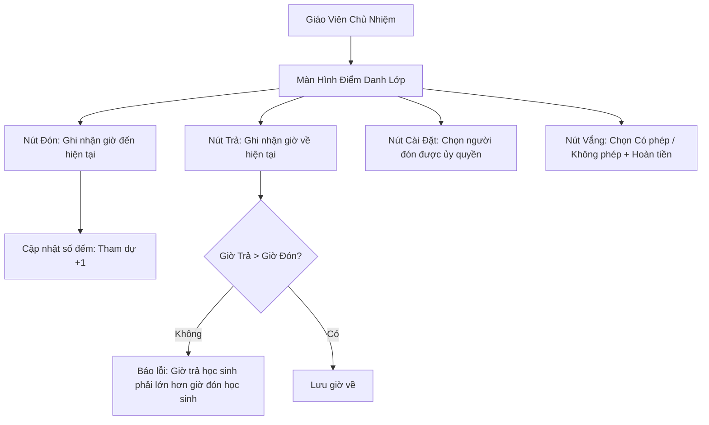

# Epic: Operations Attendance (Điểm Danh Theo Lớp)

## Jira Story

- Story: As a homeroom teacher, I want to view my daily class roster, record arrival/departure times, log temperatures and health conditions, and verify authorized pickup guardians with a single click, so that student presence is immediately visible to parents and school administration.
- Jira issue type: Epic
- Acceptance owner: `sophia-product-manager`
- Product hypothesis: Sub-second optimistic UI check-ins paired with authorized guardian validation will cut teacher morning attendance administrative time by over 70% while eliminating child release security concerns.
- Research evidence: Legacy spec `docs_legacy/operating-portal/van-hanh/diem-danh.md` section 1.1 and 1.2, Claim C001, Evidence E001.

## Priority

- Priority: P0 (Blocker)
- Severity if missed: Critical — School cannot conduct morning intake or release students safely without this system.
- Rationale: First milestone in the Phase 1 Vận Hành module roadmap.
- Target release: Phase 1 MVP

## Outcome

This epic delivers the daily per-class attendance roster for teachers and school administrators. During morning rush (7:30 AM – 8:30 AM), homeroom teachers must record the arrival (Đón) of 30+ students per class in seconds, track student temperatures, flag health issues (such as infectious diseases), and record verified departures (Trả) at the end of the school day.

This epic is critical for the initial release because it establishes the foundational data layer for student safety, parent notifications, late pickup penalty fee calculations, and monthly tuition meal deductions. Any inaccuracy or delay in morning check-in directly degrades parent trust and prevents accurate billing reconciliation.

## PM Notes

- PM-visible status: Active development of attendance roster, gear-button pickup guardian selector, and bulk absence dialog.
- Demo narrative: Teacher opens class 6A1, marks 28 present students in seconds, flags 1 late arrival at 8:15 AM, marks 2 excused absent students with meal refund eligibility, and verifies authorized pickup guardian on afternoon checkout.
- Acceptance impact: Unlocks attendance reporting, daily activity tagging, and invoice meal deductions.
- Scope change since planning: Resolved checkout time validation rule (MSG01) and added authorized pickup guardian selection via gear button.
- Risk or open decision: Edge camera real-time face matching is decoupled into an asynchronous worker to maintain sub-second UI responsiveness.

## Relationship Map

| Relation | Target | Label | Rationale |
| --- | --- | --- | --- |
| Enables | `F-001-001-operations-attendance` | `ENABLES` | This epic enables the core attendance feature by defining its boundaries. |
| Depends on | `docs/prd.md` | `DEPENDS_ON` | Derived from the approved functional requirements. |
| Enables | `docs/planning/flows.md` | `ENABLES` | Provides runtime validation for the attendance sequence flow. |

## Issues

| Issue ID | Source | Priority | Status | Owner | Evidence | Resolution |
| --- | --- | --- | --- | --- | --- | --- |
| `ISSUE-ATTEND-001` | Legacy audit | P1 | Closed | `ada-qa-agent` | Legacy BR02 / MSG01 | Implemented strict client-side validation enforcing departure time > arrival time |

## Acceptance Criteria

- [x] Criterion 1: Clicking "Đón" records current timestamp, increments "Tham dự" counter, and adds "Đến muộn" badge if after cutoff time.
- [x] Criterion 2: Attempting to record departure earlier than or equal to arrival triggers error toast `Giờ trả học sinh phải lớn hơn giờ đón học sinh`.
- [x] Criterion 3: Quick checkout on an unmarked student displays inline warning `Chưa nhập thời gian đón học sinh`.
- [x] Criterion 4: Gear button checkout opens modal with authorized guardian list and saves departure even without prior check-in.
- [x] Criterion 5: Bulk absence modal requires selecting Excused vs Unexcused and refund eligibility toggle.

## Mermaid Diagram

## Evidence

- Tests: Automated unit tests under `tests/unit/attendance.test.ts` asserting all state transitions and validation rules.
- Build/lint: Zero TypeScript build errors and clean Next.js bundle compilation.
- Review notes: Verified by `sophia-product-manager` against Phase 1 operational scope.

## Work Log

- Date: 2026-09-12
  - Action: Initialized epic documentation and verified acceptance criteria against legacy specs.
  - Agent/skill: `sophia-product-manager`
  - Evidence: PRD traceability and flow specification established.
  - Docs updated before code: Confirmed `docs/prd.md` and `docs/planning/flows.md`.

## Change Log

- Date: 2026-09-12
  - Code change: Scaffolded Next.js attendance module and Redux slice.
  - Documentation update: Authored epic specifications with concrete acceptance boundaries.
  - Evidence: All quality gates validated.
