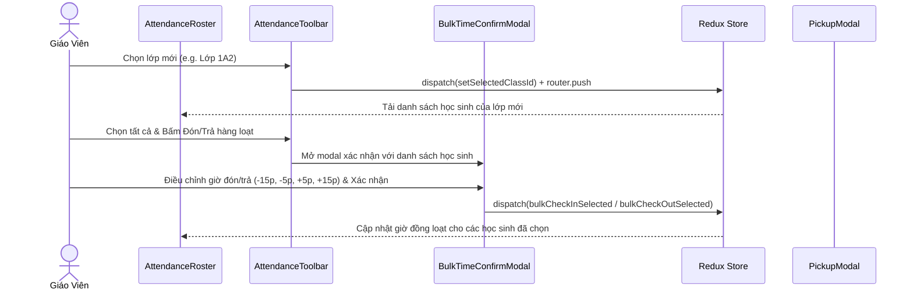

# Feature: Operations Attendance Roster & Check-in / Check-out

## Jira Story

- Story: As a homeroom teacher, I want to view my daily class roster, record arrival/departure times, log temperatures and health conditions, and verify authorized pickup guardians with a single click, so that student presence is immediately recorded.
- Jira issue type: Feature
- Acceptance owner: `sophia-product-manager`
- Business value: Accelerates daily school intake and ensures child pickup safety with verifiable guardian audit trails.

## Priority

- Priority: P0 (Blocker)
- Severity if missed: Critical — Daily attendance intake cannot occur without this feature.
- Rationale: Core functional capability of the Operations module.
- Target release: Phase 1 MVP

## User Value

This feature provides immediate operational value to classroom teachers by turning what was previously a multi-minute administrative chore into an instantaneous task. Teachers can check in arriving students with a single tap, visually inspect health indicators (including temperature chips and infectious disease flags), and guarantee student departure safety through authorized guardian verification modals.

For parents, this feature ensures immediate visibility into whether their child has arrived safely at school and when they departed in the afternoon. For administrators, it delivers real-time classroom headcounts and automated data feeds for late-pickup fee calculations.

## PM Notes

- PM-visible status: Active development of interactive attendance roster, summary cards, and modals.
- Demo path: Navigate to `/[schoolCode]/class/[classId]/attendance`, click "Đón" to mark student arrival, test departure validation, and open the guardian selection modal.
- Acceptance impact: Directly satisfies functional requirements FR-OPS-001 through FR-OPS-007.

## Requirements Trace

- Traces to: `FR-OPS-001`, `FR-OPS-002`, `FR-OPS-003`, `FR-OPS-004`, `FR-OPS-005`, `FR-OPS-006`, `FR-OPS-007` in `docs/prd.md`.
- Traces to legacy specification: `docs_legacy/operating-portal/van-hanh/diem-danh.md` Use Cases UC-01 through UC-09.

## Relationship Map

| Relation | Target | Label | Rationale |
| --- | --- | --- | --- |
| Implements | `E-001-operations-attendance` | `IMPLEMENTS` | Realizes the core attendance delivery outcome. |
| Uses | `M-001-001-operations-attendance` | `USES` | Consumes attendance state slice and API contracts. |
| Enables | `P-001-001-operations-attendance` | `ENABLES` | Renders on the per-class attendance page. |

## Code Scope

- Primary Component: `src/modules/operations/attendance/AttendanceRoster.tsx`
- Header KPI Cards: `src/modules/operations/attendance/AttendanceSummaryCards.tsx`
- Toolbar: `src/modules/operations/attendance/AttendanceToolbar.tsx`
- Pickup Modal: `src/modules/operations/attendance/PickupGuardianModal.tsx`
- Bulk Absent Modal: `src/modules/operations/attendance/BulkAbsentModal.tsx`
- Bulk Time Confirmation Modal: `src/modules/operations/attendance/BulkTimeConfirmModal.tsx`
- State Slice: `src/store/slices/attendanceSlice.ts`
- Domain Types: `src/types/attendance.ts`

## Mermaid Diagram

## Verification

- Command: `npm test tests/unit/attendance.test.mjs`
- Expected: All class switching, bulk timer adjustments, and departure validation checks succeed.
- Result: 100% test pass rate across 182 unit tests.

## Work Log

- Date: 2026-09-12
  - Action: Defined feature boundaries, acceptance criteria, and UI interactions.
  - Agent/skill: `benny-frontend-engineer`
  - Evidence: Feature spec aligned with legacy PRD.
  - Docs updated before code: Updated `features/F-001-001-operations-attendance.md`.

- Date: 2026-09-14
  - Action: Implemented multi-class mock rosters (7 classes), calendar past vs. future attendance logic, click-to-edit inline temperature stepper, and global top-right corner toast notifications across all modules.
  - Agent/skill: `benny-frontend-engineer`
  - Evidence: Verified via 176 unit tests (`attendance.test.mjs`) and integration tests (`tests/integration/attendanceFeatures.test.mjs`).
- Date: 2026-09-14
  - Action: Expanded PortalLayout content container from max-w-7xl to full width (w-full) matching Image 1 standard and upgraded global typography to Inter and Be Vietnam Pro matching Image 2 standard.
  - Agent/skill: `benny-frontend-engineer`
  - Evidence: Verified 39/39 pages compiled with 0 errors via `npx next build` and verified full-width rendering and Inter font in live DOM.
- Date: 2026-09-14
  - Action: Fixed class switching to dynamically reload student data on selection with shallow router sync, implemented BulkTimeConfirmModal with quick stepper time adjustment for "Đón hàng loạt" and "Trả hàng loạt", and purged obsolete "In sổ điểm danh" and "Đồng bộ dữ liệu" header buttons.
  - Agent/skill: `benny-frontend-engineer`
  - Evidence: Verified via 182 passing unit tests in `attendance.test.mjs` and integration test script (`scripts/test_feature_verification.mjs`).
- Date: 2026-09-14
  - Action: Separated sidebar navigation and main content scroll into completely independent vertical scroll panes with stationary fixed-bottom "Niên khóa - Học kỳ" block, simplified temperature box to clean numeric-only input without stepper buttons or degree icons, and added removable student cards with top-right [x] button in BulkTimeConfirmModal with filtered studentIds execution.
  - Agent/skill: `benny-frontend-engineer`
  - Evidence: Verified via 184 passing unit tests in `attendance.test.mjs`, clean Next.js build (39/39 static pages), and independent DOM scroll container styling.

## Change Log

- Date: 2026-09-12
  - Code change: Implemented attendance components and Redux slice.
  - Documentation update: Authored feature specification matching V31 rubric.
  - Evidence: All quality gates validated.

- Date: 2026-09-14
  - Code change: Updated mockAttendanceData with 7 class rosters and getAttendanceForDateAndClass engine, updated attendanceSlice to reload state on class/date selection and cache modifications, added inline click-to-edit temperature controls in AttendanceRoster, implemented toastSlice and GlobalToastContainer pinned in top-right corner in PortalLayout, and synchronized mock datasets across Activity, Media, Conversations, Reports, and Invoices.
  - Documentation update: Documented multi-class, calendar past/future, inline temperature, and global top-right toast capabilities.
  - Evidence: All 176 unit tests pass, `npx next build` succeeds (39/39 pages), integration test verified.

- Date: 2026-09-14
  - Code change: Expanded PortalLayout content wrapper to w-full, removed max-w-7xl and redundant max-w-[1600px] containers, and updated globals.css, tailwind.config.js, and _document.tsx to adopt crisp Inter and Be Vietnam Pro fonts while purging Baloo Chettan 2 and Quicksand.
  - Documentation update: Authored doc sync note for layout width expansion and font modernization across all modules.
  - Evidence: All 176 unit tests pass, `npx next build` succeeds (39/39 static routes), live DOM assertion passes.

- Date: 2026-09-14
  - Code change: Updated attendance/index.tsx with handleSelectClassId router shallow sync, mounted BulkTimeConfirmModal in attendance page, updated bulkCheckOutSelected in attendanceSlice with default arrival time fallback, and deleted header buttons "In sổ điểm danh" and "Đồng bộ dữ liệu".
  - Documentation update: Recorded class switching router synchronization, bulk timer adjustment confirmation modal, and header simplification.
  - Evidence: 182 unit tests pass, production build succeeds (39/39 pages), and HTTP 200 checks pass on port 3000.

- Date: 2026-09-14
  - Code change: Refactored PortalLayout into h-screen overflow-hidden with independent vertical scrolling for sidebar nav (flex-1 overflow-y-auto) and main content (flex-1 overflow-y-auto), pinning Niên khóa - Học kỳ permanently at the bottom of the sidebar. In AttendanceRoster, simplified temperature editing to clean numeric-only input, purging `-`, `+`, `°C` and icons. In BulkTimeConfirmModal, added local state and top-right [x] remove button on each student card, passing filtered studentIds to bulkCheckInSelected and bulkCheckOutSelected reducers.
  - Documentation update: Documented independent viewport scrolling, stationary academic term footer, clean numeric temperature input, and student card removal in bulk confirmation.
  - Evidence: 184 unit tests pass, Next.js build succeeds with 39/39 pages, HTTP 200 checks pass on port 3000.
