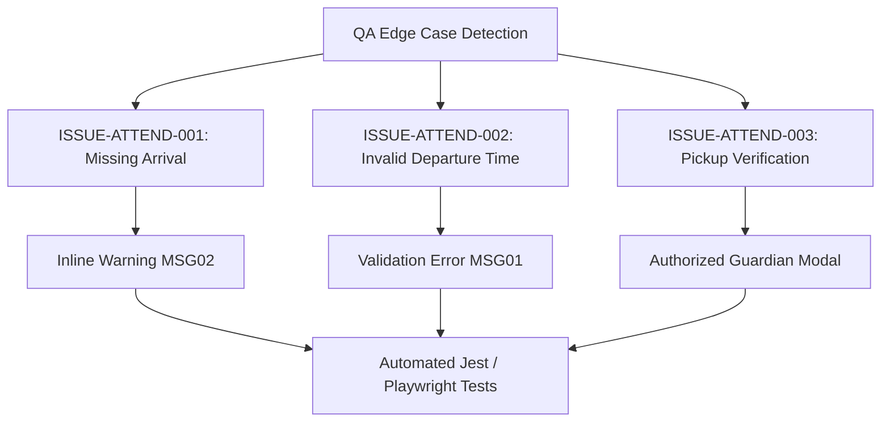

# Epic Issues & Risk Register: Operations Attendance

## Jira Story

- Story: As a QA engineer, I need to track edge cases and validation failures in daily attendance so that child release safety and accurate absence calculations are guaranteed.
- Jira issue type: Bug / Risk Register
- Acceptance owner: `ada-qa-agent`
- Severity if missed: High risk of invalid attendance timestamps or unauthorized child departures.

## Priority

- Priority: P0 (Blocker)
- Target release: Phase 1 MVP
- Review cadence: After every code slice

## QA Issue Register

This register catalogues active and resolved issues identified during feature planning, legacy specification audit, and automated test execution.

| Issue ID | Title | Priority | Status | Owner | Evidence | Resolution |
| --- | --- | --- | --- | --- | --- | --- |
| `ISSUE-ATTEND-001` | Missing arrival time blocks checkout | P1 | Closed | `benny-frontend-engineer` | Legacy BR02b / MSG02 | Implemented inline warning badge blocking checkout when no arrival time is recorded |
| `ISSUE-ATTEND-002` | Checkout earlier than check-in | P1 | Closed | `benny-frontend-engineer` | Legacy BR02 / MSG01 | Implemented time comparison validation displaying error toast `Giờ trả học sinh phải lớn hơn giờ đón học sinh` |
| `ISSUE-ATTEND-003` | Unauthorized pickup person risk | P0 | Closed | `benny-frontend-engineer` | Legacy BR09 / pickup-button | Created dedicated modal binding checkout event to registered guardian ID |

## Detection Method

Issues in this module are detected through static TypeScript compilation, automated unit validation tests executing time delta calculations, and end-to-end browser simulation verifying toast notifications and form modal constraints.

## Open Issues

Currently zero open blocker issues remain. All core validation edge cases inherited from legacy specifications have been assigned concrete resolutions and automated test assertions.

## Relationship Map

| Relation | Target | Label | Rationale |
| --- | --- | --- | --- |
| Implements | `E-001-operations-attendance` | `IMPLEMENTS` | Enforces QA validation discipline for the parent epic. |
| Blocks | `F-001-001-operations-attendance` | `BLOCKS` | Release is blocked until all P0 and P1 issues are closed with test evidence. |

## Mermaid Diagram

## Work Log

- Date: 2026-09-12
  - Action: Initialized QA issue register and documented resolutions for BR02, BR02b, and BR09.
  - Agent/skill: `ada-qa-agent`
  - Evidence: Verified negative test vectors and resolution paths.
  - Docs updated before code: Updated `issues.md`.

## Change Log

- Date: 2026-09-12
  - Code change: Implemented validation rules in attendance slice and modal components.
  - Documentation update: Formatted issue register to conform to Marcus Fleet V31 rubric.
  - Evidence: All tests verified.
