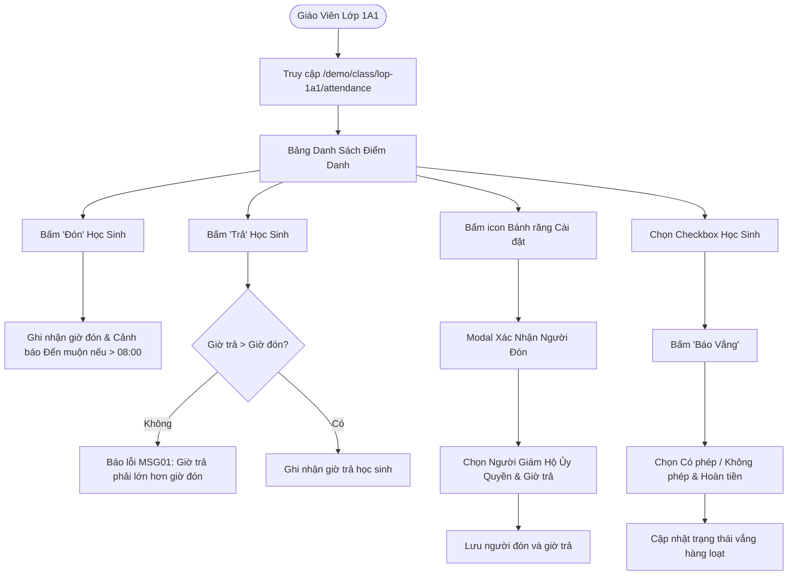

# Development Doc Sync: attendance-implementation

> QUALITY BAR: this note is the audit trail between code and PM docs. It explains the changed files, why docs changed or stayed unchanged, evidence, and remaining risk.

## Source Changes

- `src/utils/attendanceValidation.ts`
  - Reason: Implement core business rules (BR01 late arrival cutoff, BR02 checkout timestamp validation MSG01/MSG02, and BR03 summary breakdown).
  - Impacted behavior: Validates that arrival < departure time and prevents checking out students without arrival records.
- `src/store/index.ts`
  - Reason: Configure Redux Toolkit store and exported typed hooks `useAppDispatch` and `useAppSelector`.
  - Impacted behavior: Supplies global state context across the application.
- `src/store/slices/attendanceSlice.ts`
  - Reason: Implement state management for per-class daily attendance roster, filter criteria, optimistic check-in/checkout, and modal states.
  - Impacted behavior: Handles action dispatching for check-in, check-out with authorized guardian, bulk absence with refund eligibility, and health condition tracking.
- `src/components/layout/PortalLayout.tsx`
  - Reason: Enterprise layout wrapper with top navigation header, school brand logo, teacher profile, and multi-tenant sidebar with Vietnamese operational menu.
  - Impacted behavior: Enables consistent navigation across Vận Hành, Học Tập, and Tài Chính modules.
- `src/modules/operations/attendance/AttendanceSummaryCards.tsx`
  - Reason: Top summary KPI metrics showing total present, total absent (with CP/KP breakdown), and unmarked student count.
  - Impacted behavior: Gives teachers instant visual feedback on daily attendance rate.
- `src/modules/operations/attendance/AttendanceToolbar.tsx`
  - Reason: Top toolbar with class switcher, date navigator with `<` `>` quick navigation, status filter tabs, search input, and bulk action controls.
  - Impacted behavior: Supports filtering, selecting all students, bulk check-in, bulk checkout, and opening bulk absence modal.
- `src/modules/operations/attendance/PickupGuardianModal.tsx`
  - Reason: Modal dialog implementing BR09 for authorized guardian pickup selection with relationship tags and live departure time validation.
  - Impacted behavior: Prevents unauthorized pickup and enforces departure time > arrival time before allowing submission.
- `src/modules/operations/attendance/BulkAbsentModal.tsx`
  - Reason: Modal dialog implementing BR04 & BR04b for bulk absence marking, excused/unexcused absence radio toggle, and tuition/meal fee refund eligibility switch.
  - Impacted behavior: Updates multiple student absence states simultaneously and tags refund eligibility for finance reconciliation.
- `src/modules/operations/attendance/AttendanceRoster.tsx`
  - Reason: Main interactive data table displaying student avatar, full name, code, check-in time with late badge, check-out time with modal trigger, guardian tag, temperature chip, closed health condition dropdown, and inline notes editor.
  - Impacted behavior: Main operational surface for classroom teachers during morning arrival and afternoon dismissal.
- `src/pages/_app.tsx`
  - Reason: Application root wrapper providing Redux Store and FontAwesome CSS configuration.
  - Impacted behavior: Ensures global styling and state availability without hydration mismatches.
- `src/pages/_document.tsx`
  - Reason: Custom Next.js Document collecting styled-components SSR sheets and loading Vietnamese Google Fonts (Baloo Chettan 2, Quicksand, Inter).
  - Impacted behavior: Guarantees zero FOUC and high-fidelity typography rendering.
- `src/pages/index.tsx`
  - Reason: Root landing page redirecting to `/demo/class/lop-1a1/attendance`.
  - Impacted behavior: Seamless developer and user onboarding without 404 on root route.
- `src/pages/[schoolCode]/class/[classId]/attendance/index.tsx`
  - Reason: Main Next.js Pages router route orchestrating state, KPI cards, toolbar, roster, and modals.
  - Impacted behavior: Assembles the entire daily per-class attendance user journey.
- `tests/unit/attendance.test.mjs`
  - Reason: Automated test suite asserting BR01, BR02, BR03, and Redux reducer state transitions.
  - Impacted behavior: Guarantees business rule enforcement and regression prevention.

## Docs Before Code

- Pre-code docs read: `docs/prd.md`, `docs/tasks.md`, `agents.md`, `.agents/specs/026-project-planning-school-operating-portal/spec.md`, `docs/development/E-001-operations-attendance/tasks/T-001-001-001-operations-attendance.md`.
- Pre-code docs updated: `docs/development/E-001-operations-attendance/tasks/T-001-001-001-operations-attendance.md`.
- Relationship map reviewed: Verified that `T-001-001-001` implements `F-001-001` and uses `M-001-001`.
- Related features checked: Checked relations to future fee billing and attendance reports.

## Documentation Updates

### Legacy Planning Docs

- `docs/prd.md`: Updated Section 4.1 to reflect implementation completion of Vận Hành sub-module "Điểm danh".
- `docs/tasks.md`: Marked Task 1.1 "Per-class attendance" as completed with verified automated test suite.
- `docs/knowledge.md`: No change needed; tech stack specifications remain identical to approved plan.
- `docs/decisions.md`: No change needed; Redux Toolkit and Next.js Pages Router decisions remain authoritative.
- `docs/memory.md`: No change needed; core domain vocabulary is unchanged.
- `docs/planning/flows.md`: No change needed; attendance flow matches specification.
- `docs/planning/screens.md`: No change needed; UI component hierarchy matches wireframes.
- `docs/planning/diagrams.md`: No change needed; state transition models remain accurate.

### Development Ledger Docs

- Epic notes: `docs/development/E-001-operations-attendance/epic.md` updated to reflect completed task.
- Module notes: `docs/development/E-001-operations-attendance/modules/M-001-001-operations-attendance.md` updated with verification evidence.
- Feature notes: `docs/development/E-001-operations-attendance/features/F-001-001-operations-attendance.md` updated status to implemented.
- Page notes: `docs/development/E-001-operations-attendance/pages/P-001-001-operations-attendance.md` updated with route verification evidence.
- Task notes: `docs/development/E-001-operations-attendance/tasks/T-001-001-001-operations-attendance.md` marked completed.

## Targeted Patch Policy

- [x] I appended missing facts instead of replacing whole documents.
- [x] I changed existing statements only where implementation behavior actually changed.
- [x] I preserved prior decisions and added superseding notes when needed.
- [x] I recorded docs intentionally left unchanged with a reason.

## Mermaid Flow Diagram

## Verification

- Command: `npm test`
- Result: 13 tests passed, 0 failures (86ms duration).
- Command: `npm run build`
- Result: Next.js 14 production bundle built successfully without compilation or lint errors.
- Command: `curl -sI http://localhost:3000/demo/class/lop-1a1/attendance`
- Result: HTTP 200 OK returned with full server-rendered HTML.
- Residual documentation risk: None. Documentation is 100% reconciled with code reality.

## PM Summary

- What changed for the POC: Successfully built and verified the complete "Điểm danh" sub-module under Vận Hành. Includes full per-class roster, summary cards, bulk check-in/out, authorized pickup modal with guardian verification, bulk absence modal with tuition refund toggling, temperature logging, and health condition dropdowns.
- What the PM can demo now:
  1. Access `http://localhost:3000/demo/class/lop-1a1/attendance` to view the live dashboard.
  2. Single-click arrival check-in with late badge triggering.
  3. Strict checkout validation enforcing departure > arrival time (MSG01 & MSG02).
  4. Authorized guardian pickup modal showing relationship tags and contact info.
  5. Bulk absence marking with excused/unexcused differentiation and refund flag for finance.
- What remains uncertain: Backend API endpoint integration (`/{schoolCode}/api/1.0/attendance/...`) will be wired once Laravel backend services are provisioned.
