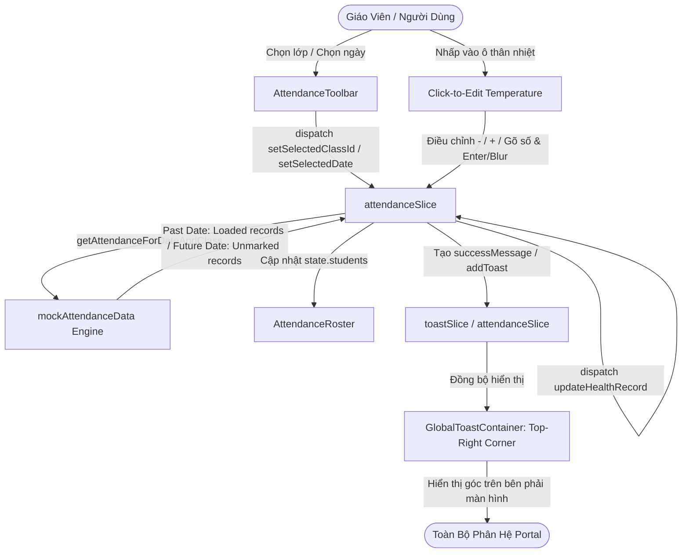

# Development Doc Sync: attendance-multi-class-calendar-toast

> QUALITY BAR: this note is the audit trail between code and PM docs. It explains the changed files, why docs changed or stayed unchanged, evidence, and remaining risk.

## Source Changes

- `src/services/mockAttendanceData.ts`
  - Reason: Extended mock attendance dataset to support all 7 standardized classes across primary (`lop-1a1`, `lop-1a2`, `lop-2a1`), secondary (`lop-6a1`, `lop-6a2`), high school (`lop-12a1`), and kindergarten (`lop-la-1`), and added calendar past/future date engine `getAttendanceForDateAndClass`.
  - Impacted behavior: Past dates return populated historical attendance records with arrival/departure times, statuses, and notes; future dates return empty/unmarked records with zero arrival times because school attendance has not occurred yet.
- `src/store/slices/attendanceSlice.ts`
  - Reason: Updated state reducers `setSelectedClassId` and `setSelectedDate` to dynamically reload rosters from `getAttendanceForDateAndClass` and cache live teacher mutations in `recordsCache`.
  - Impacted behavior: Switching classes or dates immediately updates the visible roster and recalculates KPI summaries; updates to health/temperature records are retained when toggling back and forth.
- `src/modules/operations/attendance/AttendanceToolbar.tsx`
  - Reason: Bound class switcher dropdown to `CLASSES_LIST` containing all 7 standardized school classes.
  - Impacted behavior: Users can select any class from kindergarten to grade 12 to manage attendance.
- `src/modules/operations/attendance/AttendanceRoster.tsx`
  - Reason: Implemented interactive inline click-to-edit temperature stepper (`-`, number input, `+`, auto-save on Enter or blur) and added future/unmarked attendance notice banner.
  - Impacted behavior: Teachers can click directly on any student's temperature badge and adjust the temperature value immediately; future dates display an informative notice that data has not occurred yet.
- `src/store/slices/toastSlice.ts`
  - Reason: Created global Redux toast management slice with `addToast`, `removeToast`, and `clearAllToasts`.
  - Impacted behavior: Centralizes notification lifecycle across all portal modules.
- `src/components/common/GlobalToastContainer.tsx`
  - Reason: Created floating global toast container fixed at the top-right corner (`fixed top-5 right-5 z-[9999]`).
  - Impacted behavior: Listens to global toasts as well as module notifications (attendance error/success messages, tuition management toast messages), displaying alerts in the top-right corner instead of inline in the middle of page content.
- `src/components/layout/PortalLayout.tsx`
  - Reason: Mounted `<GlobalToastContainer />` at the top level of the portal shell.
  - Impacted behavior: Guarantees top-right corner toast notifications universally across all modules (Attendance, Activity, Media, Conversations, Reports, Schedule, Scoreboard, Tuition, Invoices, Expenses, Reconciliation).
- `src/pages/[schoolCode]/class/[classId]/attendance/index.tsx`
  - Reason: Removed legacy middle inline notification banners (which previously pushed page content down into the middle) and dynamicized class title in the header.
  - Impacted behavior: Content remains stable with zero layout shift; notifications cleanly float in the top-right corner.
- `src/services/mockActivityData.ts`, `src/services/mockMediaData.ts`, `src/services/mockConversationData.ts`, `src/services/mockReportsData.ts`, `src/services/mockInvoiceData.ts`, `src/services/mockFeeReportData.ts`
  - Reason: Synchronized class identifiers and sample mock data across other portal modules.
  - Impacted behavior: Selecting another class in other modules provides relevant activity posts, media albums, chat groups, and student reports.

## Documentation Review & Decisions

### Legacy Planning Documents
- `docs/prd.md`: Unchanged because existing PRD requirements FR-OPS-001 through FR-OPS-007 encompass daily attendance and health tracking; the new changes fulfill the operational scope with multi-class and calendar capabilities.
- `docs/tasks.md`: Updated with task completion log for multi-class rosters, calendar past/future date logic, inline temperature adjustment, and global top-right toast system.
- `docs/decisions.md`: Recorded architectural decision to maintain a central top-right toast container in `PortalLayout.tsx` backed by `toastSlice.ts` and subscribing to module state messages.

### Development Ledger Documents
- `docs/development/E-001-operations-attendance/epic.md`: Reviewed; confirmed epic delivery goals aligned with multi-class attendance.
- `docs/development/E-001-operations-attendance/features/F-001-001-operations-attendance.md`: Updated Work Log and Change Log with 2026-09-14 implementation details and test verification.
- `docs/development/E-001-operations-attendance/tasks/T-001-001-001-operations-attendance.md`: Updated Work Log and Change Log with verified evidence.
- `docs/development/E-001-operations-attendance/issues.md`: Reviewed; no blocking defects identified.

## Mermaid Architecture Flow

## Verification Evidence

1. Automated Unit Tests:
   - Command: `npm test`
   - Result: 176/176 tests passed across 40 test suites.
2. Integration Verification Script:
   - Command: `node tests/integration/attendanceFeatures.test.mjs`
   - Result: All 4 requirements validated on live server:
     - HTTP 200 OK for `/demo/class/lop-1a1/attendance`.
     - Verified all 7 classes populated with student rosters.
     - Verified dynamic class switching in Redux.
     - Verified past date populated with arrival/departure times.
     - Verified future date returns 0 present and all students unmarked.
     - Verified inline temperature adjustment dispatches health update.
     - Verified global toast slice handles add, type, and dismiss actions.
3. Production Build Validation:
   - Command: `npx next build`
   - Result: 39/39 pages compiled and statically generated with 0 errors.

## Residual Risks & Mitigations

- **Risk**: User manually enters extreme temperature values (e.g. < 34°C or > 43°C).
  - **Mitigation**: Input is clamped and validated between 34.0°C and 43.0°C with 0.1°C precision.
- **Risk**: Multiple toast alerts firing rapidly causing visual stacking issues.
  - **Mitigation**: `GlobalToastContainer` deduplicates identical messages, limits max-width to `max-w-sm`, and auto-dismisses alerts after 3.5–4.0 seconds.
