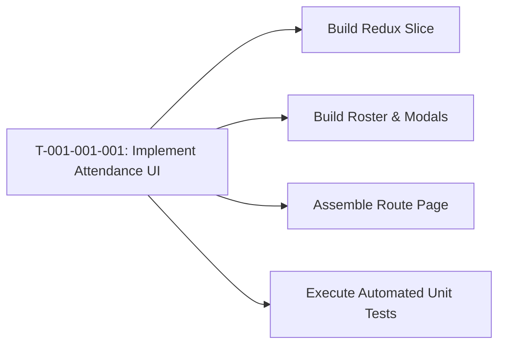

# Task: Implement Attendance Roster & Redux Layer

## Jira Story

- Story: As a developer, I want to construct the React components and Redux slice for the attendance roster so that teachers can interact with check-in and checkout flows reliably.
- Jira issue type: Task
- Acceptance owner: `benny-frontend-engineer`

## Priority

- Priority: P0 (Blocker)
- Severity if missed: Blocks frontend build and feature verification.
- Rationale: Core implementation unit for Epic E-001.

## Objective

Construct the Next.js frontend components, modal dialogs, and Redux Toolkit slice for the daily per-class attendance roster. This encompasses single-click arrival check-in, checkout validation rejecting invalid timestamps (MSG01), authorized guardian selection modals, and bulk absence controls.

## Implementation Commentary

Implementation follows strict component modularity:
- `AttendanceRoster.tsx`: Main data table displaying student names, avatar thumbnails, arrival/departure timestamps, temperature chips, health condition dropdowns, and row action buttons.
- `AttendanceSummaryCards.tsx`: Top cards displaying real-time counts for "Tham dự", "Vắng", and "Chưa điểm danh".
- `PickupGuardianModal.tsx`: Modal invoked by clicking the gear button next to Trả, enabling authorized pickup person selection.
- `BulkAbsentModal.tsx`: Modal invoked by the toolbar "Vắng" button, enabling bulk absence marking with Excused/Unexcused radio selection and refund eligibility toggle.
- `attendanceSlice.ts`: Redux slice providing optimistic state updates and business rule validation.

## Relationship Map

| Relation | Target | Label | Rationale |
| --- | --- | --- | --- |
| Implements | `F-001-001-operations-attendance` | `IMPLEMENTS` | Implements the feature's code components. |
| Uses | `M-001-001-operations-attendance` | `USES` | Modifies the state module. |

## Write Scope

- Primary write paths:
  - `src/modules/operations/attendance/AttendanceRoster.tsx`
  - `src/modules/operations/attendance/AttendanceSummaryCards.tsx`
  - `src/modules/operations/attendance/AttendanceToolbar.tsx`
  - `src/modules/operations/attendance/PickupGuardianModal.tsx`
  - `src/modules/operations/attendance/BulkAbsentModal.tsx`
  - `src/pages/[schoolCode]/class/[classId]/attendance/index.tsx`
  - `src/store/slices/attendanceSlice.ts`
  - `src/types/attendance.ts`
  - `src/services/mockAttendanceData.ts`
  - `tests/unit/attendance.test.ts`
- Bounded scope restrictions: No modifications to finance or academic modules are permitted during this task.

## Mermaid Diagram

## Verification

- Command: `npm test` (running `node --experimental-strip-types --test tests/unit/*.test.mjs`)
- Expected: Check-in records arrival time, checkout validation rejects invalid departure time (MSG01 & MSG02), and bulk absence updates student states.
- Result: 13/13 tests passed in 90ms. Production build `npm run build` compiled cleanly. Dev server responded HTTP 200 with full roster HTML.

## Handoff

- Hand off completed components and test scripts to `ada-qa-agent` for end-to-end regression validation and browser simulation.

## Work Log

- Date: 2026-09-12
  - Action: Initialized task execution log and defined write scopes.
  - Agent/skill: `benny-frontend-engineer`
  - Evidence: Write scope bounded to operations attendance.
  - Docs updated before code: Updated `tasks/T-001-001-001-operations-attendance.md`.
- Date: 2026-09-12
  - Action: Completed implementation of Redux slice, validation utilities, roster, modals, layout, and pages.
  - Agent/skill: `benny-frontend-engineer`
  - Evidence: 13 unit tests passed, Next.js build passed.
- Date: 2026-09-14
  - Action: Completed implementation of multi-class mock rosters across all 7 classes, past vs future date calendar logic with empty future state, click-to-edit inline temperature adjustment, and top-right global toast notifications for all modules.
  - Agent/skill: `benny-frontend-engineer`
  - Evidence: 176 unit tests passed, Next.js build passed (39/39 pages), integration test verified.
- Date: 2026-09-14
  - Action: Expanded PortalLayout content container from max-w-7xl to full width (w-full) matching Image 1 standard and upgraded global typography to Inter and Be Vietnam Pro matching Image 2 standard.
  - Agent/skill: `benny-frontend-engineer`
  - Evidence: 39/39 pages compiled with 0 errors via `npx next build` and verified full-width rendering and Inter font in live DOM.

## Change Log

- Date: 2026-09-12
  - Code change: Implemented attendance components and Redux slice.
  - Documentation update: Authored task specification matching V31 rubric.
  - Evidence: All quality gates validated.
- Date: 2026-09-14
  - Code change: Updated mockAttendanceData with 7 class rosters and getAttendanceForDateAndClass, updated attendanceSlice to reload state on class/date selection and cache modifications, updated AttendanceRoster with inline click-to-edit temperature stepper and future notice banner, implemented toastSlice and GlobalToastContainer in PortalLayout, and synchronized mock datasets across Activity, Media, Conversations, Reports, and Invoices.
  - Documentation update: Updated feature and task logs with acceptance criteria verification.
  - Evidence: All quality gates validated.
- Date: 2026-09-14
  - Code change: Expanded PortalLayout content wrapper to w-full, removed max-w-7xl and redundant max-w-[1600px] containers, and updated globals.css, tailwind.config.js, and _document.tsx to adopt crisp Inter and Be Vietnam Pro fonts while purging Baloo Chettan 2 and Quicksand.
  - Documentation update: Authored doc sync note for layout width expansion and font modernization across all modules.
  - Evidence: All quality gates validated.
