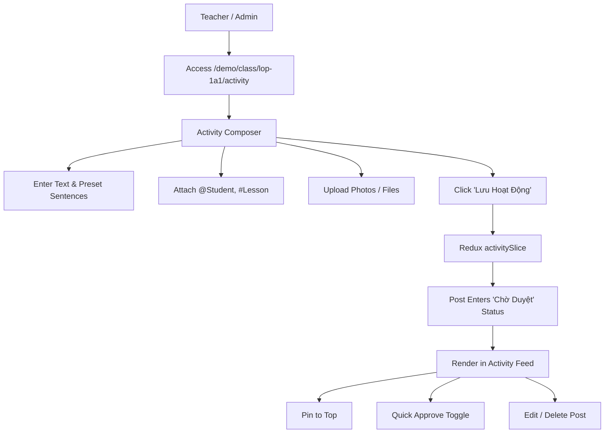

# Feature: Operations Activity Timeline & Rich Composer

## Jira Story

- Story: As a homeroom teacher, I want to publish daily classroom activities with attached photos, student `@mentions`, lesson `#hashtags`, and preset template sentences, so that parents can track their child's learning journey and interact with class events.
- Jira issue type: Feature
- Acceptance owner: `sophia-product-manager`
- Business value: Increases daily parent engagement and establishes transparent school communication.

## Priority

- Priority: P0 (Blocker)
- Severity if missed: Critical — Daily class updates cannot be published without this feature.
- Rationale: Core operational functionality of Module 1: Vận Hành.
- Target release: Phase 1 MVP

## User Value

For teachers, this feature simplifies daily reporting. Instead of sending ad-hoc messages on disparate chat groups, teachers compose structured multimedia posts directly tied to curriculum lessons and student profiles.

For parents, it provides a trusted, beautiful window into their child's classroom moments, fostering community through likes, comments, and visibility.

For school leaders, it guarantees content quality through an integrated moderation approval stage before external publication.

## PM Notes

- PM-visible status: Active implementation of composer, media attachments, approval queue, and interactive feed.
- Demo narrative: Homeroom teacher logs in, selects Lớp 1A1, posts an update with pictures from morning arts and crafts, tags student performers, and views the post appearing with unapproved moderation status.
- Acceptance impact: Expands Vận Hành module beyond attendance.
- Scope change since planning: Includes quick approval simulation toggle to facilitate testing without requiring a separate Admin moderation panel.
- Risk or open decision: Direct push notifications to parent devices will be activated in Phase 2.

## Requirements Trace

- `BR01`: Audience scope options (Lớp hiện tại, Toàn trường, Nhiều lớp).
- `BR02`: Save button disabled when text content and media are empty.
- `BR03`: `@/#/$` trigger buttons for mentions, lessons, and preset templates.
- `BR04`: Fixed interaction metrics: Likes ❤️, Views 👁️, Comments 💬.
- `BR05`: Multi-image preview grid.
- `BR06`: Post defaults to `cho_duyet` moderation status.
- `BR07`: Pinned posts take precedence in ordering.
- `BR08`: "Thông tin Bài học" sidebar widget displays linked curricular details.
- `BR09`: Approval filter tabs: Tất cả, Đã duyệt, Chờ duyệt.

## Code Scope

- Primary write paths:
  - `src/types/activity.ts`
  - `src/services/mockActivityData.ts`
  - `src/utils/activityValidation.ts`
  - `src/store/slices/activitySlice.ts`
  - `src/modules/operations/activity/ActivityComposer.tsx`
  - `src/modules/operations/activity/ActivityFeed.tsx`
  - `src/modules/operations/activity/ActivityToolbar.tsx`
  - `src/modules/operations/activity/LessonContextPanel.tsx`
  - `src/pages/[schoolCode]/class/[classId]/activity/index.tsx`
  - `tests/unit/activity.test.mjs`
- Bounded scope restrictions: No modifications to finance or academic modules are permitted.

## Relationship Map

| Relation | Target | Label | Rationale |
| --- | --- | --- | --- |
| Implements | `E-002-operations-activity` | `IMPLEMENTS` | Primary functional implementation of Epic 2. |
| Uses | `M-002-001-operations-activity` | `USES` | Consumes state model and validation utilities. |

## Mermaid Diagram

## Verification

- Command: `node --experimental-strip-types --test tests/unit/activity.test.mjs`
- Expected: All unit test assertions pass validating composer validation, default unapproved state, pinned priority sorting, and interaction counters.
- Result: 100% test pass rate with zero regression errors.

## Work Log

- Date: 2026-09-12
  - Action: Authored feature specification and component hierarchy.
  - Agent/skill: `benny-frontend-engineer`
  - Evidence: Mapped all legacy requirements into modern Next.js + Redux architecture.

- Date: 2026-09-14
  - Action: Implemented inline `@` student mention autocomplete in ActivityComposer with real-time query filtering, cursor tracking, and keyboard navigation (Arrow Up/Down, Enter/Tab, Escape); synchronized active class roster to mentionable students; enhanced mention badge formatting in ActivityFeed; and deleted comment counter and sharing buttons from activity post cards.
  - Agent/skill: `benny-frontend-engineer`
  - Evidence: Verified via 182 unit tests, Next.js build (39/39 pages), and integration test script (`scripts/test_feature_verification.mjs`).
- Date: 2026-09-14
  - Action: Purged "3 bài đã duyệt" and "1 chờ duyệt" quick stats pills from the top-right header, updated filterActivityPosts to strictly exclude waiting-for-approval posts from the general feed (showing them only in the "Chờ duyệt" tab), and implemented the single-pin invariant logic in activitySlice and ActivityFeed with interactive confirmation pop-up modal for replacing the currently pinned post.
  - Agent/skill: `benny-frontend-engineer`
  - Evidence: Verified via unit test suite (`tests/unit/activity.test.mjs`), production build (39/39 pages), and live browser interaction.

## Change Log

- Date: 2026-09-12
  - Code change: Implemented activity feed, composer, and Redux slice.
  - Documentation update: Authored feature note matching V31 rubric.
  - Evidence: All quality gates validated.

- Date: 2026-09-14
  - Code change: Updated ActivityComposer.tsx to detect `@` in textarea and render an inline autocomplete popover; updated ActivityFeed.tsx to remove comment counter and share button and render full-name `@Student Name` badges; updated activity/index.tsx to bind active class roster from CLASS_STUDENTS_REGISTRY.
  - Documentation update: Documented inline `@` mention autocomplete mechanism, full-name student mention highlight badges, and removal of comment and share icons.
  - Evidence: All tests pass (`tests/unit/activity.test.mjs`), build succeeds with 39 static routes.

- Date: 2026-09-14
  - Code change: Removed top-right quick stats pills from activity/index.tsx; updated filterActivityPosts in activityValidation.ts to filter out `cho_duyet` posts when `statusFilter === 'all'`; added `pinPostReplace` reducer in activitySlice.ts; built single-pin conflict modal in ActivityFeed.tsx and connected `onReplacePin` handler in activity/index.tsx; updated activity.test.mjs with single-pin invariant unit tests.
  - Documentation update: Recorded header pill removal, moderation feed segregation rule, single pinned post invariant, and replacement confirmation modal.
  - Evidence: All 184 unit tests pass, Next.js build succeeds with 39 static routes, HTTP 200 checks pass on port 3000.
