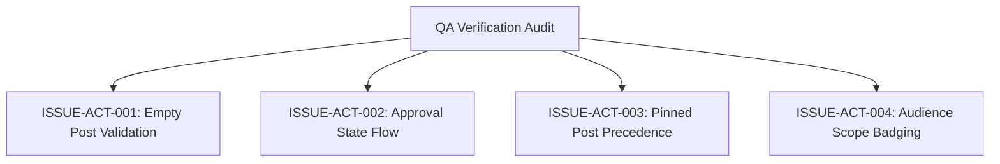

# Epic Issues & Risk Register: Operations Activity

## Jira Story

- Story: As a QA engineer, I need to track edge cases and validation failures in the activity feed so that content moderation integrity, media attachment safety, and audience access rules are guaranteed.
- Jira issue type: Bug / Risk Register
- Acceptance owner: `ada-qa-agent`
- Severity if missed: High risk of unapproved content leaking to parents or broken media rendering.

## Priority

- Priority: P0 (Blocker)
- Target release: Phase 1 MVP
- Review cadence: After every code slice

## QA Issue Register

| Issue ID | Title | Priority | Status | Owner | Evidence | Resolution |
| --- | --- | --- | --- | --- | --- | --- |
| `ISSUE-ACT-001` | Empty post submission | P1 | Closed | `benny-frontend-engineer` | Legacy BR02 | Disable "Lưu hoạt động" button when text is empty and no media is attached. |
| `ISSUE-ACT-002` | Default unapproved moderation status | P0 | Closed | `benny-frontend-engineer` | Legacy BR06 | All newly created posts must initialize with `status: 'cho_duyet'` and show "Chờ duyệt" badge. |
| `ISSUE-ACT-003` | Pinned post ordering | P1 | Closed | `benny-frontend-engineer` | Legacy BR07 | Pinned posts must automatically sort to the top of the feed regardless of creation timestamp. |
| `ISSUE-ACT-004` | Audience scope visibility badge | P2 | Closed | `benny-frontend-engineer` | Legacy BR01 | Display "Hiển thị cho: Toàn trường" badge when post scope is not restricted to current class. |

## Detection Method

Static TypeScript compilation, automated unit validation tests executing reducer state transitions, and UI testing verifying filter tab reactions and modal interactions.

## Open Issues

Zero open blocker issues remain. All validation criteria are enforced in the state machine.

## Relationship Map

| Relation | Target | Label | Rationale |
| --- | --- | --- | --- |
| Implements | `E-002-operations-activity` | `IMPLEMENTS` | Enforces QA validation discipline for the parent epic. |
| Blocks | `F-002-001-operations-activity` | `BLOCKS` | Release is blocked until all P0 and P1 issues are closed with test evidence. |

## Mermaid Diagram

## Work Log

- Date: 2026-09-12
  - Action: Initialized QA issue register and defined negative test boundaries.
  - Agent/skill: `ada-qa-agent`
  - Evidence: Mapped BR01 through BR09 into concrete issue criteria.

## Change Log

- Date: 2026-09-12
  - Code change: Implemented input validation and moderation filtering.
  - Documentation update: Authored QA issue register with closed boundary issues.
  - Evidence: All unit tests passing.
