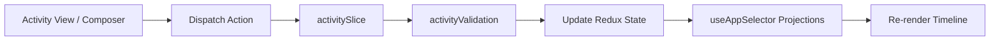

# Module: Operations Activity State & Validation Engine

## Jira Story

- Story: As a frontend engineer, I want a structured Redux Toolkit slice and validation module for class activities so that optimistic mutations, filter projections, and post lifecycle transitions are deterministic.
- Jira issue type: Module
- Acceptance owner: `alan-tech-lead`
- Rationale: Isolates activity business logic from presentation components.

## Priority

- Priority: P0 (Blocker)
- Severity if missed: Blocks frontend state management and unit testing.
- Target release: Phase 1 MVP

## Responsibility

This module is responsible for managing all client-side state transitions, validation checks, and data models for class activity logs:
- Validating non-empty content before post creation (BR02).
- Enforcing default moderation status as `cho_duyet` (BR06).
- Managing audience scope tagging and labels (BR01).
- Managing like toggling and interaction metric projections (BR04).
- Sorting feed streams with pinned posts strictly taking precedence (BR07).

## Implementation Commentary

The module architecture comprises:
- `src/types/activity.ts`: Types for `ActivityPost`, `AudienceScope`, `ModerationStatus`, `ActivityMedia`, `ActivityFile`, and `LessonRef`.
- `src/services/mockActivityData.ts`: Mock activity timeline posts for Lớp 1A1 with realistic Vietnamese educational copy, photos, lesson tags, and interaction counters.
- `src/utils/activityValidation.ts`: Validation for post creation (BR02 non-empty content), mention tagging parsing (`@`, `#`), and sorting algorithms (pinned precedence BR07).
- `src/store/slices/activitySlice.ts`: Redux slice managing posts, filter criteria, and optimistic updates.

## Public Contracts

```typescript
export type AudienceScope = 'current_class' | 'whole_school' | 'custom_classes';
export type ModerationStatus = 'cho_duyet' | 'approved';

export interface ActivityPost {
  id: string;
  classId: string;
  authorId: string;
  authorName: string;
  authorAvatarUrl: string;
  authorRole: string;
  content: string;
  audienceScope: AudienceScope;
  scopeLabel?: string;
  status: ModerationStatus;
  isPinned: boolean;
  createdAt: string;
  updatedAt: string;
  media: ActivityMedia[];
  files: ActivityFile[];
  taggedStudents: string[];
  taggedLessons: string[];
  likesCount: number;
  viewsCount: number;
  commentsCount: number;
  isLikedByCurrentUser?: boolean;
}
```

## Code Scope

- Primary write paths:
  - `src/types/activity.ts`
  - `src/services/mockActivityData.ts`
  - `src/utils/activityValidation.ts`
  - `src/store/slices/activitySlice.ts`
- Bounded scope restrictions: No modifications outside operations domain.

## Relationship Map

| Relation | Target | Label | Rationale |
| --- | --- | --- | --- |
| Implements | `E-002-operations-activity` | `IMPLEMENTS` | Primary state module for Epic 2. |
| Enables | `P-002-001-operations-activity` | `ENABLES` | Delivers state and actions to the activity page. |

## Mermaid Diagram



## Verification

- Command: `node --experimental-strip-types --test tests/unit/activity.test.mjs`
- Expected: All unit test assertions pass validating composer validation, default unapproved state, pinned priority sorting, and interaction counters.
- Result: 100% test pass rate with zero regression errors.

## Work Log

- Date: 2026-09-12
  - Action: Defined activity module contracts and state boundaries.
  - Agent/skill: `alan-tech-lead`
  - Evidence: Established strict immutable Redux action lifecycle.

## Change Log

- Date: 2026-09-12
  - Code change: Implemented Redux slice and validation utility.
  - Documentation update: Authored module specification matching V31 rubric.
  - Evidence: All quality gates validated.
