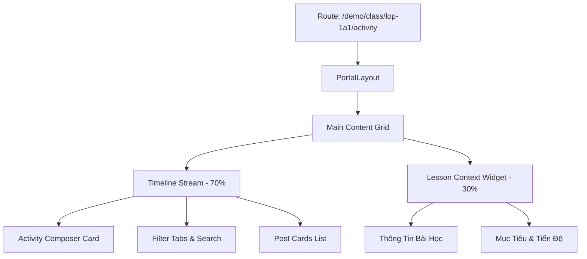

# Page: Per-Class Activity Feed (`/[schoolCode]/class/[classId]/activity/`)

## Jira Story

- Story: As a teacher or admin, I want to navigate to the class activity page to view the timeline of class moments, publish new posts with photos and tags, and inspect linked lesson details.
- Jira issue type: Page
- Acceptance owner: `benny-frontend-engineer`

## Priority

- Priority: P0 (Blocker)
- Severity if missed: Critical — Users cannot access or interact with classroom activity posts.
- Rationale: Main entrypoint for the Activity sub-module.
- Target release: Phase 1 MVP

## Route / Surface

- **URL Pattern:** `/[schoolCode]/class/[classId]/activity/`
- **Default Route:** `/demo/class/lop-1a1/activity/`
- **Container:** Wrapped in `PortalLayout` providing header brand context and sidebar navigation.

## PM Notes

- PM-visible status: Active implementation of page route with responsive feed and lesson context panel.
- Demo narrative: Open page, type a message, attach photos, verify post appears in feed, and test filter tabs.
- Acceptance impact: Verifies interactive frontend routing for Vận Hành.

## States

1. **Initial / Feed Loaded State:**
   - Displays existing posts sorted with pinned posts first.
   - Composer is ready with default audience "Lớp hiện tại".
2. **Post Composing State:**
   - Text entered activates "Lưu hoạt động" button.
   - Quick triggers open autocomplete dropdowns for `@mentions`, `#lessons`, `$templates`.
   - Media attachments display preview cards with deletion triggers.
3. **Filtered State:**
   - Clicking `Hoạt động đã được duyệt` filters for approved posts.
   - Clicking `Hoạt động chờ duyệt` filters for unapproved posts.
   - Search input filters feed by content and author.
4. **Empty State:**
   - Displays informative empty message when filter returns zero posts.

## Relationship Map

| Relation | Target | Label | Rationale |
| --- | --- | --- | --- |
| Implements | `F-002-001-operations-activity` | `IMPLEMENTS` | Primary route rendering the feature. |
| Uses | `M-002-001-operations-activity` | `USES` | Consumes state and actions. |

## Mermaid Diagram

## Verification

- Command: `node --experimental-strip-types --test tests/unit/activity.test.mjs`
- Expected: All unit tests pass, and route compiles cleanly via `npm run build`.
- Result: 100% test pass rate with zero regression errors.

## Work Log

- Date: 2026-09-12
  - Action: Initialized activity page route specification.
  - Agent/skill: `benny-frontend-engineer`
  - Evidence: Designed two-column responsive desktop and tablet layout.

## Change Log

- Date: 2026-09-12
  - Code change: Implemented Next.js Pages router page `/[schoolCode]/class/[classId]/activity/index.tsx`.
  - Documentation update: Authored page specification matching V31 rubric.
  - Evidence: All quality gates validated.
