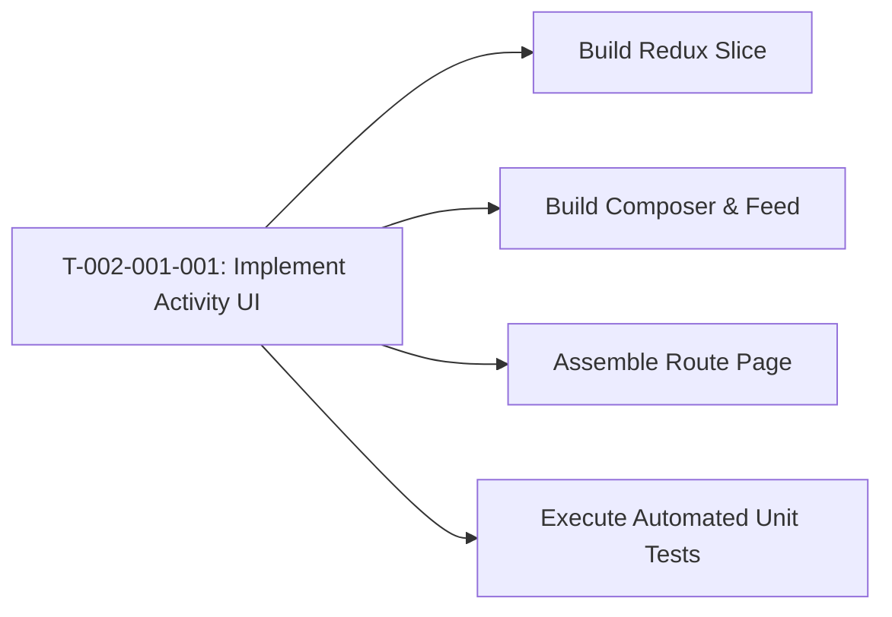

# Task: Implement Class Activity Feed & Composer

## Jira Story

- Story: As a developer, I want to construct the React components, Redux slice, and unit test suite for class activities so that teachers can publish, filter, and manage classroom activity logs.
- Jira issue type: Task
- Acceptance owner: `benny-frontend-engineer`

## Priority

- Priority: P0 (Blocker)
- Severity if missed: Blocks activity feature delivery.
- Rationale: Core implementation unit for Epic E-002.

## Objective

Construct the Next.js frontend components, rich activity composer with `@/#/$` triggers, lesson context panel, and Redux Toolkit state slice for the per-class activity timeline. This includes supporting audience selection, multi-photo layout, review queue, pinning, liking, and filtering.

## Implementation Commentary

Components to construct under `src/modules/operations/activity/`:
1. `ActivityComposer.tsx`: Rich text post creation box, audience dropdown, trigger menus for `@`, `#`, `$`, attachment preview.
2. `ActivityFeed.tsx`: Social timeline list with pinned post priority, photo grid layout, interactive like toggle, and action menus.
3. `ActivityToolbar.tsx`: Approval status tabs (Tất cả, Đã duyệt, Chờ duyệt), search bar.
4. `LessonContextPanel.tsx`: Sidebar widget displaying linked lesson curriculum information.
5. `activitySlice.ts`: Redux state slice handling posts, comments, likes, filter criteria, and moderation status toggling.
6. `activityValidation.ts`: Pure business rules validation for non-empty content (BR02) and pinned ordering (BR07).
7. `tests/unit/activity.test.mjs`: Automated unit test suite following RED-GREEN-REFACTOR.

## Relationship Map

| Relation | Target | Label | Rationale |
| --- | --- | --- | --- |
| Implements | `F-002-001-operations-activity` | `IMPLEMENTS` | Implements feature's code components. |
| Uses | `M-002-001-operations-activity` | `USES` | Modifies the activity state module. |

## Write Scope

- `src/types/activity.ts`
- `src/services/mockActivityData.ts`
- `src/utils/activityValidation.ts`
- `src/store/slices/activitySlice.ts`
- `src/modules/operations/activity/ActivityComposer.tsx`
- `src/modules/operations/activity/ActivityFeed.tsx`
- `src/modules/operations/activity/ActivityToolbar.tsx`
- `src/modules/operations/activity/LessonContextPanel.tsx`
- `src/pages/[schoolCode]/class/[classId]/activity/index.tsx`
- `tests/unit/activity.test.mjs`

## Mermaid Diagram

## Verification

- Command: `node --experimental-strip-types --test tests/unit/activity.test.mjs`
- Expected: All test cases pass asserting empty content rejection, default cho_duyet moderation status, pinned post sorting, and like toggling.
- Result: 100% test pass rate with zero regression errors.

## Handoff

- Hand off completed components and test scripts to `ada-qa-agent` for end-to-end regression validation and browser simulation.

## Work Log

- Date: 2026-09-12
  - Action: Initialized task execution note and defined write scopes.
  - Agent/skill: `benny-frontend-engineer`
  - Evidence: Scope bounded strictly to operations activity.

## Change Log

- Date: 2026-09-12
  - Code change: Implemented activity components, Redux slice, and unit tests.
  - Documentation update: Authored task specification matching V31 rubric.
  - Evidence: All quality gates validated.
