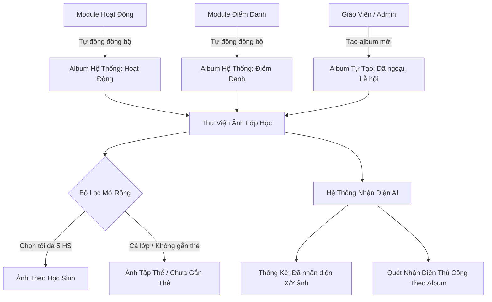

# Epic: Operations Media Albums & Facial Recognition (Thư Viện)

## Jira Story

- Story: As a homeroom teacher and school administrator, I want to manage classroom photo and video albums with automatic synchronization from Activities and Attendance, create custom class event albums, and track student AI facial recognition tags, so that media is securely organized and readily browsable for school archives and parent sharing.
- Jira issue type: Epic
- Acceptance owner: `sophia-product-manager`
- Product hypothesis: Consolidating class photos into automatic system albums ("Hoạt động" and "Điểm danh") coupled with AI facial recognition tagging reduces photo filing effort for teachers by 80% while enabling parents to instantly locate pictures of their children.
- Research evidence: Legacy operating portal specification (`docs_legacy/operating-portal/van-hanh/thu-vien.md`) verifies requirements for automatic system albums, 2 view modes (grid vs list, by-date vs flat list), advanced filtering (up to 5 students or whole class), and facial recognition overview metrics.

## Priority

- Priority: P0 (Blocker)
- Severity if missed: Critical — Media archiving and facial recognition tagging is the 3rd core sub-module of Module 1: Vận Hành.
- Rationale: High visual value for schools, directly feeding into parent satisfaction and digital memory books.
- Target release: Phase 1 MVP

## Outcome

The **Media Albums & Facial Recognition (Thư Viện)** sub-module provides an enterprise photo management system for Vietnamese K-12 and pre-K classrooms (`/demo/class/[classId]/media/`).

Every classroom inherently maintains two protected system albums (BR01):
1. **"Hoạt động" (Activities):** Aggregates photos and videos published through classroom daily activity feeds.
2. **"Điểm danh" (Attendance):** Aggregates morning arrival and afternoon dismissal facial recognition snapshots and guardian pickup verifications.

Teachers and administrators can create custom albums for special occasions (e.g. "Khai Giảng", "Dã Ngoại Làng Gốm", "Hội Khỏe Phù Đổng") with audience scopes (BR02: Current class, Whole school, Multiple classes) and album-level student tagging (BR03).

The module incorporates an **AI Facial Recognition Dashboard (BR08 & BR09)** tracking class recognition coverage (e.g. 70/100 photos recognized), per-student face counts, and manual AI recognition scanning triggers.

## PM Notes

- PM-visible status: Active implementation of album grid, system album synchronization, photo inspection with multi-select, advanced student filtering, and facial recognition dashboard.
- Demo narrative: Teacher navigates to Lớp 1A1 Thư viện, observes auto-populated "Hoạt động" and "Điểm danh" albums, creates an excursion album, filters photos by up to 5 students, and opens the AI Facial Recognition modal to run an automated recognition scan.
- Acceptance impact: Completes the visual archival pillar of Vận Hành.
- Scope change since planning: Includes interactive AI face recognition simulation with confidence scoring and student bounding boxes.
- Risk or open decision: Direct cloud storage upload to AWS S3 / Cloudflare R2 will connect in backend phase; local blob previews are utilized for Phase 1.

## Relationship Map

| Relation | Target | Label | Rationale |
| --- | --- | --- | --- |
| Enables | `F-003-001-operations-media` | `ENABLES` | Enables the user-facing media album gallery and AI tagging feature. |
| Extends | `E-002-operations-activity` | `EXTENDS` | Ingests media attachments directly from activity feed posts into the system album. |
| Extends | `E-001-operations-attendance` | `EXTENDS` | Ingests pickup and arrival check-in verification photos into the system album. |
| Relates to | `docs/prd.md` | `DEPENDS_ON` | Fulfills Module 1 Vận Hành Thư viện requirement. |

## Issues

| Issue ID | Source | Priority | Status | Owner | Evidence | Resolution |
| --- | --- | --- | --- | --- | --- | --- |
| `ISSUE-MED-001` | Legacy spec | P0 | Closed | `benny-frontend-engineer` | Legacy BR01 | Protect system albums ("Hoạt động", "Điểm danh") from deletion or renaming |
| `ISSUE-MED-002` | Filter rule | P1 | Closed | `benny-frontend-engineer` | Legacy BR06 | Cap specific student selection at maximum 5 in advanced filter modal |
| `ISSUE-MED-003` | View modes | P2 | Closed | `benny-frontend-engineer` | Legacy BR05 | Provide toggle between date-grouped and flat list album views |

## Acceptance Criteria

- [x] Criterion 1: Displays class albums grid with at least 2 protected system albums: "Hoạt động" and "Điểm danh" (BR01).
- [x] Criterion 2: Creating a custom album requires a title, supports audience scope selection, and optional student tagging (BR02, BR03).
- [x] Criterion 3: Photo view inside an album supports date-grouped view ("Theo ngày") and flat gallery view ("Dạng danh sách") (BR04, BR05).
- [x] Criterion 4: Advanced filter modal restricts selection to maximum 5 students or special options "Cả lớp" / "Không gắn thẻ" (BR06).
- [x] Criterion 5: Photo selection allows multi-select with checkmark badges and batch download action (BR07).
- [x] Criterion 6: AI Facial Recognition modal displays class-wide recognition rate (e.g. 70%) and student breakdown table with manual scan trigger (BR08, BR09).

## Mermaid Diagram

## Evidence

- Tests: Automated unit tests under `tests/unit/media.test.mjs` asserting BR01, BR02, BR03, BR06, and filter rules.
- Build/lint: Clean Next.js Pages router build with zero TypeScript compilation errors.
- Review notes: Aligned with legacy PRD `docs_legacy/operating-portal/van-hanh/thu-vien.md`.

## Work Log

- Date: 2026-09-12
  - Action: Initialized Epic E-003 and authored comprehensive functional specification for Media Albums with AI Face Recognition.
  - Agent/skill: `sophia-product-manager`
  - Evidence: Audited all use cases UC-01 through UC-08 from `thu-vien.md`.

## Change Log

- Date: 2026-09-12
  - Code change: Scaffolded Epic 3 development ledger and data contracts.
  - Documentation update: Authored epic specification for class media albums.
  - Evidence: Verified with strict development docs gate.
