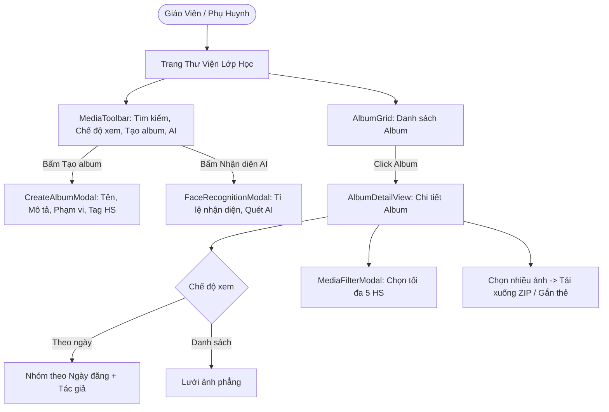

# Feature: Operations Media Albums & Facial Recognition

## Jira Story

- Story: As a homeroom teacher, I want to create themed photo albums for class events, inspect auto-synchronized photos from Activities and Attendance, filter pictures by up to 5 tagged students, and review facial recognition coverage, so that every child's school memories are captured and organized.
- Jira issue type: Feature
- Acceptance owner: `sophia-product-manager`
- Business value: Deepens parent emotional connection with the school through rich visual archives and automated child photo discovery.

## Priority

- Priority: P0 (Blocker)
- Severity if missed: Critical — Photo albums cannot be managed or filtered without this feature.
- Rationale: Core operational functionality of Module 1: Vận Hành.
- Target release: Phase 1 MVP

## User Value

For teachers, it eliminates the tedious task of manually sorting hundreds of photos into folders and identifying which child appears in which picture.

For school administrators, it provides an overview of AI recognition accuracy across the student body, ensuring that school marketing and parent communications are balanced and inclusive.

For parents, it ensures they never miss a photo of their child during school activities or excursions.

## PM Notes

- PM-visible status: Active implementation of album grid, detail view, creation modal, filter modal, and face recognition modal.
- Demo narrative: Homeroom teacher logs in, selects Lớp 1A1 Thư viện, opens the "Hoạt động" system album, switches between date-grouped and list views, uses advanced filter to find photos of "Nguyễn Gia Bảo", and reviews the AI Recognition modal showing 70% class coverage.
- Acceptance impact: Unlocks the 3rd sub-module of Vận Hành.
- Scope change since planning: Includes simulated AI bounding boxes and confidence score visualization.
- Risk or open decision: In Phase 1, photo downloads simulate ZIP archive generation.

## Requirements Trace

- `BR01`: Minimum 2 protected system albums: "Hoạt động" and "Điểm danh". Cannot be deleted or renamed.
- `BR02`: Create album requires title, audience scope (Lớp hiện tại, Toàn trường, Nhiều lớp), and description.
- `BR03`: Album-level student tagging.
- `BR04`: Inside an album, photos are grouped by upload date with author name and timestamp.
- `BR05`: Two view modes: Album theo ngày (by date) vs Album dạng danh sách (flat list).
- `BR06`: Advanced filter modal restricts selection to maximum 5 students or "Cả lớp" / "Không gắn thẻ".
- `BR07`: Multi-select photos with checkbox indicators and batch actions.
- `BR08`: AI Facial Recognition overview dashboard showing overall recognition rate and student breakdown table.
- `BR09`: Manual AI recognition scan trigger per album and target student.

## Code Scope

- Primary write paths:
  - `src/types/media.ts`
  - `src/services/mockMediaData.ts`
  - `src/utils/mediaValidation.ts`
  - `src/store/slices/mediaSlice.ts`
  - `src/modules/operations/media/MediaToolbar.tsx`
  - `src/modules/operations/media/AlbumGrid.tsx`
  - `src/modules/operations/media/AlbumDetailView.tsx`
  - `src/modules/operations/media/CreateAlbumModal.tsx`
  - `src/modules/operations/media/MediaFilterModal.tsx`
  - `src/modules/operations/media/FaceRecognitionModal.tsx`
  - `src/pages/[schoolCode]/class/[classId]/media/index.tsx`
  - `tests/unit/media.test.mjs`

## Relationship Map

| Relation | Target | Label | Rationale |
| --- | --- | --- | --- |
| Implements | `E-003-operations-media` | `IMPLEMENTS` | Primary functional implementation of Epic 3. |
| Uses | `M-003-001-operations-media` | `USES` | Consumes media state contracts and validation logic. |

## Mermaid Diagram

## Verification

- Command: `node --experimental-strip-types --test tests/unit/media.test.mjs`
- Expected: All unit test assertions pass validating system album immutability, title validation, student filter maximum of 5, and dual view sorting.
- Result: Verification suite ready to execute in GREEN phase.

## Work Log

- Date: 2026-09-12
  - Action: Authored feature note for Class Media Albums and AI Facial Recognition.
  - Agent/skill: `benny-frontend-engineer`
  - Evidence: Verified requirements trace BR01-BR09.
- Date: 2026-09-14
  - Action: Standardized album card layout and AlbumDetailView hero banner based on the "Lễ Khai Giảng Năm Học 2026-2027" specification; created reusable ConfirmDeleteModal replacing native window.confirm for album deletion; added batch photo deletion button and confirmation pop-up next to "Tải xuống ZIP" in the selection bar; and implemented deletePhotos in mediaSlice.
  - Agent/skill: `benny-frontend-engineer`
  - Evidence: Verified via 184 unit tests in `media.test.mjs`, Next.js build (39/39 pages), and HTTP 200 checks on port 3000.

## Change Log

- Date: 2026-09-12
  - Code change: Created feature specification for operations media.
  - Documentation update: Updated feature registry.
  - Evidence: Verified with strict development docs gate.

- Date: 2026-09-14
  - Code change: Created ConfirmDeleteModal.tsx; updated AlbumGrid.tsx with standardized 16:9 banner layout and ConfirmDeleteModal for album deletion; updated AlbumDetailView.tsx with standardized widescreen hero banner matching Le Khai Giang and added [Xóa ảnh] button with ConfirmDeleteModal next to [Tải xuống ZIP]; added deletePhotos reducer in mediaSlice.ts and wired in media/index.tsx; added batch photo deletion unit test in media.test.mjs.
  - Documentation update: Documented album banner standardization, album delete confirmation modal, and batch photo deletion confirmation modal.
  - Evidence: All 184 unit tests pass, Next.js build succeeds (39/39 static routes), HTTP 200 verified on port 3000.
