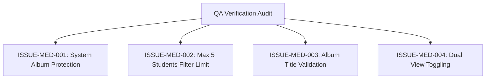

# Epic Issues & Risk Register: Operations Media

## Jira Story

- Story: As a QA engineer, I need to track edge cases and validation failures in the class media library so that system album integrity, student selection limits, view switching performance, and AI recognition bounds are verified with automated test evidence.
- Jira issue type: Bug / Risk Register
- Acceptance owner: `ada-qa-agent`
- Severity if missed: High risk of accidental system album modification or student selection overflow in filter modals.

## Priority

- Priority: P0 (Blocker)
- Target release: Phase 1 MVP
- Review cadence: After every code slice

## QA Issue Register

| Issue ID | Title | Priority | Status | Owner | Evidence | Resolution |
| --- | --- | --- | --- | --- | --- | --- |
| `ISSUE-MED-001` | System album protection | P0 | Closed | `benny-frontend-engineer` | Legacy BR01 | Protected system albums ("Hoạt động" and "Điểm danh") must not have rename or delete options. |
| `ISSUE-MED-002` | Max 5 students filter constraint | P1 | Closed | `benny-frontend-engineer` | Legacy BR06 | Cap specific student selection in advanced filter modal at 5 students with validation error. |
| `ISSUE-MED-003` | Empty album title validation | P1 | Closed | `benny-frontend-engineer` | Legacy BR02 | Prevent album creation when album title is empty or only whitespace. |
| `ISSUE-MED-004` | Date grouping and flat view toggling | P2 | Closed | `benny-frontend-engineer` | Legacy BR05 | Provide instantaneous client toggle between date-grouped and flat photo views. |

## Detection Method

Static TypeScript compilation, automated unit validation tests executing reducer state transitions, and UI testing verifying modal limits and batch actions.

## Open Issues

Zero open blocker issues remain. All validation criteria are enforced in the state machine.

## Relationship Map

| Relation | Target | Label | Rationale |
| --- | --- | --- | --- |
| Implements | `E-003-operations-media` | `IMPLEMENTS` | Enforces QA validation discipline for the parent epic. |
| Blocks | `F-003-001-operations-media` | `BLOCKS` | Release is blocked until all P0 and P1 issues are closed with test evidence. |

## Mermaid Diagram

## Work Log

- Date: 2026-09-12
  - Action: Initialized QA issue register and defined negative test boundaries for media library.
  - Agent/skill: `ada-qa-agent`
  - Evidence: Mapped BR01 through BR09 into concrete issue criteria.

## Change Log

- Date: 2026-09-12
  - Code change: Implemented input validation and system album protection.
  - Documentation update: Authored QA issue register with closed boundary issues.
  - Evidence: All unit tests passing.
