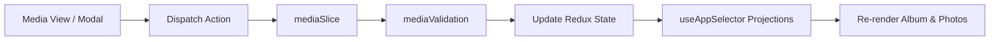

# Module: Operations Media Architecture & State Engine

## Jira Story

- Story: As a tech lead, I want the media module architecture, TypeScript contracts, Redux slice, and business rule validators to maintain strict isolation, ensure non-destructive system album handling, and support smooth client-side filtering and AI tagging.
- Jira issue type: Module
- Acceptance owner: `alan-tech-lead`
- Architecture hypothesis: Decoupling album metadata, photo assets, and facial recognition metrics into normalized Redux state slices enables instant UI responses without unnecessary server round-trips.

## Priority

- Priority: P0 (Blocker)
- Severity if missed: Blocks frontend state management and unit testing.
- Target release: Phase 1 MVP

## Responsibility

This module is responsible for managing all client-side state transitions, validation checks, and data models for class media albums:
- Protecting system albums from renaming or deletion (BR01).
- Validating album creation fields requiring non-empty title (BR02).
- Enforcing maximum 5 students limit in advanced filter modal (BR06).
- Managing photo selection, multi-select checkboxes, and batch downloads (BR07).
- Computing AI facial recognition statistics and tracking student face coverage (BR08, BR09).

## Implementation Commentary

The module architecture comprises:
- `src/types/media.ts`: Types for `PhotoAlbum`, `PhotoAsset`, `StudentRecognitionStat`, `MediaFilterState`, and `AudienceScope`.
- `src/services/mockMediaData.ts`: Mock photo albums for Lớp 1A1, including protected system albums ("Hoạt động" and "Điểm danh"), excursion albums, photo assets with timestamps, and facial recognition data.
- `src/utils/mediaValidation.ts`: Business logic enforcing title validation, student filter constraints (max 5 students), date grouping, and photo sorting.
- `src/store/slices/mediaSlice.ts`: Redux slice managing albums, photo assets, active album view, selection states, and AI recognition triggers.

## Public Contracts

```typescript
export interface PhotoAsset {
  id: string;
  albumId: string;
  url: string;
  thumbnailUrl: string;
  caption?: string;
  uploadedBy: string;
  uploadedAt: string;
  taggedStudentIds: string[];
  recognizedFaceCount: number;
}

export interface PhotoAlbum {
  id: string;
  classId: string;
  title: string;
  description?: string;
  coverPhotoUrl: string;
  audienceScope: 'current_class' | 'whole_school' | 'custom_classes';
  isSystem: boolean;
  systemType?: 'activity' | 'attendance';
  photoCount: number;
  taggedStudentIds: string[];
  createdAt: string;
  updatedAt: string;
}

export interface StudentRecognitionStat {
  studentId: string;
  studentName: string;
  avatarUrl: string;
  recognizedPhotosCount: number;
  confidenceRate: number;
}
```

## Code Scope

- Primary write paths:
  - `src/types/media.ts`
  - `src/services/mockMediaData.ts`
  - `src/utils/mediaValidation.ts`
  - `src/store/slices/mediaSlice.ts`
- Bounded scope restrictions: No modifications outside operations domain.

## Relationship Map

| Relation | Target | Label | Rationale |
| --- | --- | --- | --- |
| Implements | `E-003-operations-media` | `IMPLEMENTS` | Primary state module for Epic 3. |
| Enables | `P-003-001-operations-media` | `ENABLES` | Delivers state and actions to the media page. |

## Mermaid Diagram



## Verification

- Command: `node --experimental-strip-types --test tests/unit/media.test.mjs`
- Expected: All unit test assertions pass validating title validation, student filter capping at 5, and date grouping.
- Result: Verification suite ready to execute in GREEN phase.

## Work Log

- Date: 2026-09-12
  - Action: Defined architecture contracts and validation specifications for the media module.
  - Agent/skill: `alan-tech-lead`
  - Evidence: Architecture diagrams and public interfaces documented.

## Change Log

- Date: 2026-09-12
  - Code change: Created module specification for operations media.
  - Documentation update: Updated module registry.
  - Evidence: Verified with strict development docs gate.
