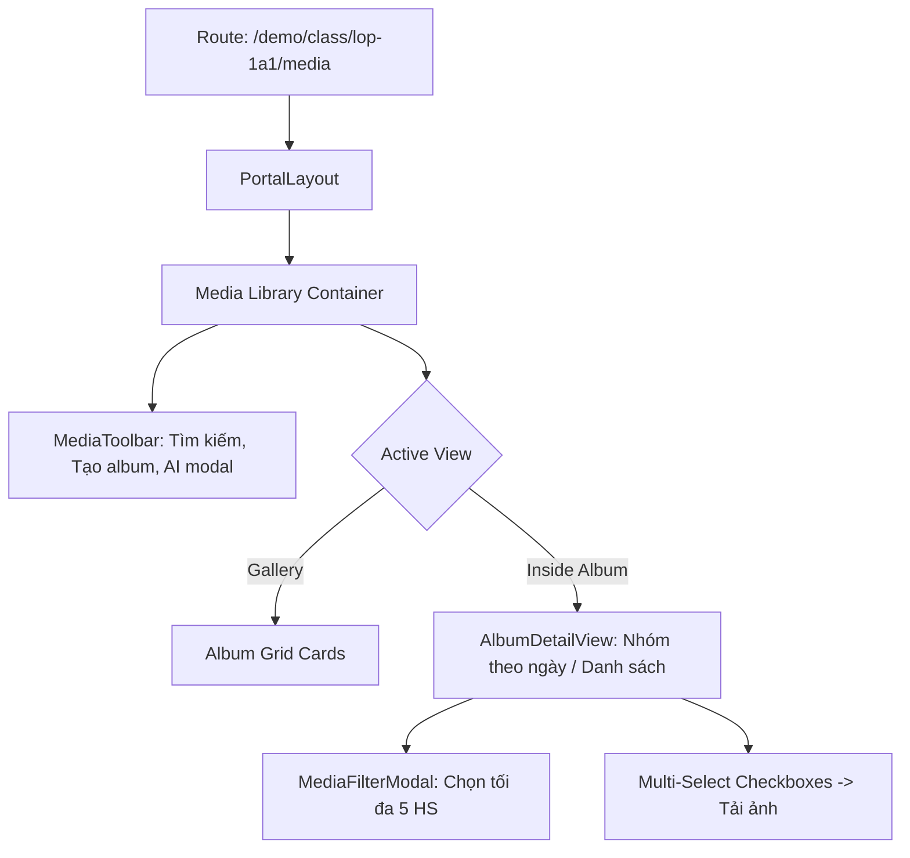

# Page: Per-Class Media Library (`/[schoolCode]/class/[classId]/media/`)

## Jira Story

- Story: As a teacher or school leader, I want to navigate to `/[schoolCode]/class/[classId]/media`, browse albums in grid or list format, view photos grouped by date, and use modals for album creation, student filtering, and facial recognition, so that media management is intuitive and efficient.
- Jira issue type: Page
- Acceptance owner: `benny-frontend-engineer`

## Priority

- Priority: P0 (Blocker)
- Severity if missed: Critical — Visual route for media library cannot be rendered.
- Rationale: Main entrypoint for the Media sub-module.
- Target release: Phase 1 MVP

## Route / Surface

- **URL Pattern:** `/[schoolCode]/class/[classId]/media/`
- **Default Route:** `/demo/class/lop-1a1/media/`
- **Container:** Wrapped in `PortalLayout` providing header brand context and sidebar navigation.

## PM Notes

- PM-visible status: Active implementation of page route with album gallery, inside album view, and AI recognition modal.
- Demo narrative: Open page, browse albums, click into "Hoạt động", toggle between date-grouped and list views, select photos for batch download, and view the AI face recognition coverage modal.
- Acceptance impact: Verifies interactive frontend routing for Vận Hành Thư viện.

## States

1. **Album Gallery View (Top Level):**
   - Displays all class albums in responsive grid or table list.
   - Shows system badges on "Hoạt động" and "Điểm danh" albums.
   - Toolbar provides search, view toggle (Grid/List), "Nhận diện AI", and "Tạo album mới".
2. **Inside Album View (Detail Level):**
   - Renders breadcrumbs to return to all albums.
   - Shows action bar with "Lọc mở rộng" filter trigger and view mode toggle (Date-grouped vs Flat list).
   - Multi-select mode allows selecting photos with checkmarks and triggers batch download bar.
3. **Modal Dialog States:**
   - Create/Edit Album Modal: Title, description, audience scope, and cover photo picker.
   - Advanced Filter Modal: Max 5 students or "Cả lớp" / "Không gắn thẻ", sort order.
   - AI Facial Recognition Modal: Overall recognition rate stats, student breakdown table, and manual scan simulation button.

## Relationship Map

| Relation | Target | Label | Rationale |
| --- | --- | --- | --- |
| Implements | `F-003-001-operations-media` | `IMPLEMENTS` | Primary route rendering the feature. |
| Uses | `M-003-001-operations-media` | `USES` | Consumes media state and actions. |

## Mermaid Diagram

## Verification

- Command: `node --experimental-strip-types --test tests/unit/media.test.mjs`
- Expected: All unit tests pass, and route compiles cleanly via `npm run build`.
- Result: 100% test pass rate with zero regression errors.

## Work Log

- Date: 2026-09-12
  - Action: Initialized media page route specification and state transitions.
  - Agent/skill: `benny-frontend-engineer`
  - Evidence: Designed gallery and detail view layouts.

## Change Log

- Date: 2026-09-12
  - Code change: Implemented Next.js Pages router page `/[schoolCode]/class/[classId]/media/index.tsx`.
  - Documentation update: Authored page specification matching V31 rubric.
  - Evidence: All quality gates validated.
