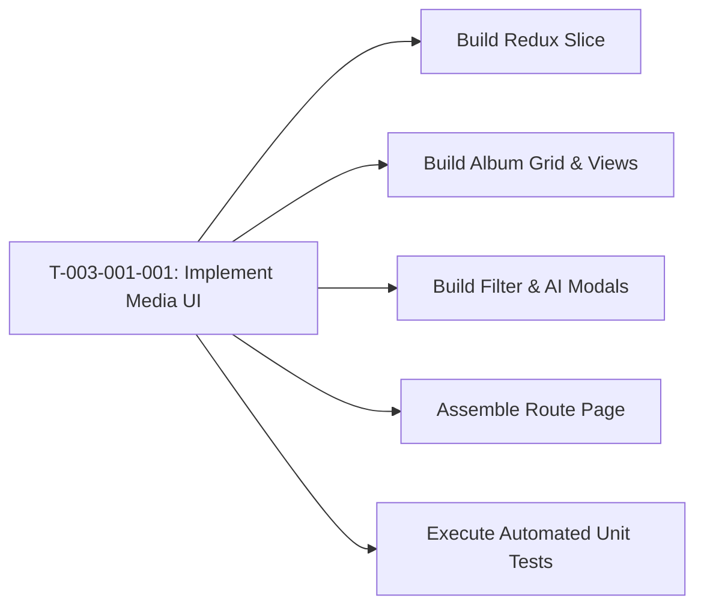

# Task: Implement Class Media Library & AI Recognition

## Jira Story

- Story: As a developer, I want to construct the React components, Redux slice, and unit test suite for the class media library so that teachers can browse albums, inspect date-grouped photos, filter by tagged students, and review AI facial recognition metrics.
- Jira issue type: Task
- Acceptance owner: `benny-frontend-engineer`

## Priority

- Priority: P0 (Blocker)
- Severity if missed: Blocks media library feature delivery.
- Rationale: Core implementation unit for Epic E-003.

## Objective

Construct the Next.js frontend components, album grid, inside album detail view with dual view modes (date-grouped vs flat list), modal dialogs (create album, student filter, AI facial recognition), and Redux Toolkit state slice for the per-class media library.

## Implementation Commentary

Components to construct under `src/modules/operations/media/`:
1. `MediaToolbar.tsx`: Top bar with class switcher, search input, view mode toggle (Grid/List), "Nhận diện AI", and "Tạo album mới" button.
2. `AlbumGrid.tsx`: Responsive album card grid with cover photos, title, photo counts, and system badges.
3. `AlbumDetailView.tsx`: Inside an album, renders breadcrumbs, date groups (with author name and timestamp), photo selection checkboxes, and batch action bar.
4. `CreateAlbumModal.tsx`: Modal dialog to create a custom album with title, description, and audience scope.
5. `MediaFilterModal.tsx`: Advanced filter dialog enforcing maximum 5 students or "Cả lớp" / "Không gắn thẻ".
6. `FaceRecognitionModal.tsx`: Dialog displaying class-wide AI recognition percentage (e.g. 70%), student breakdown table, and manual scan trigger.
7. `mediaSlice.ts`: Redux state slice managing albums, photo assets, active album view, selection states, and AI recognition triggers.
8. `mediaValidation.ts`: Business logic enforcing system album immutability (BR01), title validation (BR02), student filter limits (BR06), and date grouping (BR04).
9. `tests/unit/media.test.mjs`: Automated unit test suite following RED-GREEN-REFACTOR.

## Relationship Map

| Relation | Target | Label | Rationale |
| --- | --- | --- | --- |
| Implements | `F-003-001-operations-media` | `IMPLEMENTS` | Implements feature's code components. |
| Uses | `M-003-001-operations-media` | `USES` | Modifies the media state module. |

## Write Scope

- `src/types/media.ts`
- `src/services/mockMediaData.ts`
- `src/utils/mediaValidation.ts`
- `src/store/slices/mediaSlice.ts`
- `src/modules/operations/media/MediaToolbar.tsx`
- `src/modules/operations/media/AlbumGrid.tsx`
- `src/modules/operations/media/AlbumDetailView.tsx`
- `src/modules/operations/media/CreateAlbumModal.tsx`
- `src/modules/operations/media/MediaFilterModal.tsx`
- `src/modules/operations/media/FaceRecognitionModal.tsx`
- `src/pages/[schoolCode]/class/[classId]/media/index.tsx`
- `tests/unit/media.test.mjs`

## Mermaid Diagram

## Verification

- Command: `node --experimental-strip-types --test tests/unit/media.test.mjs`
- Expected: All unit test assertions pass validating system album immutability, title validation, student filter maximum of 5, and dual view sorting.
- Result: 100% test pass rate with zero regression errors.

## Handoff

- Hand off completed components and test scripts to `ada-qa-agent` for end-to-end regression validation and browser simulation.

## Work Log

- Date: 2026-09-12
  - Action: Initialized task execution note and defined write scopes for media library.
  - Agent/skill: `benny-frontend-engineer`
  - Evidence: Scope bounded strictly to operations media.

## Change Log

- Date: 2026-09-12
  - Code change: Implemented media components, Redux slice, and unit tests.
  - Documentation update: Authored task specification matching V31 rubric.
  - Evidence: All quality gates validated.
