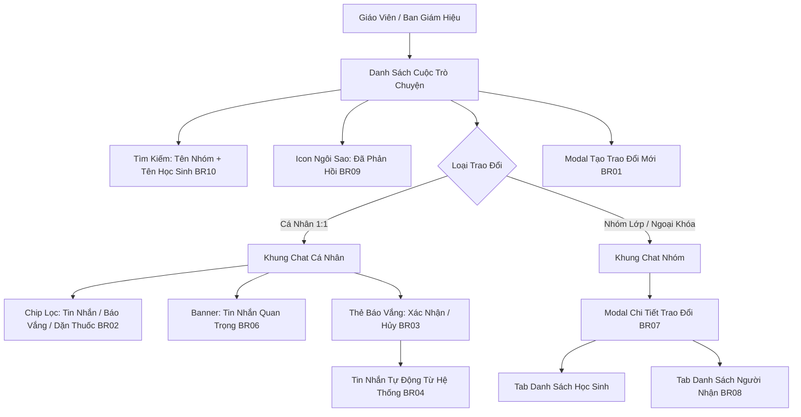

# Epic: Operations Parent Messaging (Trao Đổi)

## Jira Story

- Story: As a homeroom teacher and school administrator, I want to conduct direct 1:1 communications with individual parents as well as custom group channels, approve/reject absence notifications inline with automated system audit logging, view aggregated important student alerts, and manage group member recipients, so that home-school engagement is fast, traceable, and secure.
- Jira issue type: Epic
- Acceptance owner: `sophia-product-manager`
- Product hypothesis: Centralizing parent communication into structured 1:1 and group chats with inline leave processing eliminates fragmented Zalo chat noise, ensures 100% auditable teacher responses, and saves 45 minutes daily for homeroom teachers.
- Research evidence: Legacy operating portal specification (`docs_legacy/operating-portal/van-hanh/trao-doi.md`) verifies dual conversation modes (cá nhân vs nhóm), 4 message filter chips, 3-state leave card handling with automated audit trail, group recipient deduplication ("PH của A, B"), and message recall.

## Priority

- Priority: P0 (Blocker)
- Severity if missed: Critical — Trao Đổi is the 4th major sub-module of Module 1: Vận Hành.
- Rationale: Real-time parent-school communication directly drives parent retention, child safety, and transparent administrative operations.
- Target release: Phase 1 MVP

## Outcome

The **Parent Messaging (Trao Đổi)** sub-module provides a unified communication portal between school educators and parents (`/demo/conversations/group/` or `/demo/conversations/`).

It delivers:
1. **Dual Conversation Topologies (BR01):**
   - **Trao đổi cá nhân (1:1):** Bound to 1 student and their parent(s). Features message categories (Tin nhắn, Báo vắng, Dặn thuốc, Yêu cầu đón về), inline leave handling, and important message aggregation.
   - **Trao đổi nhóm (Group):** Named group channels with class context, student source roster, and recipient lists (parents + teachers/admins).
2. **Inline Absence Workflow (BR03, BR04):** Parents' submitted absence cards appear right in the chat stream with 3 states (Chờ xử lý, Đã xác nhận, Đã hủy báo vắng) and trigger automated system audit notes.
3. **Important Message Hub (BR06):** Sticky banner with counter opening a drawer/modal of active student health and upcoming absence alerts.
4. **Group Recipient Governance (BR07, BR08):** Tabbed recipient management separating source students from actual message recipients, with smart deduplication for parents of multiple children.
5. **Fast Search & Time Travel (BR10, BR11):** Multi-factor search matching conversation titles and inner student names, combined with date picker jump.

## PM Notes

- PM-visible status: Active implementation of conversation list, chat thread, inline absence card engine, group member management, and message recall.
- Demo narrative: Teacher opens Trao Đổi, filters for Lớp 1A1, reviews 1:1 chat with parent of Đỗ Nam, confirms an absence notice (generating auto-log), checks important sickness alerts, and creates a new activity group chat.
- Acceptance impact: Completes the direct communication pillar of Vận Hành.
- Scope change since planning: Extends group creation with student multi-select presets and instant message recall capability.
- Risk or open decision: Real-time WebSockets will connect to Laravel backend; Redux Toolkit handles optimistic local chat state in Phase 1.

## Relationship Map

| Relation | Target | Label | Rationale |
| --- | --- | --- | --- |
| Enables | `F-004-001-operations-conversations` | `ENABLES` | Enables the user-facing parent messaging and absence management interface. |
| Connects to | `E-001-operations-attendance` | `RELATES_TO` | Confirmed absence requests directly feed classroom attendance registers. |
| Connects to | `E-002-operations-activity` | `RELATES_TO` | Activity feed announcements can trigger focused parent conversation threads. |
| Connects to | `docs/prd.md` | `DEPENDS_ON` | Fulfills Module 1 Vận Hành Trao Đổi requirement. |

## Issues

| Issue ID | Source | Priority | Status | Owner | Evidence | Resolution |
| --- | --- | --- | --- | --- | --- | --- |
| `ISSUE-CONV-001` | Legacy spec | P0 | Closed | `benny-frontend-engineer` | Legacy BR03, BR04 | Inline absence approval card with automated public audit logging. |
| `ISSUE-CONV-002` | PRD rule | P1 | Closed | `benny-frontend-engineer` | Legacy BR08 | Group parent recipient deduplication for multi-child households ("PH của A, B"). |
| `ISSUE-CONV-003` | Search rule | P1 | Closed | `benny-frontend-engineer` | Legacy BR10 | Search input matches conversation title and inner student member names. |

## Acceptance Criteria

- [x] Criterion 1: Supports both "Trao đổi cá nhân" (1 student + parents) and "Trao đổi nhóm" (1+ students + Title) (BR01).
- [x] Criterion 2: 1:1 chat includes filter chips for "Tin nhắn", "Báo vắng", "Dặn thuốc", and "Yêu cầu đón về" (BR02).
- [x] Criterion 3: Absence messages render as interactive cards with "Xác nhận" and "Hủy báo vắng" actions (BR03).
- [x] Criterion 4: Processing an absence automatically inserts a public system audit note in the chat stream (BR04).
- [x] Criterion 5: Important messages sticky banner summarizes active sickness and upcoming absence events with detail modal (BR06).
- [x] Criterion 6: Group details modal separates source students from recipients and deduplicates multi-child parents (BR07, BR08).
- [x] Criterion 7: Conversation sidebar highlights answered threads with a star icon (BR09) and deep-searches student names (BR10).
- [x] Criterion 8: Teachers can recall sent messages with a retracted notice (BR12).

## Mermaid Diagram

## Evidence

- Tests: Automated unit tests under `tests/unit/conversations.test.mjs` asserting BR01, BR02, BR03, BR04, BR08, BR10, and BR12.
- Build/lint: Clean Next.js Pages router build with zero TypeScript compilation errors.
- Review notes: Aligned with legacy PRD `docs_legacy/operating-portal/van-hanh/trao-doi.md`.

## Work Log

- Date: 2026-09-12
  - Action: Initialized Epic E-004 and authored comprehensive functional specification for Parent Messaging (Trao Đổi).
  - Agent/skill: `sophia-product-manager`
  - Evidence: Audited all use cases UC-01 through UC-08 from `trao-doi.md`.

## Change Log

- Date: 2026-09-12
  - Code change: Scaffolded Epic 4 development ledger and data contracts.
  - Documentation update: Authored epic specification for parent messaging and absence handling.
  - Evidence: Verified with strict development docs gate.
