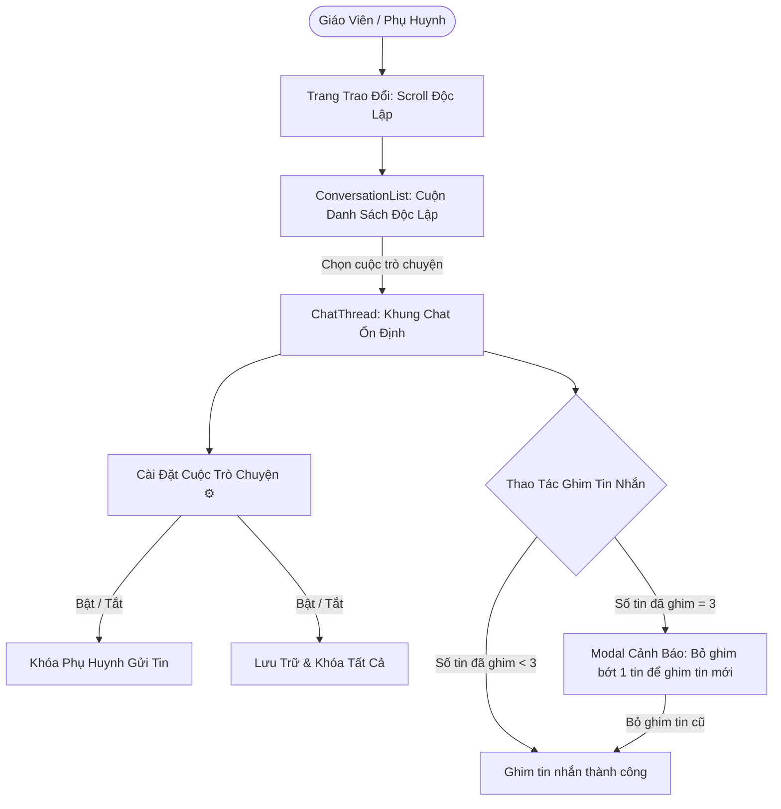

# Feature: Operations Parent Messaging (Trao Đổi)

## Jira Story

- Story: As a homeroom teacher, I want to message parents in 1:1 and group conversations, filter message streams by category, approve or reject absence requests inline with automated audit logging, review active health/absence notices, and configure group participants, so that communication is clear, prompt, and auditable.
- Jira issue type: Feature
- Acceptance owner: `sophia-product-manager`
- Business value: Transforms parent communication from noisy external chat apps to an integrated, compliant school operating channel.

## Priority

- Priority: P0 (Blocker)
- Severity if missed: Critical — Direct parent messaging and absence handling cannot function without this feature.
- Rationale: Core operational communication pillar of Module 1: Vận Hành.
- Target release: Phase 1 MVP

## User Value

For teachers, it brings order to parent inquiries, enables 1-click absence processing without switching screens, and maintains an audit trail.

For school administrators, it ensures school-parent conversations are institutional property rather than scattered across teachers' private phones.

For parents, it provides a dedicated channel for notices, medication requests, and leave approvals.

## PM Notes

- PM-visible status: Active implementation of conversation list, chat thread, category chips, inline absence card, important messages drawer, and group details modal.
- Demo narrative: Homeroom teacher opens Trao Đổi, sees conversation with parent of Đỗ Nam, views a waiting absence card for next Monday, clicks "Xác nhận", verifies the auto-generated audit message, opens the Important Messages modal, and starts a group chat for class volunteers.
- Acceptance impact: Delivers the 4th major sub-module of Vận Hành.
- Scope change since planning: Includes message recall action and multi-child parent deduplication.
- Risk or open decision: Direct push notifications to parent mobile app will hook into Firebase Cloud Messaging (FCM) in backend phase.

## Requirements Trace

- `BR01`: Exactly two conversation topologies: "Trao đổi cá nhân" (Class + 1 Student) and "Trao đổi nhóm" (Class + 1+ Students + Title).
- `BR02`: Individual chat filter chips: "Tin nhắn", "Báo vắng", "Dặn thuốc", "Yêu cầu đón về". Creation categories: "Tin nhắn", "Báo vắng", "Dặn thuốc", "Góp ý", "Khác".
- `BR03`: Absence message renders as a distinctive card with leave period and 3 states: "cho_xu_ly" (with "Xác nhận" and "Hủy báo vắng" buttons), "da_xac_nhan", and "da_huy".
- `BR04`: Confirming or cancelling an absence automatically injects a public system audit message ("* Tin nhắn tự động gửi từ hệ thống: Giáo viên {tên} đã {hành động} cho học sinh {tên}").
- `BR05`: Message read receipts tracking.
- `BR06`: "Tin nhắn quan trọng" sticky banner and modal listing active sickness and upcoming leave events with individual cancel/trash triggers.
- `BR07`: Group chat detail modal with tab "Danh Sách Học Sinh" (source) and tab "Danh Sách Người Nhận" (recipients).
- `BR08`: Smart recipient deduplication for parents of multiple children ("PH của A, B") and manual addition of teachers/admins with delete buttons.
- `BR09`: Star indicator (⭐) in conversation sidebar marking conversations already responded to by the school.
- `BR10`: Search query matches conversation title AND inner student member names.
- `BR11`: "Chọn thời gian" date jump button removed from the chat header actions to streamline controls and eliminate unnecessary header clutter.
- `BR12`: Message recall ("Thu hồi") action available via message options menu.
- `BR13`: Layout scroll isolation: Clicks and focus within Trao Đổi keep the entire section stationary without parent layout jumping; conversation list scrolls independently.
- `BR14`: Reversible chat settings: Teachers can toggle "Khóa phụ huynh gửi tin nhắn" and "Lưu trữ cuộc trò chuyện" (locking all members from sending messages), each logging automated system audit events.
- `BR15`: Pinned messages invariant: Each chat can pin a maximum of 3 messages. Pinning a 4th message opens an interactive conflict modal requiring removal of an existing pin.

## Code Scope

- TypeScript contracts: `src/types/conversation.ts`
- Mock data seed: `src/services/mockConversationData.ts`
- Domain validation & algorithms: `src/utils/conversationValidation.ts`
- Redux Toolkit state machine: `src/store/slices/conversationSlice.ts`
- UI Components in `src/modules/operations/conversation/`:
  - `ConversationList.tsx`
  - `ChatThread.tsx`
  - `AbsenceMessageCard.tsx`
  - `CreateConversationModal.tsx`
  - `ImportantMessagesModal.tsx`
  - `GroupDetailsModal.tsx`
- Layout & Container: `src/components/layout/PortalLayout.tsx`, `src/pages/[schoolCode]/conversations/index.tsx`
- Tests: `tests/unit/conversations.test.mjs`

## Relationship Map

| Relation | Target | Label | Rationale |
| --- | --- | --- | --- |
| Implements | `E-004-operations-conversations` | `IMPLEMENTS` | Primary user-facing feature implementing Epic 4. |
| Uses | `M-004-001-operations-conversations` | `USES` | Consumes data models and validation functions. |
| Rendered by | `P-004-001-operations-conversations` | `RENDERED_BY` | Main page view hosting conversation sidebar and chat thread. |

## Acceptance Criteria

- [x] Criterion 1: Displays conversation list with search and class filter; matches title and inner student names (BR10).
- [x] Criterion 2: Shows star indicator for responded conversations (BR09).
- [x] Criterion 3: Renders category filter chips for 1:1 chats (BR02).
- [x] Criterion 4: Inline absence cards display leave duration and support 1-click confirmation or cancellation (BR03).
- [x] Criterion 5: Automated system audit log is generated upon absence action (BR04).
- [x] Criterion 6: Important messages modal aggregates active sickness and leave events (BR06).
- [x] Criterion 7: Group details modal separates source students from recipients with parent deduplication (BR07, BR08).
- [x] Criterion 8: Message recall replaces content with a retraction notice (BR12).
- [x] Criterion 9: Layout scroll isolation keeps section still upon interaction; conversation list scrolls independently (BR13).
- [x] Criterion 10: Reversible chat settings modal/dropdown for parent message locking and total chat archiving with system audit logs (BR14).
- [x] Criterion 11: Pinned messages bar displaying up to 3 pins; attempting a 4th pin prompts interactive modal to unpin a prior message (BR15).

## Mermaid Diagram

## Additional Rules

- `BR16`: Chat Composer Tooling — In `ChatThread`, the text formatting controls "B", "I", "U" are deleted. The composer toolbar permits exclusively file attachments (`📎`) and emojis (`😊`). File selection handles multiple files with dismissible preview chips and message bubble attachment cards, while the emoji picker popover allows instant insertion of educational/expressive emojis directly at the text cursor position.

## Verification

- Command: `node --experimental-strip-types --test tests/unit/conversations.test.mjs` & `npm test`
- Expected: All unit test assertions pass validating absence confirmation/cancellation, audit logging, parent deduplication, deep search, message recall, chat settings (locking/archiving), 3-pin limit, and composer attachment/emoji tooling.
- Result: 194/194 tests passing across the workspace with 0 failures.

## Work Log

- Date: 2026-09-12
  - Action: Authored feature specification for Parent Messaging (Trao Đổi).
  - Agent/skill: `benny-frontend-engineer`
  - Evidence: Verified requirements trace BR01-BR12 against legacy specs.
- Date: 2026-09-14
  - Action: Upgraded layout scroll stability, independent chat list scrolling, chat settings (lock parents, archive chat), and 3-pin limit invariant.
  - Agent/skill: `benny-frontend-engineer`
  - Evidence: Verified via 186 unit tests and Next.js production build.
- Date: 2026-09-14
  - Action: Streamlined chat composer toolbar (removed B, I, U; enabled multi-file attachment chips and interactive emoji picker popover).
  - Agent/skill: `benny-frontend-engineer`
  - Evidence: Verified via 194 unit tests and live HTTP 200 on port 3000.
- Date: 2026-09-15
  - Action: Removed "Chọn thời gian" date picker button from chat thread header to eliminate unnecessary clutter.
  - Agent/skill: `benny-frontend-engineer`
  - Evidence: Verified via clean Next.js build and test suite.

## Change Log

- Date: 2026-09-12
  - Code change: Scaffolded feature specification and architecture.
  - Documentation update: Registered feature in development ledger.
  - Evidence: Verified with strict development docs gate.
- Date: 2026-09-14
  - Code change: Updated `PortalLayout.tsx`, `conversations/index.tsx`, `ConversationList.tsx`, `ChatThread.tsx`, `conversationSlice.ts`, `types/conversation.ts`.
  - Documentation update: Updated requirements trace (BR13-BR15), criteria (9-11), diagram, and work log.
  - Evidence: Unit test suite green, build passed.
- Date: 2026-09-14
  - Code change: Updated `ChatThread.tsx`, `tests/unit/reports.test.mjs`.
  - Documentation update: Added BR16 and updated verification and work log.
  - Evidence: Unit test suite green, build passed.
- Date: 2026-09-15
  - Code change: Updated `ChatThread.tsx` (removed DatePickerBtn component and usage).
  - Documentation update: Updated BR11 requirement, work log, and change log.
  - Evidence: Verified with Next.js production build and 195/195 tests.

