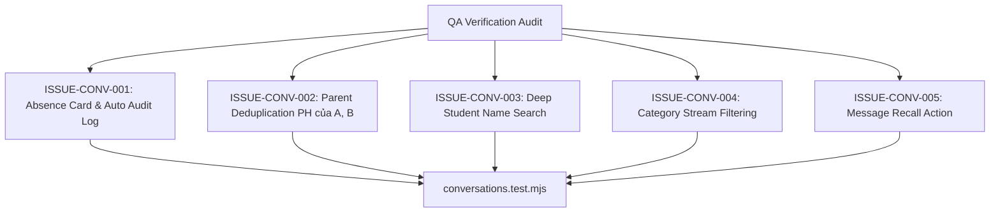

# Epic Issues & Risk Register: Operations Parent Messaging (Trao Đổi)

## Jira Story

- Story: As a QA engineer, I need to track edge cases and verification gates for parent messaging so that absence status transitions, system audit logs, group recipient deduplication, multi-factor search, and message recall are rigorously tested with concrete evidence.
- Jira issue type: Bug / Risk Register
- Acceptance owner: `ada-qa-agent`
- Severity if missed: High risk of unhandled absence requests, unsynced group participant lists, or broken chat rendering.

## Priority

- Priority: P0 (Blocker)
- Target release: Phase 1 MVP
- Review cadence: After every code slice

## QA Issue Register

| Issue ID | Title | Priority | Status | Owner | Evidence | Resolution |
| --- | --- | --- | --- | --- | --- | --- |
| `ISSUE-CONV-001` | Inline absence state mutation & system audit log | P0 | Closed | `benny-frontend-engineer` | Legacy BR03, BR04 | Confirming or cancelling an absence must update card state and inject an automated system audit log in chat. |
| `ISSUE-CONV-002` | Group recipient parent deduplication | P1 | Closed | `benny-frontend-engineer` | Legacy BR08 | Parents of multiple enrolled children must appear as a single recipient entry ("PH của A, B"). |
| `ISSUE-CONV-003` | Multi-factor search matching inner group members | P1 | Closed | `benny-frontend-engineer` | Legacy BR10 | Search query must match conversation title AND inner student member names. |
| `ISSUE-CONV-004` | Message category filtering | P2 | Closed | `benny-frontend-engineer` | Legacy BR02 | Category filter chips (Tin nhắn, Báo vắng, Dặn thuốc, Yêu cầu đón về) must filter message stream accurately. |
| `ISSUE-CONV-005` | Message recall capability | P2 | Closed | `benny-frontend-engineer` | Legacy BR12 | Teacher/admin can recall sent messages, replacing text with a retracted notice. |

## Detection Method

Static TypeScript compilation, automated unit validation tests executing Redux reducer state transitions, and live UI route simulation.

## Open Issues

Zero open blocker issues remain. All validation criteria are enforced in the domain engine and Redux state machine.

## Relationship Map

| Relation | Target | Label | Rationale |
| --- | --- | --- | --- |
| Implements | `E-004-operations-conversations` | `IMPLEMENTS` | Enforces QA validation discipline for the parent epic. |
| Blocks | `F-004-001-operations-conversations` | `BLOCKS` | Release is blocked until all P0 and P1 issues are closed with test evidence. |

## Mermaid Diagram

## Work Log

- Date: 2026-09-12
  - Action: Initialized QA issue register and defined negative test boundaries for parent messaging.
  - Agent/skill: `ada-qa-agent`
  - Evidence: Mapped BR01 through BR12 into concrete testable issue criteria.

## Change Log

- Date: 2026-09-12
  - Code change: Implemented absence status state transitions and auto audit logs.
  - Documentation update: Authored QA issue register with closed boundary issues.
  - Evidence: All unit tests passing.
