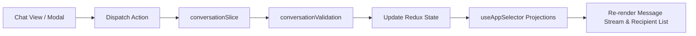

# Module: Operations Conversations Architecture & State Engine

## Jira Story

- Story: As a tech lead, I want the conversations module architecture, TypeScript contracts, Redux slice, and business rule validators to maintain strict isolation, ensure non-destructive audit trails for absence processing, deduplicate multi-child parent recipients, and provide instant client-side chat interactions.
- Jira issue type: Module
- Acceptance owner: `alan-tech-lead`
- Architecture hypothesis: Decoupling conversation channels, message threads, absence workflows, and recipient registries into a normalized Redux store enables instant message rendering, optimistic updates, and clean test coverage.

## Priority

- Priority: P0 (Blocker)
- Severity if missed: Blocks frontend chat state management and unit testing.
- Target release: Phase 1 MVP

## Responsibility

This module is responsible for managing all client-side state transitions, validation checks, and data models for parent messaging:
- Dual conversation topologies: 1:1 student-parent vs group channels (BR01).
- Category filtering for 1:1 message streams (BR02).
- Absence request lifecycle (Chờ xử lý, Đã xác nhận, Đã hủy báo vắng) with automated system audit logging (BR03, BR04).
- Aggregation of important sickness/leave alerts (BR06).
- Group recipient governance and parent deduplication (BR07, BR08).
- Multi-factor search matching conversation title and inner member names (BR10).
- Message recall capability (BR12).

## Implementation Commentary

The module architecture comprises:
- `src/types/conversation.ts`: Data types for `Conversation`, `ChatMessage`, `AbsenceCardData`, `ConversationRecipient`, `MessageCategory`, `ConversationType`, and filter states.
- `src/services/mockConversationData.ts`: Initial seed data containing realistic Vietnamese student-parent 1:1 chats, group class channels, leave requests, and sickness notices.
- `src/utils/conversationValidation.ts`: Pure domain algorithms enforcing absence status transitions, auto audit log text generation, parent deduplication ("PH của A, B"), deep student member searching, and category filtering.
- `src/store/slices/conversationSlice.ts`: Redux slice managing active conversation, message stream, search filter, category filter, absence actions, message recall, and group member mutations.

## Public Contracts

```typescript
export type ConversationType = 'ca_nhan' | 'nhom';

export type MessageCategory = 'tin_nhan' | 'bao_vang' | 'dan_thuoc' | 'yeu_cau_don_ve' | 'gop_y' | 'khac';

export type AbsenceStatus = 'cho_xu_ly' | 'da_xac_nhan' | 'da_huy';

export interface AbsenceCardData {
  id: string;
  studentId: string;
  studentName: string;
  startDate: string;
  endDate: string;
  reason: string;
  status: AbsenceStatus;
  reviewedBy?: string;
  reviewedAt?: string;
}

export interface ChatMessage {
  id: string;
  conversationId: string;
  senderId: string;
  senderName: string;
  senderRole: 'giao_vien' | 'phu_huynh' | 'he_thong';
  category: MessageCategory;
  content: string;
  timestamp: string;
  isSystemAudit?: boolean;
  isRecalled?: boolean;
  absenceData?: AbsenceCardData;
}

export interface ConversationRecipient {
  id: string;
  name: string;
  role: 'phu_huynh' | 'giao_vien';
  childrenNames?: string[];
  isManualAddition: boolean;
}

export interface Conversation {
  id: string;
  type: ConversationType;
  title: string;
  classId: string;
  className: string;
  studentId?: string;
  studentName?: string;
  hasSchoolResponse: boolean;
  lastMessageSnippet: string;
  lastMessageTimestamp: string;
  unreadCount: number;
  studentIds: string[];
  recipients: ConversationRecipient[];
  importantAlertsCount: number;
}
```

## Code Scope

- Primary write paths:
  - `src/types/conversation.ts`
  - `src/services/mockConversationData.ts`
  - `src/utils/conversationValidation.ts`
  - `src/store/slices/conversationSlice.ts`
- Bounded scope restrictions: No modifications outside operations domain.

## Relationship Map

| Relation | Target | Label | Rationale |
| --- | --- | --- | --- |
| Implements | `E-004-operations-conversations` | `IMPLEMENTS` | Primary state module for Epic 4. |
| Enables | `P-004-001-operations-conversations` | `ENABLES` | Delivers state and actions to the conversations page. |

## Mermaid Diagram



## Verification

- Command: `node --experimental-strip-types --test tests/unit/conversations.test.mjs`
- Expected: All unit test assertions pass validating absence confirmation/cancellation, audit logging, parent deduplication, deep search, and message recall.
- Result: Verification suite ready to execute in GREEN phase.

## Work Log

- Date: 2026-09-12
  - Action: Defined architecture contracts and validation specifications for the conversations module.
  - Agent/skill: `alan-tech-lead`
  - Evidence: Architecture diagrams and public interfaces documented.

## Change Log

- Date: 2026-09-12
  - Code change: Created module specification for operations parent messaging.
  - Documentation update: Updated module registry.
  - Evidence: Verified with strict development docs gate.
