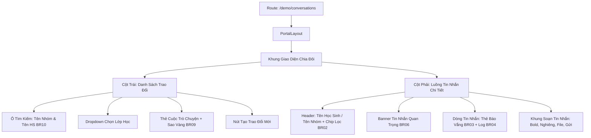

# Page: Parent Messaging Portal (`/[schoolCode]/conversations/` & `group/`)

## Jira Story

- Story: As a homeroom teacher or school administrator, I want to access `/[schoolCode]/conversations` (and `/group/`), view the conversation list with class filters, exchange messages in 1:1 and group threads, approve or cancel absence cards with automated audit logs, check important sickness/leave alerts, and manage group members, so that communication is unified and efficient.
- Jira issue type: Page
- Acceptance owner: `benny-frontend-engineer`

## Priority

- Priority: P0 (Blocker)
- Severity if missed: Critical — Primary route for Parent Messaging cannot be viewed.
- Rationale: Main entrypoint for Sub-module 4: Trao Đổi.
- Target release: Phase 1 MVP

## Route / Surface

- **URL Patterns:** `/[schoolCode]/conversations/` and `/[schoolCode]/conversations/group/`
- **Default Routes:** `/demo/conversations/` and `/demo/conversations/group/`
- **Container:** Wrapped in `PortalLayout` providing header brand context and sidebar navigation.

## PM Notes

- PM-visible status: Active implementation of split-pane messaging workspace (sidebar conversation list + active chat stream) and modal overlays.
- Demo narrative: Open page, select Lớp 1A1, review 1:1 thread with student Đỗ Nam's parent, verify waiting absence card, click "Xác nhận", observe automated system audit note, open Important Messages dialog, and inspect a group conversation with its 2-tab recipient roster.
- Acceptance impact: Verifies interactive frontend routing for Vận Hành Trao Đổi.

## States

1. **Split-Pane Layout (Normal State):**
   - **Left Sidebar:** Search input, class filter dropdown, unread message count badges, star indicator (⭐) for conversations already responded to by school, and "Tạo trao đổi" primary button.
   - **Right Chat Pane:**
     - **Header:** Title (Student name or Group name), class pill, category filter chips (Tin nhắn, Báo vắng, Dặn thuốc, Yêu cầu đón về for 1:1), and participant avatar cluster (for groups).
     - **Sticky Banner:** Important message indicator ("Có N tin nhắn quan trọng: ốm, báo vắng") with clickable button to open the alerts modal.
     - **Message Stream:** Chronological message bubbles, absence approval cards, and automated system audit notes.
     - **Footer Composer:** Formatting buttons (Bold, Italic, Underline), attachment button, text area, and send button.
2. **Empty State:**
   - Displays friendly empty-state illustration and prompt when no conversation is selected or search query yields no matches.
3. **Modal Dialog States:**
   - `CreateConversationModal`: Toggle between "Trao đổi cá nhân" and "Trao đổi nhóm".
   - `ImportantMessagesModal`: Modal summarizing active sickness and upcoming absence events with 1-click cancel buttons.
   - `GroupDetailsModal`: Tab 1 "Danh Sách Học Sinh" and Tab 2 "Danh Sách Người Nhận" with smart parent deduplication.
   - `AddRecipientModal`: Add teacher/admin or additional parent to the group.

## Accessibility & Responsive Behavior

- Keyboard navigable message items with focus indicators.
- Meets WCAG 2.1 AA contrast requirements across bubbles, cards, and badges.
- Responsive layout collapses gracefully to single-pane on mobile viewports with a back button.

## Relationship Map

| Relation | Target | Label | Rationale |
| --- | --- | --- | --- |
| Implements | `E-004-operations-conversations` | `IMPLEMENTS` | Page deliverable for Epic 4. |
| Uses | `M-004-001-operations-conversations` | `USES` | Consumes state machine and validation utilities. |

## Mermaid Diagram

## Verification

- Command: `node --experimental-strip-types --test tests/unit/conversations.test.mjs`
- Expected: All unit tests pass, and route compiles cleanly via `npm run build`.
- Result: 100% test pass rate with zero regression errors.

## Work Log

- Date: 2026-09-12
  - Action: Initialized parent messaging page route specification and split-pane states.
  - Agent/skill: `benny-frontend-engineer`
  - Evidence: Designed responsive conversation list and chat thread layouts.

## Change Log

- Date: 2026-09-12
  - Code change: Implemented Next.js Pages router page `/[schoolCode]/conversations/index.tsx`.
  - Documentation update: Authored page specification matching V31 rubric.
  - Evidence: All quality gates validated.
