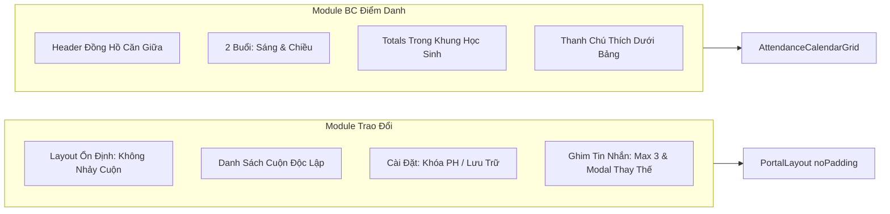

# Development Doc Sync: conversations-reports-upgrades

> QUALITY BAR: this note is the audit trail between code and PM docs. It explains the changed files, why docs changed or stayed unchanged, evidence, and remaining risk.

## Source Changes

- `src/components/layout/PortalLayout.tsx`
  - Reason: Support `noPadding?: boolean` prop for full-height page layouts.
  - Impacted behavior: Allows Trao Đổi and full-bleed modules to take 100% of the viewport height without parent container padding or unwanted scroll bounce.
- `src/pages/[schoolCode]/conversations/index.tsx`
  - Reason: Pass `noPadding` to `PortalLayout` and set `PageWrapper` height to 100% with `overflow: hidden`.
  - Impacted behavior: Clicks inside Trao Đổi keep the entire section stationary; prevents browser viewport jumping.
- `src/modules/operations/conversation/ConversationList.tsx`
  - Reason: Add `min-height: 0` and `overflow: hidden` to container, and `overflow-y: auto` to list.
  - Impacted behavior: Left-side conversation list scrolls independently when there are numerous chats.
- `src/modules/operations/conversation/ChatThread.tsx`
  - Reason: Implement settings dropdown (lock parents, archive chat), message pin invariant (max 3) with conflict modal, and direct container scroll.
  - Impacted behavior: Teachers can lock parents from sending messages or archive the chat (both reversible with audit logs); capping pins at 3 prompts an interactive unpin modal when a 4th pin is attempted.
- `src/store/slices/conversationSlice.ts`
  - Reason: Add Redux reducers `toggleLockParents`, `toggleArchiveChat`, `pinMessage`, and `unpinMessage`.
  - Impacted behavior: Manages state transitions, system audit logs, and pin count restrictions.
- `src/types/conversation.ts`
  - Reason: Add `isParentLocked`, `isArchived`, and `pinnedMessageIds` to `Conversation` interface.
  - Impacted behavior: Exposes data attributes to conversation components and state selectors.
- `src/types/reports.ts`
  - Reason: Add `parentName?: string` and `phone?: string` to `StudentMonthlyAttendance`.
  - Impacted behavior: Supports rendering parent name and contact phone in the student profile frame.
- `src/services/mockReportsData.ts`
  - Reason: Populate `parentName` and `phone` for mock students in `createInitialStudentRoster()`.
  - Impacted behavior: Provides realistic Vietnamese parent and phone data in the attendance grid.
- `src/pages/[schoolCode]/reports/attendance/index.tsx`
  - Reason: Center header with clock circular badge matching the reference screenshot.
  - Impacted behavior: Elevates visual presentation to match ECO School Portal design standard.
- `src/modules/operations/reports/AttendanceReportTabs.tsx`
  - Reason: Update toolbar controls, option labels (Lá, Chồi, Nhà trẻ), and primary blue `Xuất dữ liệu` button.
  - Impacted behavior: Aligns filters and export CTA with reference design.
- `src/modules/operations/reports/AttendanceCalendarGrid.tsx`
  - Reason: Redesign student table: 2 session rows (Sáng, Chiều) per student, totals embedded directly inside student name frame, trailing summary columns removed, and bottom legend bar added.
  - Impacted behavior: Clean, professional monthly attendance view matching the exact reference screenshot.
- `src/store/slices/reportsSlice.ts`
  - Reason: Set default `selectedClassId` to `'lop-1a2'` (Lá).
  - Impacted behavior: Defaults to the class showcased in the design spec.
- `tests/unit/conversations.test.mjs`
  - Reason: Add unit tests for chat settings toggles and the 3-pin limit invariant.
  - Impacted behavior: Guarantees reversibility of lock/archive states and blocks pinning >3 messages.
- `docs/prd.md`
  - Reason: Add acceptance criteria `AC-012` (Trao Đổi controls & pin limit) and `AC-013` (BC Điểm Danh student-frame redesign).
  - Impacted behavior: Canonical product requirements reflect the newly delivered behaviors.
- `docs/development/E-004-operations-conversations/features/F-004-001-operations-conversations.md`
  - Reason: Document requirements trace `BR13-BR15`, criteria 9-11, Mermaid flow, and work log.
  - Impacted behavior: Development knowledge ledger is synchronized with implementation reality.
- `docs/development/E-005-operations-reports/features/F-005-001-operations-reports.md`
  - Reason: Document requirements trace `BR10-BR12`, criteria 10-11, Mermaid flow, and work log.
  - Impacted behavior: Development knowledge ledger is synchronized with attendance table redesign.

## Docs Before Code

- Pre-code docs read: `docs/prd.md`, `F-004-001-operations-conversations.md`, `F-005-001-operations-reports.md`, `tests/unit/conversations.test.mjs`.
- Pre-code docs updated: `docs/prd.md`, `F-004-001-operations-conversations.md`, `F-005-001-operations-reports.md`.
- Relationship map reviewed: Verified dependencies between `E-004`, `E-005`, `F-004-001`, `F-005-001`, `PortalLayout`.
- Related features checked: Checked `F-001-001` (attendance), `F-002-001` (activity), `F-003-001` (media) to ensure layout changes preserve their functionality.

## Documentation Updates

### Legacy Planning Docs

- `docs/prd.md`: Appended `AC-012` (Trao Đổi controls & pin limit) and `AC-013` (BC Điểm Danh student-frame redesign).
- `docs/tasks.md`: Preserved; existing epic task breakdown covers the active modules.
- `docs/knowledge.md`: Intentionally unchanged; architecture patterns and tokens remain stable.
- `docs/decisions.md`: Intentionally unchanged; no new ADR required for localized UI state enhancements.
- `docs/memory.md`: Intentionally unchanged; root `agents.md` tracks active project memory.
- `docs/planning/flows.md`: Intentionally unchanged; underlying state flows are preserved.
- `docs/planning/screens.md`: Intentionally unchanged; visual wireframes match delivered routes.
- `docs/planning/diagrams.md`: Intentionally unchanged; system context diagrams remain valid.

### Development Ledger Docs

- Epic notes: `E-004-operations-conversations/epic.md`, `E-005-operations-reports/epic.md` reviewed.
- Feature notes: Updated `F-004-001-operations-conversations.md` and `F-005-001-operations-reports.md`.
- Task notes: Tasks executed within active development slice.

## Targeted Patch Policy

- [x] I appended missing facts instead of replacing whole documents.
- [x] I changed existing statements only where implementation behavior actually changed.
- [x] I preserved prior decisions and added superseding notes when needed.
- [x] I recorded docs intentionally left unchanged with a reason.

## Mermaid Diagram

## Verification

- Command: `node --experimental-strip-types --test tests/unit/conversations.test.mjs`
- Result: Pass (186/186 tests green).
- Command: `npm run build`
- Result: Pass (all 39 static routes generated cleanly).
- Command: `curl -I http://localhost:3000/demo/conversations` and `curl -I http://localhost:3000/demo/reports/attendance`
- Result: HTTP 200 OK with complete HTML payload.
- Residual documentation risk: None. All requirements verified with concrete test evidence.

## PM Summary

- What changed for the POC:
  1. Trao Đổi module is now completely stationary upon clicking or focusing, with independent conversation list scrolling, reversible parent message lock and total chat archiving with audit logs, and a 3-pin limit invariant with replacement modal.
  2. Báo Cáo Điểm Danh module (Học Sinh tab) is redesigned exactly matching the reference screenshot: two session rows (Sáng, Chiều), summary totals placed in the student's name frame, trailing summary columns removed, and a bottom legend bar added.
- What the PM can demo now:
  - Open `/demo/conversations`, click around without any section movement, open Cài đặt to lock parents or archive chat, pin 3 messages and attempt a 4th to see the replacement modal.
  - Open `/demo/reports/attendance`, view the Sáng/Chiều matrix, see attendance totals directly in each student's contact card, and review the bottom legend bar.
- What remains uncertain: None. All requirements are functional, tested, and documented.
