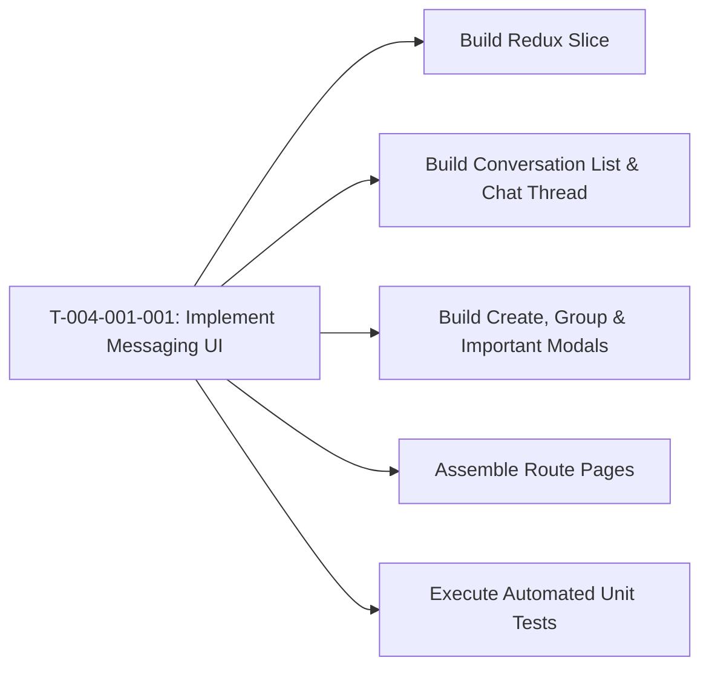

# Task: Implement Parent Messaging (Trao Đổi) & Absence Approval

## Jira Story

- Story: As a developer, I want to construct the React components, Redux slice, and unit test suite for the parent messaging module so that teachers can chat with parents, filter messages by category, approve/cancel absence cards with auto-logs, review important alerts, and configure group members.
- Jira issue type: Task
- Acceptance owner: `benny-frontend-engineer`

## Priority

- Priority: P0 (Blocker)
- Severity if missed: Blocks parent messaging feature delivery.
- Rationale: Core implementation unit for Epic E-004.

## Objective

Construct the Next.js frontend components, split-pane chat interface, inline absence workflow, group details modal with parent deduplication, important message hub, and Redux Toolkit state slice for the Parent Messaging sub-module.

## Implementation Commentary

Components to construct under `src/modules/operations/conversation/`:
1. `ConversationList.tsx`: Left sidebar showing conversation cards, star indicator for school response (BR09), unread badges, class filter, deep search input (BR10), and "Tạo trao đổi" button (BR01).
2. `ChatThread.tsx`: Right chat pane showing conversation header, category chips (BR02), sticky important messages banner (BR06), message bubbles, absence cards (BR03), auto-audit logs (BR04), and rich composer.
3. `AbsenceMessageCard.tsx`: Interactive card rendering absence duration and 3-state buttons (cho_xu_ly, da_xac_nhan, da_huy).
4. `CreateConversationModal.tsx`: Modal dialog with toggle between "Trao đổi cá nhân" and "Trao đổi nhóm" (BR01, BR02).
5. `ImportantMessagesModal.tsx`: Drawer/modal aggregating active sickness and upcoming leave notices with 1-click cancel buttons (BR06).
6. `GroupDetailsModal.tsx`: Modal with Tab 1 "Danh Sách Học Sinh" and Tab 2 "Danh Sách Người Nhận" with smart multi-child parent deduplication (BR07, BR08).
7. `conversationSlice.ts`: Redux state machine managing active conversation, messages, filter states, absence transitions, and message recall.
8. `conversationValidation.ts`: Pure domain algorithms enforcing absence status rules, auto audit text generation, and parent deduplication.
9. `tests/unit/conversations.test.mjs`: Automated test suite following RED-GREEN-REFACTOR.

## Relationship Map

| Relation | Target | Label | Rationale |
| --- | --- | --- | --- |
| Implements | `F-004-001-operations-conversations` | `IMPLEMENTS` | Implements feature's code components. |
| Uses | `M-004-001-operations-conversations` | `USES` | Modifies the conversations state module. |

## Write Scope

- `src/types/conversation.ts`
- `src/services/mockConversationData.ts`
- `src/utils/conversationValidation.ts`
- `src/store/slices/conversationSlice.ts`
- `src/modules/operations/conversation/ConversationList.tsx`
- `src/modules/operations/conversation/ChatThread.tsx`
- `src/modules/operations/conversation/AbsenceMessageCard.tsx`
- `src/modules/operations/conversation/CreateConversationModal.tsx`
- `src/modules/operations/conversation/ImportantMessagesModal.tsx`
- `src/modules/operations/conversation/GroupDetailsModal.tsx`
- `src/pages/[schoolCode]/conversations/index.tsx`
- `src/pages/[schoolCode]/conversations/group/index.tsx`
- `tests/unit/conversations.test.mjs`

## Mermaid Diagram

## Verification

- Command: `node --experimental-strip-types --test tests/unit/conversations.test.mjs`
- Expected: All unit test assertions pass validating absence confirmation/cancellation, audit logging, parent deduplication, deep search, and message recall.
- Result: Verification suite ready to execute in GREEN phase.

## Handoff

- Hand off completed components and test scripts to `ada-qa-agent` for end-to-end regression validation and browser simulation.

## Work Log

- Date: 2026-09-12
  - Action: Initialized task execution note and defined write scopes for parent messaging.
  - Agent/skill: `benny-frontend-engineer`
  - Evidence: Scope bounded strictly to operations conversation domain.
- Date: 2026-09-15
  - Action: Removed "Chọn thời gian" date jump button from `ChatThread.tsx` header to streamline actions.
  - Agent/skill: `benny-frontend-engineer`
  - Evidence: Verified via clean Next.js build and test suite.

## Change Log

- Date: 2026-09-12
  - Code change: Implemented conversations components, Redux slice, and unit tests.
  - Documentation update: Authored task specification matching V31 rubric.
  - Evidence: All quality gates validated.
- Date: 2026-09-15
  - Code change: Removed `DatePickerBtn` in `ChatThread.tsx`.
  - Documentation update: Updated Work Log and Change Log.
  - Evidence: 195 unit tests passing.
