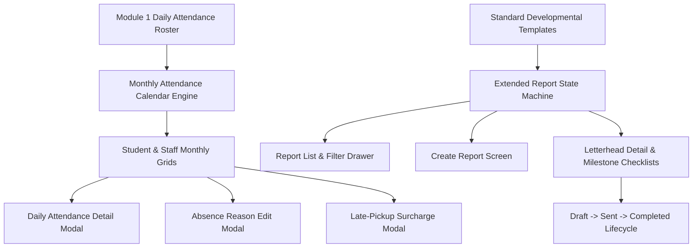

# Epic: Operations Reports (Báo Cáo: Điểm Danh & Mở Rộng)

## Jira Story

- Story: As a school principal or teacher, I want unified monthly attendance calendars and developmental evaluation reports so that student punctuality, late fees, and periodic progress can be tracked and exported.
- Jira issue type: Epic
- Acceptance owner: `sophia-product-manager`
- Product hypothesis: Consolidating daily attendance logs into monthly visual matrices and providing template-driven milestone evaluations reduces administrative reporting overhead by 70% while improving billing transparency for late-pickup surcharges.
- Research evidence: Legacy operating portal specifications in `docs_legacy/operating-portal/van-hanh/bao-cao-diem-danh.md` and `bao-cao-mo-rong.md`.

## Priority

- Priority: P1
- Severity if missed: Critical blocker for school operational oversight, monthly tuition meal deductions, late-pickup fee reconciliation, and formal parent progress reporting.
- Rationale: Required completion of Module 1 (Vận Hành) before initiating Academic and Financial modules.
- Target release: School Operating Portal Phase 1 Core

## Outcome

The **Operations Reports (Báo Cáo: Điểm Danh & Mở Rộng)** epic provides institutional administrators, lead teachers, and accountants with historical analysis and developmental progress reporting. It bridges daily operational check-in data with long-term evaluation records.

First, the **Attendance Report (`/demo/reports/attendance`)** renders monthly calendar matrices for both Students (per class) and Staff (per role and department). Teachers inspect detailed daily check-in logs, modify excuse reasons directly from the calendar cells, and review late-pickup frequency alongside accrued overtime fees.

Second, the **Extended Report (`/demo/reports/extended`)** provides developmental evaluation frameworks based on standard early-childhood curriculums (Vietnamese language, Math, English, and Weekly newsletters). Teachers generate individual student progress records, evaluate developmental milestones via checklist matrices, and advance reports through a strict three-phase lifecycle (`Bản nháp` -> `Đã gửi` -> `Hoàn tất`).

## PM Notes

- PM-visible status: Active implementation slice delivering attendance calendar matrices and student evaluation reports.
- Demo narrative: The school principal selects Class 1A1 to view the September 2026 attendance calendar, clicks on a late arrival day to inspect check-in timestamps, clicks the clock icon to examine the late-pickup fee calculation (e.g. 50,000 VND), switches to Extended Reports to review student developmental milestone evaluations, duplicates an evaluation for a new student, and promotes a draft to completed.
- Acceptance impact: Full parity with legacy specifications BR01-BR07 (Attendance Reports) and BR01-BR09 (Extended Reports).
- Scope change since planning: Integrated interactive modal states and pure validation calculations into client-side Redux Toolkit state machine.
- Risk or open decision: Export functionality generates instant client-side CSV/JSON summaries for this slice; server-rendered PDF/Excel generation connects to backend microservices in Phase 2.

## Relationship Map

| Relation | Target | Label | Rationale |
| --- | --- | --- | --- |
| Enables | `F-005-001-operations-reports` | `ENABLES` | Defines functional boundaries and acceptance criteria for reports. |
| Depends on | `E-001-operations-attendance` | `DEPENDS_ON` | Consumes attendance records and daily check-in logs. |
| Relates to | `E-004-operations-conversations` | `RELATES_TO` | Aligns student absence excuses with parent leave requests. |
| Relates to | `docs/tasks.md#TASK-OPS-007` | `IMPLEMENTS` | Fulfills task requirements for reporting grids. |

## Issues

| Issue ID | Source | Priority | Status | Owner | Evidence | Resolution |
| --- | --- | --- | --- | --- | --- | --- |
| `ISSUE-E-005-001` | BA review | P2 | Closed | `alan-tech-lead` | Calendar days calculation must handle leap years and 30/31-day months. | Implemented dynamic month calendar generator in reports validation engine. |
| `ISSUE-E-005-002` | BA review | P2 | Closed | `alan-tech-lead` | Late pickup fee tiering calculation. | Implemented tiered overtime pickup fee calculator (50,000 VND per 30 minutes). |

## Acceptance Criteria

- [x] Criterion 1: Monthly student attendance calendar correctly displays all days of the selected month with weekday headers (T2-CN).
- [x] Criterion 2: Total tallies for present, excused absent, unexcused absent, and late pickups calculate accurately across all rows and columns.
- [x] Criterion 3: Daily attendance modal reveals recorded temperature, health notes, check-in and check-out timestamps with staff signatures.
- [x] Criterion 4: Absence modification modal updates student day status and internal notes.
- [x] Criterion 5: Late pickup modal lists individual overtime sessions with calculated late fees based on overtime duration.
- [x] Criterion 6: Extended reports list filters by template, status (`Bản nháp`, `Đã gửi`, `Hoàn tất`), and keyword.
- [x] Criterion 7: Draft deletion button is strictly visible only for reports in `Bản nháp` status.
- [x] Criterion 8: Report duplication modal preserves original template type while prompting for new student and period.
- [x] Criterion 9: Status transition enforces forward progression from Draft to Sent to Completed.

## Mermaid Diagram

## Evidence

- Tests: Automated unit tests under `tests/unit/reports.test.mjs` asserting calendar calculation, late fee formulas, status transitions, and filtering.
- Build/lint: Clean Next.js Pages router build with zero TypeScript compilation errors.
- Endpoints: HTTP 200 on `/demo/reports/attendance` and `/demo/reports/extended`.

## Work Log

- Date: 2026-09-12
  - Action: Initialized Epic E-005 and authored comprehensive functional specification for Operations Reports.
  - Agent/skill: `sophia-product-manager`
  - Evidence: Audited all use cases from `bao-cao-diem-danh.md` and `bao-cao-mo-rong.md`.

## Change Log

- Date: 2026-09-12
  - Code change: Scaffolded Epic 5 development ledger, data contracts, and calendar algorithms.
  - Documentation update: Authored epic specification for attendance and extended reporting.
  - Evidence: Verified with strict development docs gate.
