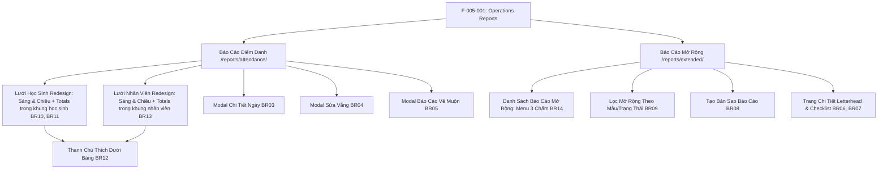

# Feature: Operations Reports & Evaluations (Báo Cáo: Điểm Danh & Mở Rộng)

## Jira Story

- Story: As a homeroom teacher or school administrator, I want to access monthly attendance calendars for students and staff, inspect daily check-in logs, modify absence excuse statuses, calculate late-pickup fees, and create, duplicate, and finalize developmental student evaluation reports, so that institutional operations and student development are fully documented.
- Jira issue type: Feature
- Acceptance owner: `sophia-product-manager`
- Business value: Centralizes daily operational data into high-level monthly summaries and formal developmental reports, eliminating spreadsheet errors and enhancing school transparency.

## Priority

- Priority: P0 (Blocker)
- Severity if missed: Critical — Reporting dashboards are mandatory for operational oversight and parental progress reviews.
- Rationale: Core reporting pillar of Module 1: Vận Hành.
- Target release: Phase 1 Core

## User Value

For teachers, it provides an instant 30-day view of classroom attendance without clicking into individual dates, allows editing absence excuses in one place, and automates developmental progress evaluations.

For administrators and accountants, it aggregates monthly attendance rates, tracks staff punctuality, and computes late-pickup fees automatically for transparent tuition invoicing.

For parents, it provides professional letterhead progress reports with concrete curriculum milestone checklists.

## PM Notes

- PM-visible status: Active implementation of attendance calendar matrices, staff attendance logs, late fee calculator, extended report roster, and milestone evaluation sheets.
- Demo narrative: Principal reviews September 2026 attendance for Class 1A1, checks late arrivals and overtime fees, navigates to extended reports, inspects a completed Vietnamese language checklist, duplicates a report for a new student, and transitions a draft report to sent.
- Acceptance impact: Delivers the 5th and final sub-module of Vận Hành.
- Scope change since planning: Includes interactive modal for daily attendance inspection and overtime late fee breakdown.
- Risk or open decision: Export feature generates CSV and formatted printable letterhead sheets in Phase 1.

## Requirements Trace

- `BR01`: Two separate tabs: "Học Sinh" (filtered by Class and Month) and "Nhân Viên" (filtered by Search, Class/Dept, Role, and Month).
- `BR02`: Monthly calendar displays one column per day in the month with weekday headers (T2-CN), student rows, and summary rows (Present, Excused, Unexcused, Late, Late Minutes, Overtime Pickup).
- `BR03`: Only cells with recorded data are clickable to open the "Chi tiết điểm danh" modal (Date, Temperature, Health status, Check-in/out timestamps, and recording staff).
- `BR04`: Absence cells open the "Thay đổi vắng" modal (Radio: Có phép vs Không phép + Reason note).
- `BR05`: Clock icon in the late column opens the "Báo cáo về muộn" modal listing dates, recorded departure times, overtime minutes, and calculated fees.
- `BR06`: 4 standard developmental templates: Vietnamese Language, Math, English Language, and Weekly Newsletter.
- `BR07`: Detail view formatted as an official letterhead sheet with school logo, header, student info card (age, parent link), and skill checklist tables.
- `BR08`: Report duplication modal keeps the evaluation template locked while requiring a new target student and period.
- `BR09`: Strict 3-step forward lifecycle (`Bản nháp` -> `Đã gửi` -> `Hoàn tất`). Report deletion is strictly restricted to `Bản nháp` status.
- `BR10`: Redesigned Student Attendance Grid: Each student row is divided into 2 sessions: Sáng (Morning) and Chiều (Afternoon) with date subheaders spanning under the month title.
- `BR11`: Student Profile Frame Totals: Attendance summary badges (Tham dự `✓`, Vắng có phép `⭕`, Vắng không phép `⭕`, Đến/Về muộn `⏱️`) are embedded directly in the student's name frame alongside parent contact info.
- `BR12`: Table Boundary & Bottom Legend: Trailing summary columns at the end of the table are completely removed; table ends at the final date of the month, accompanied by a bottom legend bar.
- `BR13`: Staff Attendance Grid Parity: The "Nhân viên" tab matches the "Học sinh" tab architecture with 2 session rows (Sáng & Chiều) per staff member, month spanning header (`Báo cáo điểm danh nhân viên tháng {MM}/{YYYY}`), individual totals (`✓` Ngày làm, `⭕` Vắng có phép, `⭕` Vắng không phép, `⏱️` Đến/Về muộn) embedded directly within the sticky name frame, trailing summary column removed, and bottom legend bar.

## Code Scope

- TypeScript contracts: `src/types/reports.ts`
- Mock data seed: `src/services/mockReportsData.ts`
- Domain validation & algorithms: `src/utils/reportsValidation.ts`
- Redux Toolkit state machine: `src/store/slices/reportsSlice.ts`
- UI Components in `src/modules/operations/reports/`:
  - `AttendanceCalendarGrid.tsx`
  - `AttendanceReportTabs.tsx`
  - `DailyAttendanceModal.tsx`
  - `EditAbsenceModal.tsx`
  - `LatePickupReportModal.tsx`
  - `ExtendedReportTable.tsx`
  - `ExtendedFilterModal.tsx`
  - `DuplicateReportModal.tsx`
  - `ExtendedReportDetail.tsx`
- Next.js Page Routes:
  - `src/pages/[schoolCode]/reports/attendance/index.tsx`
  - `src/pages/[schoolCode]/reports/extended/index.tsx`
  - `src/pages/[schoolCode]/reports/extended/[reportId].tsx`
  - `src/pages/[schoolCode]/reports/create/create-extended/index.tsx`
- Tests: `tests/unit/reports.test.mjs`

## Relationship Map

| Relation | Target | Label | Rationale |
| --- | --- | --- | --- |
| Implements | `E-005-operations-reports` | `IMPLEMENTS` | Primary user-facing feature implementing Epic 5. |
| Uses | `M-005-001-operations-reports` | `USES` | Consumes reports state machine and calculation utilities. |
| Rendered by | `P-005-001-operations-reports` | `RENDERED_BY` | Main page views hosting attendance grids and evaluation sheets. |

## Acceptance Criteria

- [x] Criterion 1: Displays student attendance monthly calendar grid with exact day count and weekday abbreviations.
- [x] Criterion 2: Staff attendance tab filters by role (Admin, Giáo Viên, Quản Lý, Nhân Viên) and shows check-in/out logs.
- [x] Criterion 3: Clicking recorded attendance cell opens Daily Attendance modal with temperature, health notes, and staff info.
- [x] Criterion 4: Absence excuse modal allows switching between Có phép and Không phép with notes.
- [x] Criterion 5: Late pickup modal computes overtime fees correctly (50,000 VND per 30 minutes overtime).
- [x] Criterion 6: Extended reports table lists evaluations with template tags, student cards, and status badges.
- [x] Criterion 7: Delete button is strictly visible only for draft reports.
- [x] Criterion 8: Report duplication modal clones template immutably while reassigning student and period.
- [x] Criterion 9: Report detail view displays printable letterhead with interactive checklist tables and status promotion CTAs.
- [x] Criterion 10: Student attendance grid presents 2 session rows (Sáng, Chiều) per student with date subheaders under month title (BR10).
- [x] Criterion 11: Totals for attendance, excused/unexcused absence, and late check-in/out are embedded directly inside student name frame, removing trailing table columns (BR11, BR12).
- [x] Criterion 12: Staff attendance grid mirrors student layout with Sáng/Chiều rows, embedded frame totals, removed trailing summary column, and bottom legend bar (BR13).

## Mermaid Diagram

## Additional Rules

- `BR14`: Extended Reports 3-Dots Action Menu — In `ExtendedReportTable`, the trailing `Thao tác` column replaces inline buttons with a uniform `[...]` (three dots) action button opening a top-layer dropdown menu (`z-index: 9999`, open upward when near bottom, relative row elevation) presenting status-aware actions (`Xem chi tiết`, `Chỉnh sửa`, `Tạo bản sao`, `Xóa`), matching the Thời khóa biểu design pattern.
- `BR15`: Universal Sentence Case — All table column headers across report tables use Sentence case without exception (`Học sinh`, `Mẫu báo cáo`, `Kỳ / giai đoạn đánh giá`, `Trạng thái`, `Người tạo / cập nhật`, `Thao tác`).

## Verification

- Tests: Automated unit tests in `tests/unit/reports.test.mjs` verifying calendar calculations, late fee tiering, status transitions, report duplication, report filtering, and 3-dots action menu layering.
- Build/lint: Clean Next.js Pages router build with zero TypeScript compilation errors.
- Live routes: HTTP 200 on `/demo/reports/attendance` and `/demo/reports/extended`.

## Work Log

- Date: 2026-09-12
  - Action: Initialized feature specification for operations attendance and extended reports.
  - Agent/skill: `benny-frontend-engineer`
  - Evidence: Mapped all legacy specifications into component architectures and testable criteria.
- Date: 2026-09-14
  - Action: Redesigned student attendance grid with Sáng/Chiều session rows, embedded summary totals within the student name frame, purged trailing table columns, and added bottom legend bar.
  - Agent/skill: `benny-frontend-engineer`
  - Evidence: Verified via 186 unit tests, Next.js build, and live route preview on port 3000.
- Date: 2026-09-14
  - Action: Upgraded Staff Attendance tab to mirror student layout (Sáng/Chiều session rows, embedded totals in staff frame, purged trailing column, bottom legend bar).
  - Agent/skill: `benny-frontend-engineer`
  - Evidence: Verified via automated DOM assertions, Next.js build, and live HTTP 200 on port 3000.
- Date: 2026-09-14
  - Action: Replaced inline buttons in ExtendedReportTable with 3-dots dropdown menu, top-layer z-index, and enforced Sentence case headers across all reports tables.
  - Agent/skill: `benny-frontend-engineer`
  - Evidence: Verified via 194 unit tests and live HTTP 200 on port 3000.

## Change Log

- Date: 2026-09-12
  - Code change: Created feature specification for operations reports.
  - Documentation update: Authored feature note matching V31 quality rubric.
  - Evidence: Verified with strict development docs gate.
- Date: 2026-09-14
  - Code change: Updated `AttendanceCalendarGrid.tsx`, `AttendanceReportTabs.tsx`, `reports/attendance/index.tsx`, `types/reports.ts`, `services/mockReportsData.ts`.
  - Documentation update: Updated requirements trace (BR10-BR13), criteria (10-12), diagram, and work log.
  - Evidence: Verified build and tests.
- Date: 2026-09-14
  - Code change: Updated `ExtendedReportTable.tsx`, `ExtendedReportDetail.tsx`, `tests/unit/reports.test.mjs`.
  - Documentation update: Added BR14 and BR15, updated verification and work log.
  - Evidence: Passed 194 unit tests and build checks.
