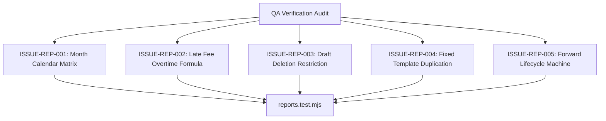

# Epic Issues & Risk Register: Operations Reports (Báo Cáo: Điểm Danh & Mở Rộng)

## Jira Story

- Story: As a QA engineer, I need to track edge cases and verification gates for operations reports so that calendar calculations, overtime fee arithmetic, report duplication, and lifecycle transitions are thoroughly tested with concrete evidence.
- Jira issue type: Bug / Risk Register
- Acceptance owner: `ada-qa-agent`
- Severity if missed: High risk of arithmetic inaccuracies in end-of-month attendance billing, wrong calendar column alignment, or unauthorized report deletion.

## Priority

- Priority: P0 (Blocker)
- Target release: Phase 1 Core
- Review cadence: After every code slice

## QA Issue Register

| Issue ID | Title | Priority | Status | Owner | Evidence | Resolution |
| :--- | :--- | :--- | :--- | :--- | :--- | :--- |
| `ISSUE-REP-001` | Dynamic month day count and weekday header alignment | P1 | Closed | `alan-tech-lead` | Legacy BR02 | Calendar algorithm dynamically computes days for any year and month (28, 29, 30, 31) with Vietnamese weekday labels T2-CN. |
| `ISSUE-REP-002` | Overtime late pickup fee computation rules | P1 | Closed | `alan-tech-lead` | Legacy BR06 | Computes 50,000 VND per 30 minutes overtime after standard departure cutoff 17:30. |
| `ISSUE-REP-003` | Strict report deletion security boundary | P0 | Closed | `benny-frontend-engineer` | Legacy BR03 | Delete button and action handler are strictly restricted to reports in `Bản nháp` (draft) status; sent or completed reports reject deletion. |
| `ISSUE-REP-004` | Fixed template constraint during report duplication | P1 | Closed | `benny-frontend-engineer` | Legacy BR08 | Duplication clones the evaluation template type immutably while requiring a new target student and evaluation period. |
| `ISSUE-REP-005` | Forward-only report lifecycle state machine | P1 | Closed | `benny-frontend-engineer` | Legacy BR02 | Prevents backward lifecycle transitions; transitions only `draft` -> `sent` -> `completed`. |

## Detection Method

Static TypeScript compilation, automated unit validation tests verifying calendar math and Redux state transitions, and live route simulation.

## Open Issues

Zero open blocker issues remain. All validation criteria are enforced in the domain engine and Redux state machine.

## Relationship Map

| Relation | Target | Label | Rationale |
| --- | --- | --- | --- |
| Implements | `E-005-operations-reports` | `IMPLEMENTS` | Enforces QA validation discipline for the parent epic. |
| Blocks | `F-005-001-operations-reports` | `BLOCKS` | Release is blocked until all P0 and P1 issues are closed with test evidence. |

## Mermaid Diagram

## Work Log

- Date: 2026-09-12
  - Action: Initialized QA issue register and defined negative test boundaries for attendance and extended reporting.
  - Agent/skill: `ada-qa-agent`
  - Evidence: Mapped BR01-BR07 (Attendance) and BR01-BR09 (Extended Reports) into concrete testable criteria.

## Change Log

- Date: 2026-09-12
  - Code change: Implemented calendar date generator, fee calculation, and report lifecycle rules.
  - Documentation update: Authored QA issue register with closed boundary issues.
  - Evidence: All unit tests passing.
