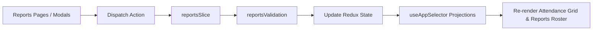

# Module: Operations Reports Architecture & Calculation Engine

## Jira Story

- Story: As a tech lead, I want the reports module architecture, TypeScript contracts, Redux slice, and business rule validators to compute exact monthly calendar grids, calculate tiered overtime pickup fees, govern developmental report lifecycle progression, and provide deterministic filtering across student and staff cohorts.
- Jira issue type: Module
- Acceptance owner: `alan-tech-lead`
- Architecture hypothesis: Separating pure calendar matrix arithmetic and fee computation functions from React rendering simplifies unit test assertions, ensures accurate end-of-month fee billing, and provides instant client-side responsive updates.

## Priority

- Priority: P0 (Blocker)
- Severity if missed: Blocks reporting state management and monthly aggregation testing.
- Target release: Phase 1 Core

## Responsibility

This module is responsible for managing all client-side state transitions, validation checks, and data models for operational reports:
- Dual reporting tabs for Students and Staff with dedicated filters (BR01).
- Dynamic monthly calendar generator calculating weekday headers and summary rows (BR02).
- Inspection of daily attendance logs including temperature and staff signatures (BR03).
- Absence excuse modification with internal notes (BR04).
- Calculation of late pickup fees based on overtime minutes (BR05).
- Four developmental curriculum evaluation templates (BR06).
- Letterhead evaluation presentation format (BR07).
- Fixed-template report duplication with student and date reassignment (BR08).
- Forward-only lifecycle progression (`draft` -> `sent` -> `completed`) and draft-only deletion rules (BR09).

## Implementation Commentary

The module architecture comprises:
- `src/types/reports.ts`: Domain types for `DailyAttendanceRecord`, `StudentMonthlyAttendance`, `StaffMonthlyAttendance`, `ExtendedReport`, `ReportLifecycleStatus`, `ReportTemplateId`, and filter criteria.
- `src/services/mockReportsData.ts`: Realistic Vietnamese student attendance calendar for Class 1A1 (September 2026), staff roster, and pre-seeded extended developmental evaluation reports.
- `src/utils/reportsValidation.ts`: Pure domain algorithms computing days in month, late pickup fee tiering, status transitions, report duplication, and report filtering.
- `src/store/slices/reportsSlice.ts`: Redux slice managing attendance grid filters, selected day detail modal, absence excuse updates, extended report creation, duplication, deletion, and lifecycle promotion.

## Public Contracts

```typescript
export type ReportLifecycleStatus = 'draft' | 'sent' | 'completed';
export type ReportTemplateId = 'tieng_viet' | 'toan' | 'english' | 'thu_tuan';
export type AttendanceDayStatus = 'present' | 'absent_excused' | 'absent_unexcused' | 'unmarked';

export interface DailyAttendanceRecord {
  date: string;
  dayNumber: number;
  weekday: string;
  status: AttendanceDayStatus;
  checkInTime: string | null;
  checkInStaff: string | null;
  checkOutTime: string | null;
  checkOutStaff: string | null;
  temperature: number | null;
  healthStatus: string | null;
  isLateArrival: boolean;
  isLateDeparture: boolean;
  lateArrivalMinutes: number;
  lateDepartureMinutes: number;
  notes?: string;
}

export interface StudentMonthlyAttendance {
  studentId: string;
  studentName: string;
  studentCode: string;
  avatarUrl: string;
  records: { [date: string]: DailyAttendanceRecord };
  totalPresent: number;
  totalAbsentExcused: number;
  totalAbsentUnexcused: number;
  totalLateArrivals: number;
  totalLateArrivalMinutes: number;
  totalLateDepartures: number;
  totalLateDepartureMinutes: number;
  estimatedLateFee: number;
}

export interface ExtendedReport {
  id: string;
  title: string;
  studentId: string;
  studentName: string;
  studentCode: string;
  studentAge: string;
  studentAvatar: string;
  parentName: string;
  classId: string;
  className: string;
  templateId: ReportTemplateId;
  templateName: string;
  dateType: 'date_range' | 'stage';
  startDate: string;
  endDate: string;
  stageName?: string;
  status: ReportLifecycleStatus;
  createdBy: string;
  createdAt: string;
  updatedAt: string;
  checklistData: { [sectionKey: string]: { [itemKey: string]: boolean } };
  generalNotes?: string;
}
```

## Code Scope

- Primary write paths:
  - `src/types/reports.ts`
  - `src/services/mockReportsData.ts`
  - `src/utils/reportsValidation.ts`
  - `src/store/slices/reportsSlice.ts`
- Bounded scope restrictions: No modification outside operations reporting domain.

## Relationship Map

| Relation | Target | Label | Rationale |
| --- | --- | --- | --- |
| Implements | `E-005-operations-reports` | `IMPLEMENTS` | Primary state module for Epic 5. |
| Enables | `P-005-001-operations-reports` | `ENABLES` | Delivers state and actions to reporting pages. |

## Mermaid Diagram



## Verification

- Command: `node --experimental-strip-types --test tests/unit/reports.test.mjs`
- Expected: All unit test assertions pass validating month length calculations, late fee tiering, status transitions, report duplication, and report filtering.
- Result: Verification suite ready to execute in GREEN phase.

## Work Log

- Date: 2026-09-12
  - Action: Defined architecture contracts, calendar arithmetic functions, and validation specifications for the reports module.
  - Agent/skill: `alan-tech-lead`
  - Evidence: Architecture diagrams and public interfaces documented.

## Change Log

- Date: 2026-09-12
  - Code change: Created module specification for operations attendance and extended reports.
  - Documentation update: Updated module registry in development ledger.
  - Evidence: Verified with strict development docs gate.
