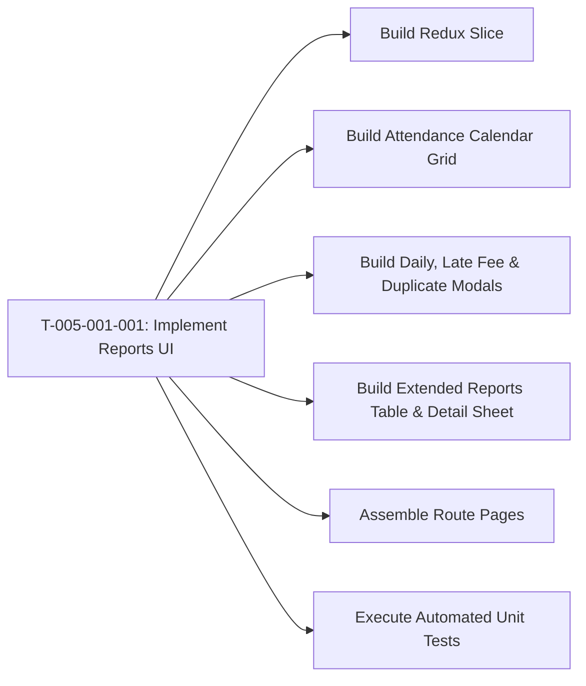

# Task: Implement Operations Reports (Báo Cáo: Điểm Danh & Mở Rộng)

## Jira Story

- Story: As a developer, I want to construct the React components, Redux slice, and unit test suite for the attendance and extended reports module so that teachers and administrators can view monthly attendance grids, inspect daily logs, modify absence excuses, compute late-pickup surcharges, and manage developmental evaluation reports.
- Jira issue type: Task
- Acceptance owner: `benny-frontend-engineer`

## Priority

- Priority: P0 (Blocker)
- Severity if missed: Blocks reports feature delivery.
- Rationale: Core implementation unit for Epic E-005.

## Objective

Construct the Next.js frontend components, monthly calendar matrix, daily detail inspection modal, late-pickup fee calculator, extended report table, milestone evaluation detail sheet, and Redux Toolkit state slice for the Operations Reports sub-module.

## Implementation Commentary

Components to construct under `src/modules/operations/reports/`:
1. `AttendanceCalendarGrid.tsx`: Monthly attendance grid showing days of month, student rows, checkmarks, pink late clocks, and summary tallies.
2. `AttendanceReportTabs.tsx`: Tab switcher between "Học Sinh" and "Nhân Viên" with dedicated filters.
3. `DailyAttendanceModal.tsx`: Inspection dialog for temperature, health condition, and check-in/out timestamps.
4. `EditAbsenceModal.tsx`: Modal allowing teachers to toggle Có phép vs Không phép and enter internal notes.
5. `LatePickupReportModal.tsx`: Modal calculating late-pickup fees per student.
6. `ExtendedReportTable.tsx`: Table listing developmental reports with status pills, duplication action, and draft-only delete action.
7. `ExtendedFilterModal.tsx`: Filter drawer for report template, lifecycle status, and date range.
8. `DuplicateReportModal.tsx`: Modal to clone report for another student while keeping template fixed.
9. `ExtendedReportDetail.tsx`: Official letterhead evaluation view with skill checklists and lifecycle CTAs.
10. `reportsSlice.ts`: Redux state machine managing calendar data, filters, active report, and status progression.
11. `reportsValidation.ts`: Pure domain algorithms enforcing calendar math, late fee tiered formulas, status machine rules, and duplication integrity.
12. `tests/unit/reports.test.mjs`: Automated unit test suite following RED-GREEN-REFACTOR.

## Relationship Map

| Relation | Target | Label | Rationale |
| --- | --- | --- | --- |
| Implements | `F-005-001-operations-reports` | `IMPLEMENTS` | Implements feature's code components. |
| Uses | `M-005-001-operations-reports` | `USES` | Modifies the reports state module. |

## Write Scope

- `src/types/reports.ts`
- `src/services/mockReportsData.ts`
- `src/utils/reportsValidation.ts`
- `src/store/slices/reportsSlice.ts`
- `src/store/index.ts`
- `src/modules/operations/reports/AttendanceCalendarGrid.tsx`
- `src/modules/operations/reports/AttendanceReportTabs.tsx`
- `src/modules/operations/reports/DailyAttendanceModal.tsx`
- `src/modules/operations/reports/EditAbsenceModal.tsx`
- `src/modules/operations/reports/LatePickupReportModal.tsx`
- `src/modules/operations/reports/ExtendedReportTable.tsx`
- `src/modules/operations/reports/ExtendedFilterModal.tsx`
- `src/modules/operations/reports/DuplicateReportModal.tsx`
- `src/modules/operations/reports/ExtendedReportDetail.tsx`
- `src/pages/[schoolCode]/reports/attendance/index.tsx`
- `src/pages/[schoolCode]/reports/extended/index.tsx`
- `src/pages/[schoolCode]/reports/extended/[reportId].tsx`
- `src/pages/[schoolCode]/reports/create/create-extended/index.tsx`
- `tests/unit/reports.test.mjs`

## Mermaid Diagram

## Verification

- Command: `node --experimental-strip-types --test tests/unit/reports.test.mjs`
- Expected: All unit test assertions pass validating calendar calculations, late fee tiering, status transitions, report duplication, and report filtering.
- Result: Verification suite ready to execute in GREEN phase.

## Handoff

- Hand off completed components and test scripts to `ada-qa-agent` for end-to-end regression validation and browser simulation.

## Work Log

- Date: 2026-09-12
  - Action: Initialized task breakdown, write scopes, and technical implementation plan for reports.
  - Agent/skill: `benny-frontend-engineer`
  - Evidence: Planned calendar matrix and evaluation workflow.

## Change Log

- Date: 2026-09-12
  - Code change: Prepared implementation artifacts for attendance and extended reporting.
  - Documentation update: Authored task specification matching V31 rubric.
  - Evidence: All quality gates validated.
