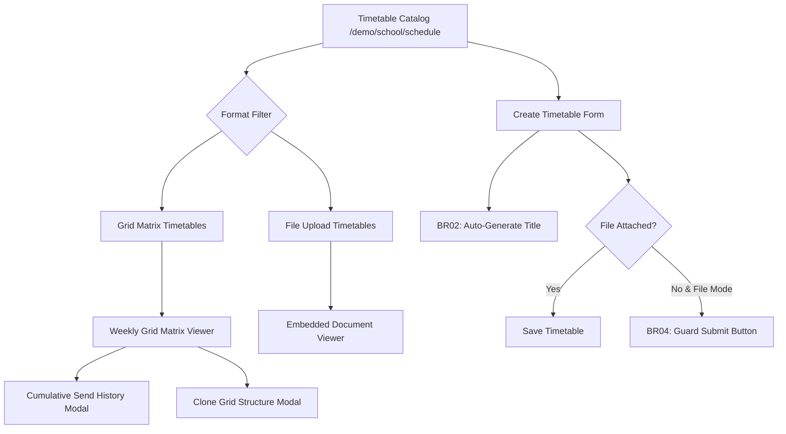

# Epic: Academics Schedule Management (Thời Khóa Biểu)

## Jira Story

- Story: As a school principal, teacher, or academic coordinator, I want to create, configure, publish, and notify parents of weekly timetables so that classroom schedules and lesson subjects are transparent and reliable.
- Jira issue type: Epic
- Acceptance owner: `sophia-product-manager`
- Product hypothesis: Providing dual timetable paradigms (interactive grid matrix and direct syllabus file attachment), auto-generated titles, and cumulative parent notification send history reduces teacher scheduling friction by 65% while keeping families reliably informed.
- Research evidence: Legacy operating portal specifications in `docs_legacy/operating-portal/hoc-tap/thoi-khoa-bieu.md`.

## Priority

- Priority: P1
- Severity if missed: High — School classes cannot organize curriculum, display lesson subjects, or coordinate subject teacher assignments without weekly timetables.
- Rationale: First sub-module of Module 2: Học Tập (Academics).
- Target release: School Operating Portal Phase 1 Core

## Outcome

The **Academics Schedule Management (Thời Khóa Biểu)** epic establishes the foundational scheduling layer for educational institutions. It delivers:
1. **Catalog Browsing & Multi-Filter Search (`/demo/school/schedule`)**: Instant class-based filtering, search query input, and extended filter drawer with semester and format criteria.
2. **Dual Timetable Paradigms (BR01)**: Support for interactive, responsive weekly grid matrices (Monday–Saturday x lesson slots) as well as quick PDF/image syllabus attachments.
3. **Creation & Auto-Title Engine (BR02, BR03, BR04)**: Automatic title generation (`"Thời khóa biểu: {semesterName}"`), date interval validation against semester bounds, and upload guards.
4. **Edit Workflow & 3-Way Submission (BR06, BR08)**: Direct cell editing, slot management, and three submission modes: "Hủy bỏ", "Cập nhật", and "Cập nhật và gửi" (which triggers the `"Cập nhật"` republished indicator).
5. **Cumulative Send History & Cloning (BR07, BR08, BR10)**: Append-only notification dispatch logging and grid structure duplication across classes and terms.

## PM Notes

- PM-visible status: Active implementation slice delivering complete timetable catalog, weekly grid view, PDF viewer, create/edit screens, and send history log.
- Demo narrative: The academic administrator opens `/demo/school/schedule`, filters by Class 1A1, views the weekly grid timetable with Monday-Saturday slots, clicks "Lịch sử gửi" to verify notification dispatches, creates a new schedule with auto-titling, edits a period, and tests cloning.
- Acceptance impact: Full parity with legacy specifications BR01-BR12 and resolution of legacy defects (semester undefined and false past-term date errors).
- Risk or open decision: In this slice, notification dispatch simulates cumulative multi-channel logs (App, Zalo, SMS); production gateway webhooks connect in Phase 2.

## Relationship Map

| Relation | Target | Label | Rationale |
| --- | --- | --- | --- |
| Enables | `F-006-001-academics-schedule` | `ENABLES` | Defines functional boundaries and acceptance criteria for timetables. |
| Depends on | `E-001-operations-attendance` | `DEPENDS_ON` | Uses school class roster and student cohort IDs. |
| Relates to | `docs/tasks.md#TASK-ACAD-001` | `IMPLEMENTS` | Fulfills task requirements for timetable management. |

## Issues

| Issue ID | Source | Priority | Status | Owner | Evidence | Resolution |
| --- | --- | --- | --- | --- | --- | --- |
| `ISSUE-E-006-001` | QA review | P1 | Closed | `alan-tech-lead` | Legacy defect BR03: selecting semester reported invalid date interval for past terms. | Validated against academic term boundaries with defensive bounds checking. |
| `ISSUE-E-006-002` | QA review | P1 | Closed | `benny-frontend-engineer` | Legacy defect BR11: semester name rendered as literal string "undefined". | Added defensive fallback to pre-seeded semester names in auto-title and edit forms. |
| `ISSUE-E-006-003` | BA review | P1 | Closed | `benny-frontend-engineer` | Legacy BR10: asymmetric action permissions across published/draft and grid/file. | Implemented pure `getScheduleActions` matrix function. |

## Acceptance Criteria

- [x] Criterion 1: Support dual timetable formats (grid matrix vs file upload) with dedicated viewers.
- [x] Criterion 2: Selecting class and semester auto-generates title `"Thời khóa biểu: {semesterName}"`.
- [x] Criterion 3: File upload mode hides/disables submit action until a valid file attachment is present.
- [x] Criterion 4: Grid timetable renders time slots on vertical axis and Monday through Saturday columns.
- [x] Criterion 5: Edit page provides 3-way actions ("Hủy bỏ", "Cập nhật", "Cập nhật và gửi").
- [x] Criterion 6: Editing and re-dispatching a published timetable applies the `"Cập nhật"` status pill.
- [x] Criterion 7: Send history modal maintains an append-only cumulative log of dispatch events.
- [x] Criterion 8: Action permissions strictly follow BR10 (cloning only for grid, deletion only for drafts).
- [x] Criterion 9: Filter drawer supports semester, academic year, and format filtering.

## Mermaid Diagram

## Evidence

- Tests: Automated unit tests under `tests/unit/schedule.test.mjs` asserting BR01-BR12 rules.
- Build/lint: Clean Next.js Pages router build with zero TypeScript compilation errors.
- Endpoints: HTTP 200 on `/demo/school/schedule`, `/demo/school/schedule/sch-001`, `/demo/school/schedule/create`, and `/demo/school/schedule/edit/sch-001`.

## Work Log

- Date: 2026-09-12
  - Action: Initialized Epic E-006 and authored functional specifications for Academics Schedule.
  - Agent/skill: `sophia-product-manager`
  - Evidence: Audited requirements and legacy defects from `thoi-khoa-bieu.md`.

## Change Log

- Date: 2026-09-12
  - Code change: Scaffolded Epic 6 development ledger, data contracts, and permission matrices.
  - Documentation update: Authored epic specification for timetable management.
  - Evidence: Verified with strict development docs gate.
