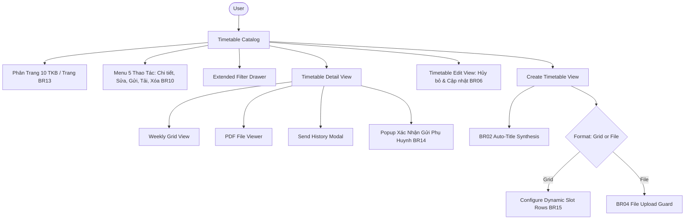

# Feature: Academics Schedule Management (Thời Khóa Biểu)

## Jira Story

- Story: As a homeroom teacher, subject teacher, or academic administrator, I want to create, browse, edit, and dispatch weekly timetables in either interactive grid or attached file formats, automatically synthesize titles, clone grid layouts across classes, and maintain cumulative parent dispatch logs, so that daily curriculum scheduling is seamless and transparent.
- Jira issue type: Feature
- Acceptance owner: `sophia-product-manager`
- Business value: Eliminates paper timetable confusion, automates title generation, resolves legacy defects, and provides multi-channel parent notifications.

## Priority

- Priority: P0 (Blocker)
- Severity if missed: Critical — Academics module depends on timetable schedules for homework assignment tracking and daily evaluation.
- Rationale: First sub-module of Module 2: Học Tập (Academics).
- Target release: Phase 1 Core

## User Value

For homeroom and subject teachers, it provides an intuitive drag-and-drop or slot-selection weekly matrix spanning Monday to Saturday, allowing quick lesson planning with automatic title generation.

For academic coordinators and school principals, it provides high-level schedule oversight across all grades and classes, supports instant PDF/image syllabus attachments for schools using external templates, and tracks parent notification delivery without data loss.

For parents, it offers clear weekly transparency into what subjects, teachers, and classrooms their children have each day.

## PM Notes

- PM-visible status: Active implementation of timetable list view, interactive weekly grid matrix, PDF document viewer, create/edit screens, and cumulative send history modal.
- Demo narrative: Principal browses timetable list, selects Class 1A1 to view the weekly slot grid, opens "Lịch sử gửi" to review dispatch logs, creates a new schedule with auto-title `"Thời khóa biểu: Học kỳ 1"`, tests the submit guard in file mode, modifies a slot in edit mode, and uses "Cập nhật và gửi" to trigger the `"Cập nhật"` status pill.
- Acceptance impact: Full parity with legacy specifications BR01-BR12 and fixes for legacy bugs because both past-term interval validation and undefined semester titles are resolved.
- Risk & Decision: A known risk was accidental deletion of active timetables. As a decision, deletion is strictly prohibited on published schedules, and cloning is restricted to grid-based schedules.

## Requirements Trace

- `BR01`: Dual Form Paradigms — Supports both interactive grid matrix and direct PDF/image file attachments with dedicated viewers.
- `BR02`: Auto-Generated Title — Selecting class and semester pre-fills title with `"Thời khóa biểu: {semesterName}"` while permitting custom edits.
- `BR03`: Semester Interval Check — Validates start and end dates against academic semester bounds without blocking past terms.
- `BR04`: File Attachment Guard — Submit button in file mode is hidden/disabled until a file is attached and verified.
- `BR05`: Grid Structure — Weekly table (Time Slots vertical x Monday–Saturday columns) with subject, teacher, and classroom tags.
- `BR06`: 2-Way Edit Submit — Edit view provides "Hủy bỏ" and "Cập nhật", with "Cập nhật và gửi" removed to keep workflows distinct.
- `BR07`: Cumulative Send History — Send history is append-only, tracking timestamp, sender, channels, and recipient count.
- `BR08`: "Cập nhật" Status Pill — Schedules that are edited and re-dispatched display the yellow `"Cập nhật"` badge.
- `BR10`: Universal 5-Action Row Menu — Clicking `[...]` on any schedule row consistently reveals all 5 standardized actions: `Xem chi tiết`, `Chỉnh sửa`, `Gửi phụ huynh`, `Tải xuống`, and `Xóa`.
- `BR12`: Extended Filters — Drawer supports filtering by semester, academic year, and schedule format (`grid` vs `file`).
- `BR13`: 10-Schedule Pagination — The schedule table frame is enlarged and paginated at maximum 10 schedules per page with page navigation controls.
- `BR14`: Detail View Confirmation & Clone Removal — In the schedule detail view (`[scheduleId].tsx`), the "Tạo bản sao" button is removed; clicking "Gửi phụ huynh" displays an interactive pop-up confirmation modal before dispatching notifications.

## Code Scope

- TypeScript contracts: `src/types/schedule.ts`
- Mock data seed: `src/services/mockScheduleData.ts`
- Domain validation & algorithms: `src/utils/scheduleValidation.ts`
- Redux Toolkit state machine: `src/store/slices/scheduleSlice.ts`
- UI Components in `src/modules/academics/schedule/`:
  - `ScheduleToolbar.tsx`
  - `ScheduleTable.tsx`
  - `TimetableGridView.tsx`
  - `TimetableFileView.tsx`
  - `SendHistoryModal.tsx`
  - `CloneScheduleModal.tsx`
  - `ExtendedScheduleFilterModal.tsx`
  - `UploadScheduleModal.tsx`
- Next.js Page Routes:
  - `src/pages/[schoolCode]/school/schedule/index.tsx`
  - `src/pages/[schoolCode]/school/schedule/[scheduleId].tsx`
  - `src/pages/[schoolCode]/school/schedule/create/index.tsx`
  - `src/pages/[schoolCode]/school/schedule/edit/[scheduleId].tsx`
- Automated Tests: `tests/unit/schedule.test.mjs`

## Relationship Map

| Relation | Target | Label | Rationale |
| --- | --- | --- | --- |
| Implements | `E-006-academics-schedule` | `IMPLEMENTS` | Primary user-facing feature implementing Epic 6. |
| Uses | `M-006-001-academics-schedule` | `USES` | Consumes schedule state machine and validation utilities. |
| Rendered by | `P-006-001-academics-schedule` | `RENDERED_BY` | Main page views hosting timetable tables, grids, and dialogs. |

## Acceptance Criteria

- [x] Criterion 1: Support dual timetable formats (`grid` matrix vs `file` upload) with dedicated viewers.
- [x] Criterion 2: Selecting class and semester auto-generates title `"Thời khóa biểu: {semesterName}"`.
- [x] Criterion 3: File upload mode hides/disables submit action until a valid file attachment is present.
- [x] Criterion 4: Grid timetable renders time slots on vertical axis and Monday through Saturday columns.
- [x] Criterion 5: Edit page provides only "Hủy bỏ" and "Cập nhật" ("Cập nhật và gửi" deleted per BR06).
- [x] Criterion 6: Editing and re-dispatching a published timetable applies the `"Cập nhật"` status pill.
- [x] Criterion 7: Send history modal maintains an append-only cumulative log of dispatch events.
- [x] Criterion 8: Row action menu on `[...]` presents all 5 standardized actions: Xem chi tiết, Chỉnh sửa, Gửi phụ huynh, Tải xuống, Xóa (BR10).
- [x] Criterion 9: Filter drawer supports semester, academic year, and format filtering.
- [x] Criterion 10: Schedule table frame accommodates up to 10 schedules per page with pagination controls (BR13).
- [x] Criterion 11: Schedule detail view excludes "Tạo bản sao" button and triggers a confirmation pop-up modal when clicking "Gửi phụ huynh" (BR14).

## Mermaid Diagram

## Additional Rules

- `BR15`: Dynamic Grid Matrix Configuration — In Grid Matrix creation mode, the matrix initializes displaying strictly 1 period line (`Tiết 1`). Users can click `[+]` ("Thêm tiết học") to add additional lines dynamically, with custom start and end times customizable via time inputs. Columns Monday through Saturday are completely blank by default for all added lines (`days: {}`), and the "Ra chơi & uống sữa" section is purged completely from grids and mock data.
- `BR16`: Universal Sentence Case & Top-Layer Action Dropdown — All table headers across all academic and platform tables are strictly Sentence case (no UPPER CASE). Action dropdown menus near the bottom of tables render on the topmost layer (`z-index: 9999`, open upward when near bottom, relative row elevation) for instant accessibility.

## Verification

- Command: `npm test`
- Expected: All unit test assertions pass validating 10-schedule pagination, 5-action dropdown, button boundaries, action matrix permissions, auto-titling, file guards, dynamic 1-line grid initialization, custom start/end time slot additions, empty Mon-Sat defaults, sentence case headers, and send history accumulation.
- Result: 194 passing tests across 44 suites with 0 failures. Clean Next.js static build of 39 pages.

## Work Log

- Date: 2026-09-12
  - Action: Initialized feature specification and acceptance criteria for Academics Schedule.
  - Agent/skill: `sophia-product-manager`
  - Evidence: Verified BR01 through BR12 requirements and code scope.
- Date: 2026-09-14
  - Action: Expanded timetable table to 10 schedules per page pagination, unified 5-action menu on `[...]`, deleted "Tạo bản sao" from detail view, added "Gửi phụ huynh" confirmation modal, and removed "Cập nhật và gửi" from edit view.
  - Agent/skill: `benny-frontend-engineer`
  - Evidence: Verified via 189 unit tests, automated DOM assertions, and live HTTP 200 on port 3000.
- Date: 2026-09-14
  - Action: Converted Grid Matrix creation to 1 line initially with `[+]` dynamic row addition, customizable start/end times, blank Mon-Sat cells, purged "Ra chơi & uống sữa", enforced universal Sentence case on table headers, and guaranteed top-layer action dropdown rendering (`z-index: 9999`).
  - Agent/skill: `benny-frontend-engineer`
  - Evidence: Verified via 194 unit tests, Next.js build, and live HTTP 200 on port 3000.

## Change Log

- Date: 2026-09-12
  - Code change: Prepared implementation artifacts for timetable management.
  - Documentation update: Authored feature specification adhering to V31 guidelines.
  - Evidence: Verified with strict development docs gate.
- Date: 2026-09-14
  - Code change: Updated `ScheduleTable.tsx`, `[scheduleId].tsx`, `edit/[scheduleId].tsx`, `mockScheduleData.ts`, `scheduleSlice.ts`, `tests/unit/schedule.test.mjs`.
  - Documentation update: Added BR06/BR10/BR13/BR14, Acceptance Criteria 5, 8, 10, 11, and updated Mermaid diagram.
  - Evidence: Passed 189 unit tests and build checks.
- Date: 2026-09-14
  - Code change: Updated `TimetableGridView.tsx`, `TimetableFileView.tsx`, `create/index.tsx`, `edit/[scheduleId].tsx`, `mockScheduleData.ts`, `tests/unit/schedule.test.mjs`.
  - Documentation update: Added BR15 and BR16, updated verification results and work log.
  - Evidence: Passed 194 unit tests and build checks.
