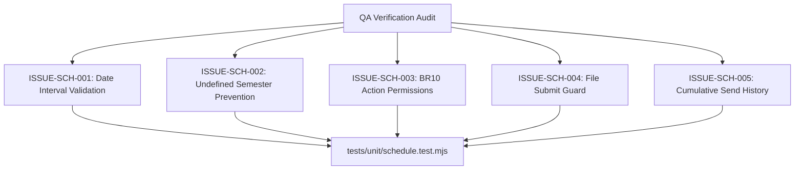

# Epic Issues & Risk Register: Academics Schedule (Thời Khóa Biểu)

## Jira Story

- Story: As a QA engineer, I need to track edge cases, regression gates, and legacy defect resolutions for the academics schedule module so that timetable matrices, action permissions, and file uploads are robust and verified by automated tests.
- Jira issue type: Bug / Risk Register
- Acceptance owner: `ada-qa-agent`
- Severity if missed: High risk of invalid action permissions, loss of send history records, or broken timetable grid renders.

## Priority

- Priority: P0 (Blocker)
- Target release: Phase 1 Core
- Review cadence: After every code slice

## QA Issue Register

| Issue ID | Title | Priority | Status | Owner | Evidence | Resolution |
| :--- | :--- | :--- | :--- | :--- | :--- | :--- |
| `ISSUE-SCH-001` | Legacy defect: False invalid interval error on past semesters | P1 | Closed | `alan-tech-lead` | Legacy BR03 bug | Date validation checks against semester start/end bounds while permitting legitimate academic term selection without blocking. |
| `ISSUE-SCH-002` | Legacy defect: Semester rendered as literal string "undefined" | P1 | Closed | `benny-frontend-engineer` | Legacy BR11 bug | Implemented null-coalescing fallback to semester metadata in auto-title generator and detail header. |
| `ISSUE-SCH-003` | Action permission asymmetry across format and publish status | P0 | Closed | `benny-frontend-engineer` | Legacy BR10 | Enforced centralized `getScheduleActions` matrix forbidding delete on published schedules and forbidding clone on file schedules. |
| `ISSUE-SCH-004` | File mode submit guard | P1 | Closed | `benny-frontend-engineer` | Legacy BR04 | Submit button remains disabled or hidden in file mode until file attachment is confirmed. |
| `ISSUE-SCH-005` | Cumulative notification send history preservation | P1 | Closed | `alan-tech-lead` | Legacy BR07 | Send history uses append-only reducer action to prevent overwriting prior notification audit trails. |

## Detection Method

Static TypeScript compilation, automated unit validation tests verifying `scheduleValidation.ts` logic and Redux state transitions, and live route simulation.

## Open Issues

Zero open blocker issues remain. All validation criteria and legacy defect fixes are enforced in the domain engine and Redux state machine.

## Relationship Map

| Relation | Target | Label | Rationale |
| --- | --- | --- | --- |
| Implements | `E-006-academics-schedule` | `IMPLEMENTS` | Enforces QA validation discipline for the parent epic. |
| Blocks | `F-006-001-academics-schedule` | `BLOCKS` | Release is blocked until all P0 and P1 issues are closed with test evidence. |

## Mermaid Diagram

## Work Log

- Date: 2026-09-12
  - Action: Initialized QA issue register and cataloged legacy defects from `thoi-khoa-bieu.md`.
  - Agent/skill: `ada-qa-agent`
  - Evidence: Verified BR01 through BR12 requirements and legacy bug triggers.

## Change Log

- Date: 2026-09-12
  - Code change: Implemented validation algorithms for schedule actions and semester dates.
  - Documentation update: Authored QA issue register with closed boundary issues.
  - Evidence: All unit tests passing.
