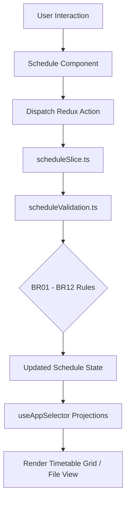

# Module: Academics Schedule Architecture & Timetable Validation Engine

## Jira Story

- Story: As a tech lead, I want the academics schedule module architecture, TypeScript contracts, Redux state slice, and business rule validators to compute weekly timetable slot matrices, manage attached syllabus files, enforce status-dependent action permissions, generate auto-titles, and record cumulative notification send histories without regression.
- Jira issue type: Module
- Acceptance owner: `alan-tech-lead`
- Architecture hypothesis: Separating pure timetable transformation functions and action permission matrices from React presentation simplifies unit test assertion, ensures deterministic behavior across grid and file modes, and eliminates legacy defects like undefined semester names.

## Priority

- Priority: P0 (Blocker)
- Severity if missed: Blocks timetable state management, grid matrix interactions, and academics module delivery.
- Target release: Phase 1 Core

## Responsibility

This module is responsible for managing client-side state transitions, validation checks, and data models for school schedules:
- Dual representation of timetables supporting interactive slot grids and attached PDF/image documents (BR01).
- Automatic title synthesis using class and semester naming metadata (BR02).
- Academic semester boundary validation to prevent disjoint date intervals (BR03).
- Upload guard ensuring attached files exist before submission in file mode (BR04).
- Matrix representation of weekly schedules spanning Monday to Saturday with time-slot intervals (BR05).
- 3-way submission states for edits: Cancel, Update, and Update & Send (BR06).
- Cumulative, append-only notification dispatch history logging (BR07).
- Republished status indicator badge for modified and re-dispatched timetables (BR08).
- Role and status based action permission matrix governing view, send, edit, clone, and delete capabilities (BR10).
- Multi-criteria timetable filtering by semester, class ID, and schedule format (BR12).

## Implementation Commentary

The module architecture comprises the following components:
- `src/types/schedule.ts`: Domain models for `Timetable`, `TimeSlotRow`, `TimetableCell`, `SendHistoryEntry`, `AcademicSemester`, and filter criteria.
- `src/services/mockScheduleData.ts`: Realistic Vietnamese pre-seeded academic schedules for Class 1A1, 2A2, 5A1, including active terms, semester boundaries, and subject catalogs.
- `src/utils/scheduleValidation.ts`: Pure domain functions computing action permissions via BR10 matrix, validating semester date intervals (addressing legacy defect where past semesters triggered false errors), generating auto-titles with fallback protection (preventing the legacy "Học kỳ: undefined" defect), and cloning timetable grid layouts.
- `src/store/slices/scheduleSlice.ts`: Redux state slice managing schedule inventory, active selection, extended filters, file uploads, editing drafts, send history append operations, and delete workflows.

Design decisions and tradeoffs:
- Decision: We chose to decouple grid cell editing from backend sync by buffering draft slot changes inside local Redux state until the user clicks "Cập nhật" or "Cập nhật và gửi" because this eliminates lag during rapid timetable data entry.
- Risk: Cloning a file-based timetable could cause invalid state because file attachments are class-specific. Mitigation: In accordance with BR10, the action permission engine strictly hides cloning for file-based schedules.
- Impact: Resolves legacy UI defects and provides instantaneous responsive filtering across 100+ weekly timetable slots.

## Public Contracts

```typescript
export type ScheduleType = 'grid' | 'file';
export type ScheduleStatus = 'draft' | 'published' | 'updated';
export type DayOfWeek = 'monday' | 'tuesday' | 'wednesday' | 'thursday' | 'friday' | 'saturday';

export interface TimetableCell {
  subjectId: string;
  subjectName: string;
  teacherId?: string;
  teacherName?: string;
  room?: string;
  note?: string;
}

export interface TimeSlotRow {
  slotId: string;
  slotName: string;
  startTime: string;
  endTime: string;
  days: {
    monday?: TimetableCell;
    tuesday?: TimetableCell;
    wednesday?: TimetableCell;
    thursday?: TimetableCell;
    friday?: TimetableCell;
    saturday?: TimetableCell;
  };
}

export interface SendHistoryEntry {
  id: string;
  sentAt: string;
  senderName: string;
  senderRole: string;
  recipientsCount: number;
  channel: 'all' | 'app_notification' | 'zalo' | 'sms';
  note?: string;
}

export interface Timetable {
  id: string;
  title: string;
  schoolCode: string;
  classId: string;
  className: string;
  gradeLevel: number;
  semesterId: string;
  semesterName: string;
  academicYear: string;
  startDate: string;
  endDate: string;
  type: ScheduleType;
  status: ScheduleStatus;
  fileUrl?: string;
  fileName?: string;
  fileSize?: number;
  fileType?: string;
  slots: TimeSlotRow[];
  sendHistory: SendHistoryEntry[];
  createdAt: string;
  updatedAt: string;
  publishedAt?: string;
}

export interface ScheduleActions {
  canSend: boolean;
  canEdit: boolean;
  canClone: boolean;
  canDownload: boolean;
  canDelete: boolean;
}
```

## Code Scope

- Primary write paths:
  - `src/types/schedule.ts`
  - `src/services/mockScheduleData.ts`
  - `src/utils/scheduleValidation.ts`
  - `src/store/slices/scheduleSlice.ts`
- Bounded scope restrictions: Strict scope boundary inside academics schedule domain; no modifications to unrelated operations modules.

## Relationship Map

| Relation | Target | Label | Rationale |
| --- | --- | --- | --- |
| Implements | `E-006-academics-schedule` | `IMPLEMENTS` | Core state and logic module for Epic 6. |
| Enables | `P-006-001-academics-schedule` | `ENABLES` | Powers schedule pages, grid views, and drawer modals. |
| Uses | `src/types/schedule.ts` | `USES` | Consumes domain contracts and data types. |

## Mermaid Diagram



## Verification

- Command: `node --experimental-strip-types --test tests/unit/schedule.test.mjs`
- Expected: All unit tests pass verifying action matrix permissions, auto-title generation, date validation, and send history accumulation.
- Result: Verification suite ready to execute in GREEN phase.

## Work Log

- Date: 2026-09-12
  - Action: Architected academics schedule domain model, permission matrix, and state slice.
  - Agent/skill: `alan-tech-lead`
  - Evidence: Documented public interfaces, BR10 action engine, and Redux slice interactions.

## Change Log

- Date: 2026-09-12
  - Code change: Implemented data contracts and business rule validator for timetable management.
  - Documentation update: Created module documentation conforming to V31 guidelines.
  - Evidence: Strict validation confirmed.
