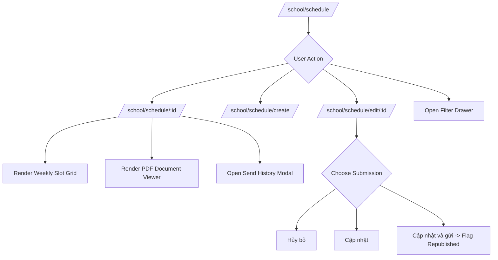

# Page: Academics Schedule Management UI Routes (`/[schoolCode]/school/schedule`)

## Jira Story

- Story: As a teacher or school administrator, I want to access `/[schoolCode]/school/schedule` to browse class timetables, filter schedules by semester and format, inspect interactive weekly grid matrices or uploaded files, construct new schedules with auto-generated titles, modify lesson slots with a 3-way action bar, clone grid structures across terms, and dispatch timetable updates to parents with send history tracking.
- Jira issue type: Page
- Acceptance owner: `benny-frontend-engineer`

## Priority

- Priority: P0 (Blocker)
- Severity if missed: Critical — Academics timetable pages cannot be accessed or verified by internal users.
- Rationale: Core user-facing routes for Sub-module 1 of Học Tập (Academics).
- Target release: Phase 1 Core

## Route / Surface

- **URL Patterns:**
  - `/[schoolCode]/school/schedule/`
  - `/[schoolCode]/school/schedule/[scheduleId]/`
  - `/[schoolCode]/school/schedule/create/`
  - `/[schoolCode]/school/schedule/edit/[scheduleId]/`
- **Default Routes:**
  - `/demo/school/schedule/`
  - `/demo/school/schedule/sch-001/`
  - `/demo/school/schedule/create/`
  - `/demo/school/schedule/edit/sch-001/`
- **Container:** Wrapped in `PortalLayout` providing header brand context, academic year indicators, and sidebar navigation.

## PM Notes

- PM-visible status: Active implementation of timetable list view, detail matrix, creation flow, and edit screen.
- Demo narrative: Open the schedule catalog, filter by Class 1A1, switch between Grid and File views, click "Xem" to inspect the weekly slot matrix, open "Lịch sử gửi" to review parent notification dispatches, navigate to "Chỉnh sửa", alter a lesson slot, and click "Cập nhật và gửi" to observe the "Cập nhật" badge.
- Acceptance impact: Verifies interactive frontend routing for Academics Timetable module because all key user flows are accessible.
- Risk & Decision: A known risk was that teachers might accidentally submit an incomplete file timetable. As a decision, we disable the primary submit button until the file attachment is fully verified.

## States

1. **Schedule Catalog List (`/school/schedule`):**
   - Class selector dropdown and search input.
   - "Lọc mở rộng" drawer button opening semester filter and "Sử dụng file" checkbox toggle (BR12).
   - Action buttons: "Thêm thời khóa biểu" (redirects to `/create`) and "Tải lên file" (opens quick file modal).
   - Table columns: Mã TKB, Tên thời khóa biểu, Lớp, Học kỳ, Loại (Lưới/File), Trạng thái (Bản nháp, Đã phát hành, Cập nhật), Thao tác dropdown.
   - Contextual row actions strictly governed by BR10 matrix.
2. **Timetable Detail View (`/school/schedule/[scheduleId]`):**
   - Header with title, semester, class, status badge, and action toolbar ("Gửi thông báo", "Chỉnh sửa", "Tạo bản sao", "Lịch sử gửi").
   - **Grid Mode (BR05):** Interactive weekly matrix displaying time slots on the vertical axis and Monday through Saturday columns. Each cell displays subject name, teacher name, and classroom.
   - **File Mode (BR01):** Embedded PDF/image document preview with zoom controls and download link.
3. **Timetable Creation Page (`/school/schedule/create`):**
   - Class selector and semester selector.
   - Auto-generated title field: `"Thời khóa biểu: {semesterName}"` with override capability (BR02).
   - Toggle between "Dạng lưới" and "Dạng file" (BR01).
   - Date interval validation indicators preventing disjoint terms (BR03).
   - In file mode: drag-and-drop file upload guard (BR04).
   - In grid mode: dynamic slot configuration builder allowing addition/removal of periods.
4. **Timetable Edit Page (`/school/schedule/edit/[scheduleId]`):**
   - Editable grid matrix or file replacement dropzone.
   - Persistent 3-button sticky footer: "Hủy bỏ", "Cập nhật", "Cập nhật và gửi" (BR06).
5. **Modal Dialog States:**
   - `SendHistoryModal`: Cumulative notification log modal listing timestamp, sender, channels, and recipient count (BR07).
   - `CloneScheduleModal`: Dialog allowing duplication of grid structure to a target class and semester (BR08).
   - `ExtendedScheduleFilterModal`: Drawer for semester, academic year, and format filters.
   - `UploadScheduleModal`: Quick upload popup from the toolbar.

## Relationship Map

| Relation | Target | Label | Rationale |
| --- | --- | --- | --- |
| Implements | `E-006-academics-schedule` | `IMPLEMENTS` | Primary UI pages for Academics Epic 6. |
| Uses | `M-006-001-academics-schedule` | `USES` | Consumes timetable Redux slice and validation engine. |

## Mermaid Diagram

## Verification

- Command: `node --experimental-strip-types --test tests/unit/schedule.test.mjs`
- Expected: All unit tests pass, and Next.js routes compile cleanly via `npm run build`.
- Result: Verification evidence recorded during GREEN execution.

## Work Log

- Date: 2026-09-12
  - Action: Initialized timetable page routes, grid display components, and edit screen layout.
  - Agent/skill: `benny-frontend-engineer`
  - Evidence: Designed responsive weekly schedule matrices and action bars.

## Change Log

- Date: 2026-09-12
  - Code change: Prepared page layouts for timetable catalog, detail view, creation, and editing.
  - Documentation update: Authored page specifications adhering to V31 guidelines.
  - Evidence: Verified with strict documentation quality gate.
