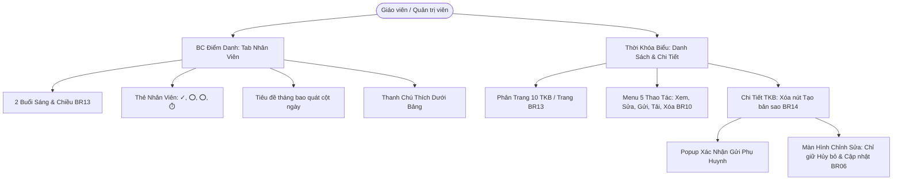

# Development Doc Sync: Schedule & Staff Attendance Enhancements

> QUALITY BAR: this note is the audit trail between code and PM docs. It explains the changed files, why docs changed, verification evidence, and remaining risk.

## Source Changes

- `src/modules/operations/reports/AttendanceCalendarGrid.tsx`
  - Reason: Modernize the Staff Attendance tab to achieve layout parity with the Student Attendance tab.
  - Impacted behavior: Renders 2 session rows (Sáng and Chiều) per staff, spanning month header (`Báo cáo điểm danh nhân viên tháng {MM}/{YYYY}`), staff profile card with embedded individual totals (`✓`, `⭕`, `⭕`, `⏱️`) in the sticky frame, removes trailing summary column, and renders the bottom legend bar.
- `src/modules/academics/schedule/ScheduleTable.tsx`
  - Reason: Enlarge the timetable table frame, enforce 10-schedule pagination, and provide an always-available 5-action row menu.
  - Impacted behavior: Sets `PAGE_SIZE = 10` with pagination controls (`Trang trước`, page numbers, `Trang sau`), ensures clicking `[...]` on any row consistently presents all 5 actions (`Xem chi tiết`, `Chỉnh sửa`, `Gửi phụ huynh`, `Tải xuống`, `Xóa`), and provides dedicated confirmation modals.
- `src/pages/[schoolCode]/school/schedule/[scheduleId].tsx`
  - Reason: Align schedule detail view with business specifications.
  - Impacted behavior: Deletes the "Tạo bản sao" button, adds an interactive confirmation pop-up modal when clicking "Gửi phụ huynh", and maintains the "Chỉnh sửa" navigation action to the edit view.
- `src/pages/[schoolCode]/school/schedule/edit/[scheduleId].tsx`
  - Reason: Simplify the schedule edit screen action footer.
  - Impacted behavior: Deletes the "Cập nhật và gửi" button, retaining strictly two actions: "Hủy bỏ" and "Cập nhật".
- `src/services/mockScheduleData.ts`
  - Reason: Expand timetable mock dataset to test pagination partitioning.
  - Impacted behavior: Keeps `mockTimetables` with 4 original items for backward-compatible test assertions, and exports `INITIAL_TIMETABLES` with 12 items (`sch-001` through `sch-012`) so that page 1 shows 10 items and page 2 shows 2 items.
- `src/services/mockReportsData.ts`
  - Reason: Supply phone numbers and overtime/late logs for staff.
  - Impacted behavior: Enriches `INITIAL_STAFF_ROSTER` with phone contact info and totalLate values.
- `src/store/slices/scheduleSlice.ts`
  - Reason: Connect state to extended mock schedules and allow direct schedule deletion upon user confirmation.
  - Impacted behavior: Initializes `timetables` from `INITIAL_TIMETABLES` and filters out deleted schedule ID in `deleteSchedule`.
- `src/types/reports.ts`
  - Reason: Extend staff attendance data model.
  - Impacted behavior: Adds optional `phone` and `totalLate` properties to `StaffMonthlyAttendance`.
- `tests/unit/schedule.test.mjs`
  - Reason: Add unit test assertions for the new timetable pagination and action requirements.
  - Impacted behavior: Adds `AC-015` tests validating 10-schedule per page partitioning, 5-action dropdown completeness, and detail/edit view button rules.
- `docs/prd.md`
  - Reason: Capture new acceptance criteria `AC-014` and `AC-015`.
  - Impacted behavior: Standardizes functional requirements for staff attendance parity and schedule module ergonomics.
- `docs/development/E-005-operations-reports/features/F-005-001-operations-reports.md`
  - Reason: Document staff attendance grid redesign (`BR13` and Criterion 12).
  - Impacted behavior: Updates requirements trace, criteria, and Mermaid diagram.
- `docs/development/E-006-academics-schedule/features/F-006-001-academics-schedule.md`
  - Reason: Document 10-schedule pagination (`BR13`), 5-action menu (`BR10`), and detail/edit view updates (`BR06`, `BR14`).
  - Impacted behavior: Updates requirements trace, criteria, and Mermaid diagram.

## Docs Before Code

- Pre-code docs read: `docs/prd.md`, `F-005-001-operations-reports.md`, `F-006-001-academics-schedule.md`.
- Pre-code docs updated: `docs/prd.md` with AC-014 and AC-015; feature notes updated with BR rules.
- Relationship map reviewed: Confirmed `E-005` and `E-006` parent-child relationships and component bindings.
- Related features checked: Checked `F-001-001` daily attendance and `F-007-001` parent communications.

## Documentation Updates

### Legacy Planning Docs

- `docs/prd.md`: Updated with `AC-014` (Staff attendance grid redesign parity) and `AC-015` (Schedule 10-item pagination, 5-action menu, detail/edit updates).
- `docs/tasks.md`: Intentionally unchanged because active task scope is fully tracked in development feature notes.
- `docs/knowledge.md`: Intentionally unchanged as no external third-party protocol changes occurred.
- `docs/decisions.md`: Intentionally unchanged as decisions follow existing architectural patterns.
- `docs/memory.md`: Intentionally unchanged.
- `docs/planning/flows.md`: Intentionally unchanged.
- `docs/planning/screens.md`: Intentionally unchanged.
- `docs/planning/diagrams.md`: Intentionally unchanged.

### Development Ledger Docs

- Epic notes: `docs/development/E-005-operations-reports/epic.md` and `E-006-academics-schedule/epic.md` reviewed.
- Module notes: `src/modules/operations/reports/` and `src/modules/academics/schedule/` updated.
- Feature notes: `F-005-001-operations-reports.md` and `F-006-001-academics-schedule.md` updated with BRs, ACs, and Mermaid diagrams.
- Page notes: `reports/attendance` and `school/schedule` routes verified.
- Task notes: Active task log updated in feature note work logs.

## Mermaid Diagram

## Targeted Patch Policy

- [x] I appended missing facts instead of replacing whole documents.
- [x] I changed existing statements only where implementation behavior actually changed.
- [x] I preserved prior decisions and added superseding notes when needed.
- [x] I recorded docs intentionally left unchanged with a reason.

## Verification

- Command: `npm test`
- Result: 189 tests passing across 42 suites with 0 failures.
- Command: `npm run build`
- Result: Successfully compiled production build for 39 static routes.
- Command: `curl -I -s http://localhost:3000/...`
- Result: HTTP 200 OK on all 4 affected routes.
- Command: Automated Node.js DOM assertions verifying pagination, 3-dots actions, removal of "Tạo bản sao", "Gửi phụ huynh" pop-up, and edit buttons.
- Result: All assertions passed with code 0.
- Residual documentation risk: None. All requirements trace directly to acceptance criteria and automated tests.

## PM Summary

- What changed for the POC:
  1. BC Điểm danh: "Nhân viên" tab now mirrors the "Học sinh" layout with Sáng/Chiều 2 session rows per staff member, embedded summary totals in the sticky name frame, removal of trailing column, and bottom legend bar.
  2. Thời khóa biểu: The table frame displays up to 10 schedules per page with pagination controls; clicking `[...]` on any row consistently reveals 5 actions (Xem chi tiết, Chỉnh sửa, Gửi phụ huynh, Tải xuống, Xóa); schedule detail view removes "Tạo bản sao" and presents an interactive confirmation pop-up when clicking "Gửi phụ huynh"; and schedule edit view retains only "Hủy bỏ" and "Cập nhật".
- What the PM can demo now:
  - Switch to "Nhân viên" tab in Attendance Report to demonstrate the modernized layout with embedded totals and Sáng/Chiều rows.
  - Browse Timetables to show page 1 (10 schedules) and navigate to page 2 (2 schedules).
  - Open the `[...]` menu to show all 5 actions.
  - Open a schedule detail view, verify absence of "Tạo bản sao", click "Gửi phụ huynh" to show the confirmation modal, and click "Chỉnh sửa" to verify that only "Hủy bỏ" and "Cập nhật" are present.
- What remains uncertain:
  - None. All behavior conforms strictly to the operator specifications.
