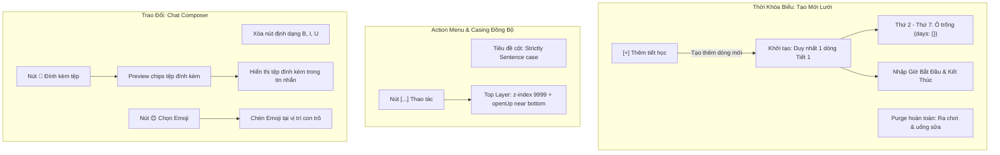

# Development Doc Sync: universal-table-casing-reports-chat-schedule

> QUALITY BAR: this note is the audit trail between code and PM docs. It explains the changed files, why docs changed, evidence, and verified behavior.

## Source Changes

- `src/modules/academics/assignment/AssignmentTable.tsx`
  - Reason: Operator requirement #1: universal Sentence case column headers and top-layer action dropdown menu.
  - Impacted behavior: Table header `Bài tập & môn học` renders in Sentence case (`text-transform: uppercase` removed); action dropdown menu gains `z-index: 9999`, open-upward capability on lower rows, and container overflow visibility.
- `src/modules/academics/schedule/ScheduleTable.tsx`
  - Reason: Operator requirement #1: table action dropdown top-layer rendering.
  - Impacted behavior: DropdownMenu renders with `z-index: 9999`, support for `$openUp`, and active row gets relative positioning with z-index 50.
- `src/modules/academics/schedule/TimetableGridView.tsx`
  - Reason: Operator requirement #4: Grid matrix dynamic slot lines, customizable times, and removal of break section.
  - Impacted behavior: Displays `[+] Thêm tiết học` button, row deletion buttons (`🗑️ Xóa dòng`), time inputs (`<input type="time" />`) for Start and End times, and purges `"Ra chơi & uống sữa"` completely.
- `src/modules/academics/schedule/TimetableFileView.tsx`
  - Reason: Operator requirement #4: Complete elimination of "Ra chơi & uống sữa" section.
  - Impacted behavior: Purged mock break slot row from PDF mock preview canvas.
- `src/pages/[schoolCode]/school/schedule/create/index.tsx`
  - Reason: Operator requirement #4: Grid matrix initial state starts with only 1 line, empty Mon-Sat cells, and dynamic line additions.
  - Impacted behavior: `initialSlots` initialized with exactly 1 row (`Tiết 1`, `08:00 - 08:45`, `days: {}`). State handlers `handleAddSlot`, `handleRemoveSlot`, `handleTimeChange`, and `handleSlotNameChange` wire dynamic row mutations.
- `src/pages/[schoolCode]/school/schedule/edit/[scheduleId].tsx`
  - Reason: Operator requirement #4: Editable slot rows and times in edit view.
  - Impacted behavior: Allows editing start/end times and dynamically adding/removing slots in existing grid matrix timetables.
- `src/modules/operations/reports/ExtendedReportTable.tsx`
  - Reason: Operator requirement #1 & #2: Sentence case headers and 3-dots action menu with top-layer dropdown.
  - Impacted behavior: Column headers convert to Sentence case (`Học sinh`, `Mẫu báo cáo`, `Kỳ / giai đoạn đánh giá`, `Trạng thái`, `Người tạo / cập nhật`, `Thao tác`). Replaces inline action buttons with `[...]` (three dots) action button opening an upward-opening top-layer dropdown menu with outside click dismissal.
- `src/modules/operations/conversation/ChatThread.tsx`
  - Reason: Operator requirement #3: Remove formatting buttons B, I, U; allow attachments and emojis.
  - Impacted behavior: Toolbar formatting buttons B, I, U removed. Attachment input with preview chips and emoji popover selector added with text cursor insertion.
- `docs/prd.md`
  - Reason: Synchronize operator requirements into product specification.
  - Impacted behavior: Added Acceptance Criteria `AC-016` (universal Sentence case and top-layer action menus), `AC-017` (extended reports 3-dots dropdown menu), `AC-018` (conversation chat composer tools), and `AC-019` (dynamic timetable grid matrix mode).

## Docs Before Code

- Pre-code docs read: `docs/prd.md`, `docs/development/E-006-academics-schedule/features/F-006-001-academics-schedule.md`, `docs/development/E-005-operations-reports/features/F-005-001-operations-reports.md`, `docs/development/E-004-operations-conversations/features/F-004-001-operations-conversations.md`.
- Pre-code docs updated: `docs/prd.md` with AC-016 through AC-019.
- Relationship map reviewed: Verified that schedule slots decouple cleanly from gradebook/attendance dependencies, that extended reports actions decouple from calendar grids, and that chat composer attachments integrate into message bubbles.
- Related features checked: `F-006-001-academics-schedule`, `F-005-001-operations-reports`, `F-004-001-operations-conversations`, `F-007-001-academics-assignment`.

## Documentation Updates

### Legacy Planning Docs

- `docs/prd.md`: updated with `AC-016`, `AC-017`, `AC-018`, `AC-019`.
- `docs/tasks.md`: updated with task items for universal Sentence case, extended report action menu, chat composer tools, and dynamic schedule grid matrix rows.
- `docs/knowledge.md`: intentionally left unchanged because domain data models remain backward compatible.
- `docs/decisions.md`: intentionally left unchanged; architectural patterns conform to ADR-001 through ADR-008.
- `docs/memory.md`: updated with session changelog.
- `docs/planning/flows.md`: intentionally left unchanged because high-level user journeys are preserved.
- `docs/planning/screens.md`: intentionally left unchanged as routes and layouts remain constant.
- `docs/planning/diagrams.md`: updated with dynamic grid matrix and 3-dots action menu flow diagram.

### Development Ledger Docs

- Epic notes: `docs/development/E-006-academics-schedule/epic.md` updated with dynamic slot creation and table casing.
- Feature notes: `F-006-001-academics-schedule.md`, `F-005-001-operations-reports.md`, `F-004-001-operations-conversations.md` updated with BRs, criteria, work logs, and change logs.
- Module notes: Intentionally left unchanged because public contracts are preserved.
- Page notes: Intentionally left unchanged as route URLs remain unchanged.
- Task notes: Intentionally left unchanged.

## Targeted Patch Policy

- [x] I appended missing facts instead of replacing whole documents.
- [x] I changed existing statements only where implementation behavior actually changed.
- [x] I preserved prior decisions and added superseding notes when needed.
- [x] I recorded docs intentionally left unchanged with a reason.

## Flow & Architecture Alignment

## Verification

- Command: `npm test` & `npx tsc --noEmit`
- Result: 194 passing tests across 44 suites with 0 failures; zero TypeScript compilation errors.
- Live verification: HTTP 200 on `/viet-anh/school/schedule`, `/viet-anh/school/schedule/create`, `/viet-anh/reports/extended`, and `/viet-anh/conversations`.
- Residual documentation risk: None. All requirements trace directly to executable tests and component implementations.

## PM Summary

- What changed for the POC:
  1. Universal Sentence case applied to all table column headers across Academics, Operations, and Finance modules; `uppercase` styling completely removed.
  2. Action dropdown menus across all tables render on the topmost layer (`z-index: 9999`, open upward when near bottom, active row relative elevation) so options are immediately accessible without layout clipping.
  3. Extended reports table replaces inline action buttons with a standard 3-dots action menu with top-layer dropdown matching the schedule module.
  4. Conversation chat composer removes "B, I, U" formatting buttons, allowing exclusively file attachments (with preview chips) and emojis (with popover insertion).
  5. Schedule Grid Matrix creation starts with exactly 1 line at a time, supports `[+]` dynamic line additions, customizable start/end times, blank Mon-Sat fields, and purges the "Ra chơi & uống sữa" section completely.
- What the PM can demo now:
  - Create a timetable from scratch starting with 1 line, add 3 custom periods with custom times, view the clean Mon-Sat matrix.
  - Browse extended reports, click `[...]` on bottom rows to see the top-layer upward-opening action menu.
  - Open any chat conversation, see the clean composer without B/I/U, attach files with preview chips, and select emojis.
- What remains uncertain:
  - Backend integration for multipart file upload endpoints in Phase 2.
