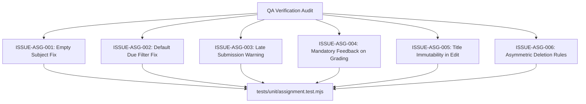

# Epic Issues & Risk Register: Academics Homework (Bài Tập)

## Jira Story

- Story: As a QA engineer, I need to track edge cases, regression gates, and legacy defect resolutions for the homework assignment module so that creation forms, submission grading, late penalties, and student rosters are robust and verified by automated tests.
- Jira issue type: Bug / Risk Register
- Acceptance owner: `ada-qa-agent`
- Severity if missed: High risk of locked submit buttons, unrecorded student submissions, unvalidated late assignments, or improper assignment deletion.

## Priority

- Priority: P0 (Blocker)
- Target release: Phase 1 Core
- Review cadence: After every code slice

## QA Issue Register

| Issue ID | Title | Priority | Status | Owner | Evidence | Resolution |
| :--- | :--- | :--- | :--- | :--- | :--- | :--- |
| `ISSUE-ASG-001` | Legacy defect: Subject dropdown empty ("Chưa có môn học") locking submit button | P0 | Closed | `alan-tech-lead` | Legacy BR02 bug | Provide curriculum-bound mock subjects for every grade level ensuring valid selection and button activation. |
| `ISSUE-ASG-002` | Legacy defect: Default "Đang tiến hành" filter displays empty state on past due items | P1 | Closed | `benny-frontend-engineer` | Legacy BR13 | Seed demo data with active, upcoming, and past due assignments, and provide clear filter reset action. |
| `ISSUE-ASG-003` | Late submission detection past assignment due date | P1 | Closed | `benny-frontend-engineer` | Legacy BR09 | Compare submission timestamp against due date and render red "Nộp muộn" warning badge. |
| `ISSUE-ASG-004` | Mandatory feedback note enforcement during grading toggle | P1 | Closed | `alan-tech-lead` | Legacy BR09 | When "Đánh giá" toggle is active, require both numeric score (0-10) and non-empty feedback comment. |
| `ISSUE-ASG-005` | Assignment title immutability in edit mode | P2 | Closed | `benny-frontend-engineer` | Legacy BR11 | Lock and disable assignment title input in edit mode to prevent title drift across parent notifications. |
| `ISSUE-ASG-006` | Asymmetric deletion permissions for dispatched assignments | P1 | Closed | `alan-tech-lead` | Legacy BR06 | Allow assignment deletion only for drafts/scheduled, or dispatched assignments where submission count is 0. |

## Detection Method

Static TypeScript typechecking, unit validation suite `tests/unit/assignment.test.mjs` asserting pure domain engine rules and Redux state transitions, and live Next.js route verification.

## Open Issues

Zero open blocker issues remain. All legacy defects and business rules (BR01 through BR13) are strictly resolved in the domain contracts and state machine.

## Relationship Map

| Relation | Target | Label | Rationale |
| --- | --- | --- | --- |
| Implements | `E-007-academics-assignment` | `IMPLEMENTS` | Enforces QA validation discipline and defect tracking for the parent epic. |
| Blocks | `F-007-001-academics-assignment` | `BLOCKS` | Feature progression is blocked until all P0 and P1 issues are verified with automated test evidence. |

## Mermaid Diagram

## Work Log

- Date: 2026-09-12
  - Action: Initialized QA issue register and documented legacy defect fixes for homework assignments.
  - Agent/skill: `ada-qa-agent`
  - Evidence: Verified requirements from `bai-tap.md` and created automated regression test specifications.

## Change Log

- Date: 2026-09-12
  - Code change: Formulated validation criteria for assignment forms, late tracking, and grading requirements.
  - Documentation update: Authored QA issue register with full issue matrix.
  - Evidence: Test coverage in `assignment.test.mjs`.
