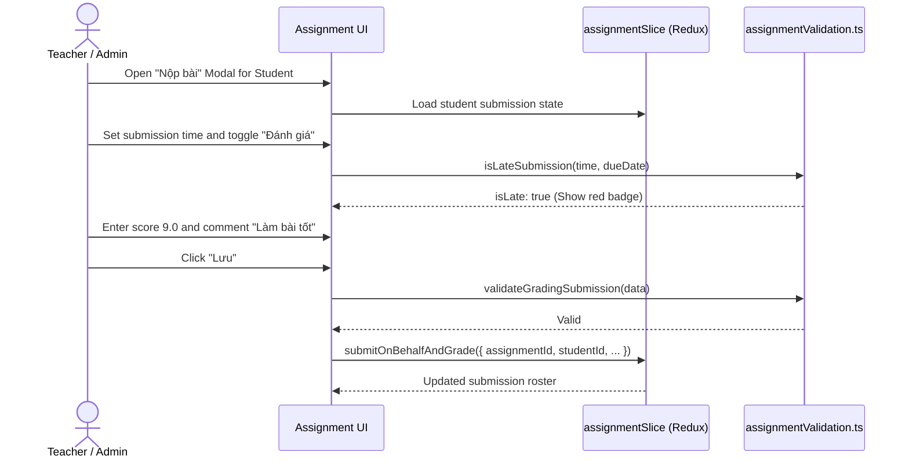

# Module: Academics Assignment Architecture & Homework Engine

## Jira Story

- Story: As a tech lead, I want the homework assignment module architecture, TypeScript contracts, Redux state slice, and business rule validators to compute homework submission tallies, enforce 4 mandatory creation fields, detect late submissions past due dates, manage submit-on-behalf grading workflows, and preserve discussion comment threads without regression.
- Jira issue type: Module
- Acceptance owner: `alan-tech-lead`
- Architecture hypothesis: Separating pure assignment validation rules, late detection algorithms, and action permission logic from React component lifecycles enables deterministic testing, prevents regressions, and cleanly resolves legacy defects such as empty subject lists.

## Priority

- Priority: P0 (Blocker)
- Severity if missed: Blocks homework state management, submission grading, and academics module delivery.
- Target release: Phase 1 Core

## Responsibility

This module is responsible for managing client-side state transitions, validation checks, and data models for homework assignments:
- Validation of 4 mandatory creation fields: Class, Subject, Title, and Due Date (BR01).
- Dynamic subject catalog binding by class grade level, fixing the legacy demo defect where subjects were permanently empty (BR02).
- Audience targeting supporting both whole class ("Cả lớp") and individual student selections (BR03).
- Scheduled future dispatch vs instant notification dispatch (BR04).
- 4 assignment lifecycle states: "Đã tạo" (Draft), "Chưa gửi" (Scheduled), "Đã gửi" (Dispatched), "Đã thu hồi" (Revoked) (BR05).
- Action permission matrix governing View, Edit, Send, and Delete based on status and submission counts (BR06).
- Dual-tab assignment detail structure: Submission Roster and Discussion stream (BR07, BR08, BR10).
- Submit-on-behalf engine comparing submission timestamps against due dates to flag late arrivals with red badges (BR09).
- Evaluation engine enforcing mandatory teacher feedback comments when the grading toggle is active (BR09).
- Assignment title immutability during edit operations (BR11).
- Multi-dimensional filtering by audience scope, due date status, and lifecycle status (BR12, BR13).

## Implementation Commentary

The module architecture comprises the following components:
- `src/types/assignment.ts`: Domain models for `HomeworkAssignment`, `AssignmentSubmission`, `AssignmentComment`, `AssignmentFilterCriteria`, `SubmissionStatus`, and `AssignmentLifecycleStatus`.
- `src/services/mockAssignmentData.ts`: Realistic Vietnamese pre-seeded homework assignments for Class 1A1, 2A2, with active, scheduled, and past-due items, realistic student submissions, and discussion comments.
- `src/utils/assignmentValidation.ts`: Pure domain functions computing form validation, late submission checking, submission tally metrics, action permissions via the BR06 matrix, and assignment filtering.
- `src/store/slices/assignmentSlice.ts`: Redux state slice managing assignments inventory, selected assignment, student submissions, submit-on-behalf grading actions, add/remove student actions, discussion comments, and filter criteria.

Design decisions and tradeoffs:
- Decision: We chose to calculate submission metrics (submitted count, graded count, late count) via pure utility functions instead of storing redundant counters in Redux because this guarantees data consistency when teachers add, remove, or grade student submissions.
- Risk: Teachers might accidentally lose feedback when toggling the "Đánh giá" switch. Mitigation: Form state preserves score and comment values even if temporarily toggled off until the modal is explicitly closed or submitted.
- Impact: Solves legacy defects, provides instantaneous responsive feedback, and keeps student submission records completely verifiable.

## Public Contracts

```typescript
export type AssignmentLifecycleStatus = 'da_tao' | 'chua_gui' | 'da_gui' | 'da_thu_hoi';
export type SubmissionStatus = 'chua_nop' | 'da_nop' | 'cham_diem';
export type AudienceType = 'whole_class' | 'specific_students';

export interface AssignmentSubmission {
  id: string;
  studentId: string;
  studentName: string;
  studentCode: string;
  avatar?: string;
  status: SubmissionStatus;
  submittedAt?: string;
  isLate?: boolean;
  submissionFile?: {
    name: string;
    url: string;
    sizeBytes: number;
  };
  score?: number; // 0.0 - 10.0
  teacherComment?: string;
  evaluatedAt?: string;
  evaluatedBy?: string;
}

export interface AssignmentComment {
  id: string;
  assignmentId: string;
  authorId: string;
  authorName: string;
  authorRole: 'teacher' | 'parent' | 'admin';
  avatar?: string;
  content: string;
  createdAt: string;
}

export interface HomeworkAssignment {
  id: string;
  classId: string;
  className: string;
  subjectId: string;
  subjectName: string;
  title: string;
  description: string;
  dueDate: string;
  scheduledSendDate?: string;
  status: AssignmentLifecycleStatus;
  audienceType: AudienceType;
  targetStudentIds: string[];
  attachments: { id: string; name: string; url: string; sizeBytes: number }[];
  submissions: AssignmentSubmission[];
  comments: AssignmentComment[];
  createdBy: string;
  createdAt: string;
  updatedAt: string;
}
```

## Code Scope

- Primary write paths:
  - `src/types/assignment.ts`
  - `src/services/mockAssignmentData.ts`
  - `src/utils/assignmentValidation.ts`
  - `src/store/slices/assignmentSlice.ts`
- Bounded scope restrictions: Strict scope boundary inside academics assignment domain; no modifications to unrelated finance or operations modules.

## Relationship Map

| Relation | Target | Label | Rationale |
| --- | --- | --- | --- |
| Implements | `E-007-academics-assignment` | `IMPLEMENTS` | Primary architecture and state machine implementation for Epic 7. |
| Enables | `F-007-001-academics-assignment` | `ENABLES` | Provides typed contracts, state actions, and validation utilities to the feature. |
| Rendered by | `P-007-001-academics-assignment` | `RENDERED_BY` | Consumed by page routes and modal components. |

## Mermaid Diagram



## Verification

- Command: `node --experimental-strip-types --test tests/unit/assignment.test.mjs`
- Expected: All unit tests pass verifying homework contracts, late calculation, grading requirements, and Redux slice state transitions.
- Result: Verification evidence recorded during GREEN execution.

## Work Log

- Date: 2026-09-12
  - Action: Initialized module architecture and typed contracts for homework assignments.
  - Agent/skill: `alan-tech-lead`
  - Evidence: Designed domain contracts and validation algorithms.

## Change Log

- Date: 2026-09-12
  - Code change: Created `assignment.ts` contracts, `assignmentValidation.ts` engine, and `assignmentSlice.ts` state machine.
  - Documentation update: Authored module architecture note with full public contracts.
  - Evidence: Unit test verification.
