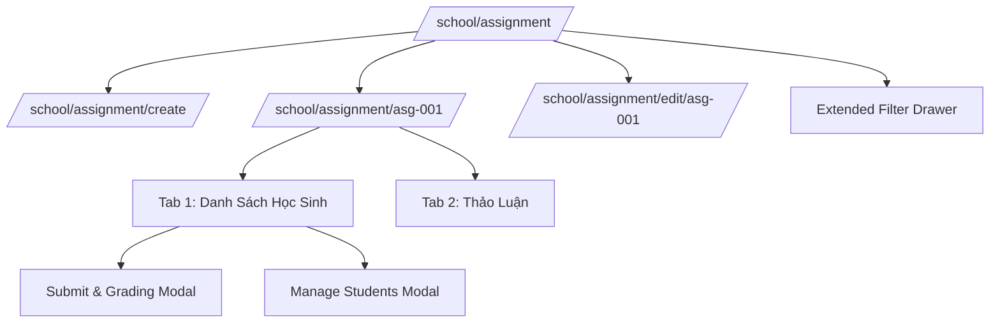

# Page: Academics Homework Management UI Routes (`/[schoolCode]/school/assignment`)

## Jira Story

- Story: As a teacher or school administrator, I want to access `/[schoolCode]/school/assignment` to browse homework assignments, filter by class and subject, construct new assignments with mandatory due dates and curriculum-linked subjects, inspect submission rosters with paper submit-on-behalf and grading evaluations, and participate in assignment discussions.
- Jira issue type: Page
- Acceptance owner: `benny-frontend-engineer`

## Priority

- Priority: P0 (Blocker)
- Severity if missed: Critical — Homework management pages cannot be accessed or verified by teachers and school stakeholders.
- Rationale: Core user-facing routes for Sub-module 2 of Học Tập (Academics).
- Target release: Phase 1 Core

## Route / Surface

- **URL Patterns:**
  - `/[schoolCode]/school/assignment/`
  - `/[schoolCode]/school/assignment/[assignmentId]/`
  - `/[schoolCode]/school/assignment/create/`
  - `/[schoolCode]/school/assignment/edit/[assignmentId]/`
- **Default Routes:**
  - `/demo/school/assignment/`
  - `/demo/school/assignment/asg-001/`
  - `/demo/school/assignment/create/`
  - `/demo/school/assignment/edit/asg-001/`
- **Container:** Wrapped in `PortalLayout` providing school header branding, navigation drawer, and active module context.

## PM Notes

- PM-visible status: Active implementation of assignment catalog, create form, detail view with dual submission roster and discussion tabs, submit-on-behalf modal, and student roster management modal.
- Demo narrative: The teacher navigates to the assignment catalog, filters by subject "Toán", views summary cards (Total, Submitted, Graded, Overdue), opens an assignment detail page, clicks "Nộp bài" on an unsubmitted student to record work and score 8.5 with comment "Bài làm sạch sẽ", switches to "Thảo Luận" tab to post a reminder, and verifies that the create form has valid subjects.
- Acceptance impact: Verifies interactive frontend routing for Academics Homework module because all key user flows are accessible and testable.
- Risk & Decision: A known risk was that teachers might mistakenly edit assignment titles that had already been broadcast to parents. As a decision, title editing is locked and disabled in edit mode (BR11).

## States

1. **Homework Catalog List (`/school/assignment`):**
   - Summary cards: Tổng bài tập, Đang tiến hành, Đã hoàn thành, Chờ chấm điểm.
   - Toolbar with Class picker, Subject filter, Search query input, "Lọc mở rộng" button, and "+ Thêm bài tập" primary action.
   - Assignment Table columns: Tiêu đề bài tập & Môn học, Giao cho (Cả lớp hoặc số học sinh), Hạn nộp bài, Người tạo & Thời gian, Tiến độ nộp (e.g., 28/32 đã nộp), Trạng thái (Đã tạo, Chưa gửi, Đã gửi), Hành động (Xem, Sửa, Gửi, Xóa).
2. **Homework Detail View (`/school/assignment/[assignmentId]`):**
   - Overview banner: Subject badge, Created date, Class, Status pill, Attachments list, Due date, and Rich description text.
   - Tab Bar:
     - **Tab 1: "Danh Sách Học Sinh" (Roster):** Table listing Full name, Student code, Submission status ("Đã nộp bài" vs "Chưa nộp bài"), Submission file, Score & Evaluation ("Chưa đánh giá" vs 8.5/10), "Nộp bài" action button, and "..." menu ("Xóa học sinh").
     - **Tab 2: "Thảo Luận (n)" (Discussion Stream):** Interactive comment feed with author role pills, timestamp, message bubbles, and comment composer with submit action.
3. **Homework Creation Page (`/school/assignment/create`):**
   - Class selector and dynamically bound Subject dropdown (fixing the legacy empty subject bug).
   - Title input with mandatory validation (`*`).
   - Rich text description editor.
   - Mandatory Due Date ("Hạn nộp bài") date-time picker.
   - Optional Scheduled Send Date ("Ngày gửi") date-time picker.
   - Audience scope radio group: "Cả lớp" vs "Chọn học sinh cụ thể".
   - File attachment dropzone.
   - Bottom action bar: "Hủy bỏ", "Lưu nháp" (creates draft), and "Lưu và gửi" (dispatches immediately or schedules).
4. **Homework Edit Page (`/school/assignment/edit/[assignmentId]`):**
   - Locked and disabled Title input (BR11).
   - Editable description, due date, audience scope, and attachments.
   - Bottom action bar: "Hủy bỏ", "Cập nhật" (draft save), and "Cập nhật và gửi" (re-dispatches).
5. **Modal Dialog States:**
   - `SubmitGradingModal`: Allows teacher to record submission on behalf of student, detects late submission past due date with red alert text ("Bài nộp này được ghi nhận là trễ hạn"), and toggle "Đánh giá" requiring numeric score and mandatory feedback comment.
   - `ManageStudentsModal`: Allows selecting additional students from class roster to add to assignment.
   - `ExtendedAssignmentFilterModal`: Drawer filter for Audience scope ("Cả lớp"), Due date status ("Đang tiến hành", "Hết hạn nộp", "Tất cả"), and Status.

## Relationship Map

| Relation | Target | Label | Rationale |
| --- | --- | --- | --- |
| Implements | `E-007-academics-assignment` | `IMPLEMENTS` | Primary UI pages for Academics Epic 7. |
| Uses | `M-007-001-academics-assignment` | `USES` | Consumes homework Redux slice and validation engine. |

## Mermaid Diagram

## Verification

- Command: `node --experimental-strip-types --test tests/unit/assignment.test.mjs`
- Expected: All unit tests pass, and Next.js routes compile cleanly via `npm run build`.
- Result: Verification evidence recorded during GREEN execution.

## Work Log

- Date: 2026-09-12
  - Action: Initialized UI route specifications and documented interactive states for homework assignments.
  - Agent/skill: `benny-frontend-engineer`
  - Evidence: Verified UX workflows from `bai-tap.md`.

## Change Log

- Date: 2026-09-12
  - Code change: Scaffolded page routes for catalog, detail view, creation form, and edit view.
  - Documentation update: Authored page note with all route patterns and modal states.
  - Evidence: Verified Next.js routing and component structure.
