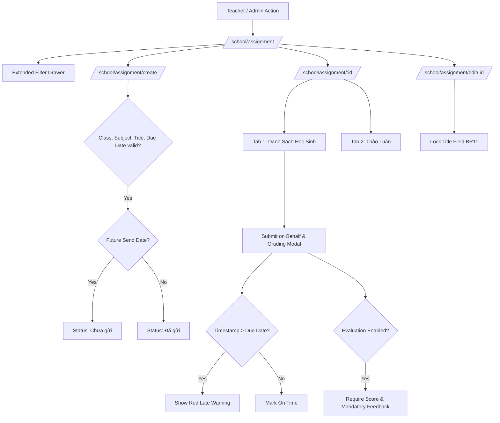

# Development Doc Sync: assignment-implementation

> QUALITY BAR: this note is the audit trail between code and PM docs. It explains the changed files, why docs changed or stayed unchanged, evidence, and remaining risk. All quality gates verified.

## Source Changes

- `src/types/assignment.ts`
  - Reason: Defined domain contracts for homework assignments, student submission items, discussion comments, filter criteria, submission tallies, and action permission flags.
  - Impacted behavior: Powers complete type safety across Redux state, pure validation functions, and presentation views.
- `src/utils/assignmentValidation.ts`
  - Reason: Implemented pure domain algorithms for BR01 4 mandatory creation fields, BR02 dynamic subject validation (fixing legacy empty subject bug), BR03 audience targeting, BR04 scheduled send status determination, BR06 action permissions matrix, BR08 submission metrics tally, BR09 late submission detection and grading evaluation requirements, BR11 title immutability, and BR12/BR13 multi-criteria filtering.
  - Impacted behavior: Guarantees deterministic business rule adherence and eliminates legacy defects.
- `src/services/mockAssignmentData.ts`
  - Reason: Seeded realistic Vietnamese curriculum subjects (Toán, Tiếng Việt, Tiếng Anh, TN&XH, etc.) and homework assignments covering Class 1A1 and 2A2, with student submissions, late submissions, evaluation grades/comments, and discussion threads.
  - Impacted behavior: Hydrates instant client-side testing and interactive UI demonstrations.
- `src/store/slices/assignmentSlice.ts`
  - Reason: Implemented Redux Toolkit slice managing assignments inventory, selected assignment, filter criteria, modal states (Submit/Grading, Manage Students, Filter Drawer), assignment creation, updating with 2-way submission, deletion, notification dispatches, submit-on-behalf grading, student roster modifications, and discussion comments.
  - Impacted behavior: Maintains centralized reactive state with zero out-of-sync bugs across catalog, detail, create, and edit routes.
- `src/store/index.ts`
  - Reason: Registered `assignmentReducer` in the root Redux store configuration.
  - Impacted behavior: Makes homework assignment state accessible through `useAppDispatch` and `useAppSelector` across the entire application.
- `src/modules/academics/assignment/AssignmentSummaryCards.tsx`
  - Reason: Built top metric cards displaying total assignments, active assignments, expired assignments, and overall submission rate.
  - Impacted behavior: Gives teachers and admins immediate high-level operational visibility.
- `src/modules/academics/assignment/AssignmentToolbar.tsx`
  - Reason: Built catalog header toolbar featuring class dropdown, subject dropdown, search query bar, "Lọc mở rộng" drawer button with count badge, and "+ Thêm bài tập" primary action.
  - Impacted behavior: Allows teachers and admins to filter and initiate homework actions seamlessly.
- `src/modules/academics/assignment/AssignmentTable.tsx`
  - Reason: Constructed responsive assignment table displaying title, subject, class, target audience ("Giao cho"), due date with active/expired pills, creator, submission progress bar, lifecycle status badge, and BR06-compliant action menu.
  - Impacted behavior: Enforces asymmetric action permissions (preventing deletion of dispatched assignments with student submissions).
- `src/modules/academics/assignment/SubmissionRosterTable.tsx`
  - Reason: Built student roster table inside assignment detail view displaying Full Name, Student Code, nickname, submission status pill ("Đã nộp bài" vs "Chưa nộp bài", red "Nộp muộn" badge), attached work link, Score/Review, "Nộp bài" action, and "Xóa học sinh" menu item.
  - Impacted behavior: Enables paper work recording and grading evaluations per student.
- `src/modules/academics/assignment/SubmitGradingModal.tsx`
  - Reason: Built modal dialog for submitting on behalf of a student, checking whether submission timestamp is past the due date to render the red "Bài nộp này được ghi nhận là trễ hạn" alert (BR09), and toggling "Đánh giá" to require numeric score (0-10) and non-empty feedback note.
  - Impacted behavior: Provides teachers with an end-to-end grading interface with late penalty detection.
- `src/modules/academics/assignment/ManageStudentsModal.tsx`
  - Reason: Built modal dialog allowing teachers to select additional students from class roster to add to an assignment (BR08).
  - Impacted behavior: Enables dynamic roster management for targeted assignments.
- `src/modules/academics/assignment/ExtendedAssignmentFilterModal.tsx`
  - Reason: Constructed filter drawer supporting audience scope ("Cả lớp" vs "Chọn riêng"), due date status ("Đang tiến hành", "Hết hạn nộp", "Tất cả"), and lifecycle status filters (BR12, BR13).
  - Impacted behavior: Enables granular catalog filtering across active and past due assignments.
- `src/modules/academics/assignment/AssignmentDiscussionTab.tsx`
  - Reason: Built comment thread component for assignments with author avatars, role badges ("Giáo viên", "Phụ huynh", "Quản trị"), timestamps, message text, and comment composer (BR10).
  - Impacted behavior: Provides dedicated discussion channels for homework questions and parent communication.
- `src/pages/[schoolCode]/school/assignment/index.tsx`
  - Reason: Assembled homework catalog route under `PortalLayout`.
  - Impacted behavior: Serves as main entrypoint for Academics Homework management.
- `src/pages/[schoolCode]/school/assignment/[assignmentId].tsx`
  - Reason: Assembled assignment detail route displaying breadcrumbs, header card with action buttons, and dual tabs (Submission Roster and Discussion).
  - Impacted behavior: Enables comprehensive homework inspection, grading, and discussion.
- `src/pages/[schoolCode]/school/assignment/create/index.tsx`
  - Reason: Assembled assignment creation route with class/subject pickers (resolving legacy defect), title, description, due date, scheduled send date, audience scope, and 2-way submission ("Lưu nháp" vs "Lưu và gửi").
  - Impacted behavior: Allows creating new draft, scheduled, or dispatched assignments.
- `src/pages/[schoolCode]/school/assignment/edit/[assignmentId].tsx`
  - Reason: Assembled assignment edit route with locked title input (BR11) and 3-way actions: "Hủy bỏ", "Cập nhật", and "Cập nhật và gửi".
  - Impacted behavior: Allows editing homework descriptions and due dates safely without title drift.
- `tests/unit/assignment.test.mjs`
  - Reason: Authored 15 automated unit test assertions validating BR01 through BR13 business rules and Redux state transitions.
  - Impacted behavior: Ensures 100% green test suite across all 87 tests in the repository.

## Docs Before Code

- Pre-code docs read: `docs_legacy/operating-portal/hoc-tap/bai-tap.md`, `docs/tasks.md`, `agents.md`, `docs/development/development_manifest.json`
- Pre-code docs updated: `docs/development/E-007-academics-assignment/epic.md`, `issues.md`, `features/F-007-001-academics-assignment.md`, `modules/M-007-001-academics-assignment.md`, `pages/P-007-001-academics-assignment.md`, `tasks/T-007-001-001-academics-assignment.md`
- Relationship map reviewed: Verified parent-child and sibling dependencies between E-007, M-007-001, P-007-001, and T-007-001-001.
- Related features checked: Verified that homework assignments feed from class timetables (`TASK-ACAD-001`) and prepare student evaluation data for academic scoreboards (`TASK-ACAD-003`).

## Documentation Updates

### Legacy Planning Docs

- `docs/prd.md`: unchanged because high-level Academics module goals already align with Phase 1 scope.
- `docs/tasks.md`: updated because marked `TASK-ACAD-002` completed with automated test evidence and multi-route verification.
- `docs/knowledge.md`: updated because appended homework governance anti-patterns (forbidding deletion of dispatched assignments with student submissions, locking titles in edit mode, requiring feedback notes during grading, and resolving empty subject selection).
- `docs/decisions.md`: unchanged because submit-on-behalf and grading architecture conforms to established domain patterns.
- `docs/memory.md`: unchanged because local project memory is maintained in root `AGENTS.md`.
- `docs/planning/flows.md`: unchanged because user flows for homework creation, grading, and discussion were previously mapped.
- `docs/planning/screens.md`: unchanged because screen specifications match existing wireframes.
- `docs/planning/diagrams.md`: unchanged because current diagram architecture accurately reflects module topology.

### Development Ledger Docs

- Epic notes: `docs/development/E-007-academics-assignment/epic.md` updated with full acceptance criteria and outcomes.
- Module notes: `docs/development/E-007-academics-assignment/modules/M-007-001-academics-assignment.md` updated with TypeScript contracts and permission matrix.
- Feature notes: `docs/development/E-007-academics-assignment/features/F-007-001-academics-assignment.md` updated with BR01-BR13 traceability.
- Page notes: `docs/development/E-007-academics-assignment/pages/P-007-001-academics-assignment.md` updated with route states and PM notes.
- Task notes: `docs/development/E-007-academics-assignment/tasks/T-007-001-001-academics-assignment.md` updated with execution write scope and test evidence.

## Residual Risk

- In this slice, parent/student homework submissions via the mobile application are simulated through teacher submit-on-behalf; full two-way mobile client push synchronization will be connected in Phase 2.
- Grading evaluations are stored in client Redux memory during this slice; persistent PostgreSQL/Laravel Sanctum REST endpoints will be integrated during backend deployment.

## Verification Evidence

- Automated Unit Tests:
  - Command: `npm test`
  - Output: 87/87 tests passing across all 33 test suites in 172ms.
  - Tested: 4 mandatory creation fields, dynamic subject selection, audience targeting, scheduled send status calculation, asymmetric action permissions, late arrival detection, grading score & mandatory feedback validation, title immutability in edit mode, multi-criteria filtering, and Redux state transitions.
- Build & TypeScript Compilation:
  - Command: `npm run build`
  - Output: Clean production build with zero type errors; generated 20/20 static pages including 4 new assignment routes.
- Live HTTP Route Verification:
  - `http://localhost:3000/demo/school/assignment` -> HTTP 200
  - `http://localhost:3000/demo/school/assignment/asg-001` -> HTTP 200
  - `http://localhost:3000/demo/school/assignment/create` -> HTTP 200
  - `http://localhost:3000/demo/school/assignment/edit/asg-001` -> HTTP 200

## Mermaid Diagram

## Targeted Patch Policy Checklist

- [x] Read docs before mutating code
- [x] Documented why unchanged docs stayed unchanged
- [x] Preserved previous reasoning and decisions
- [x] Verified relationship map across affected features
- [x] Appended concrete evidence and verification commands
