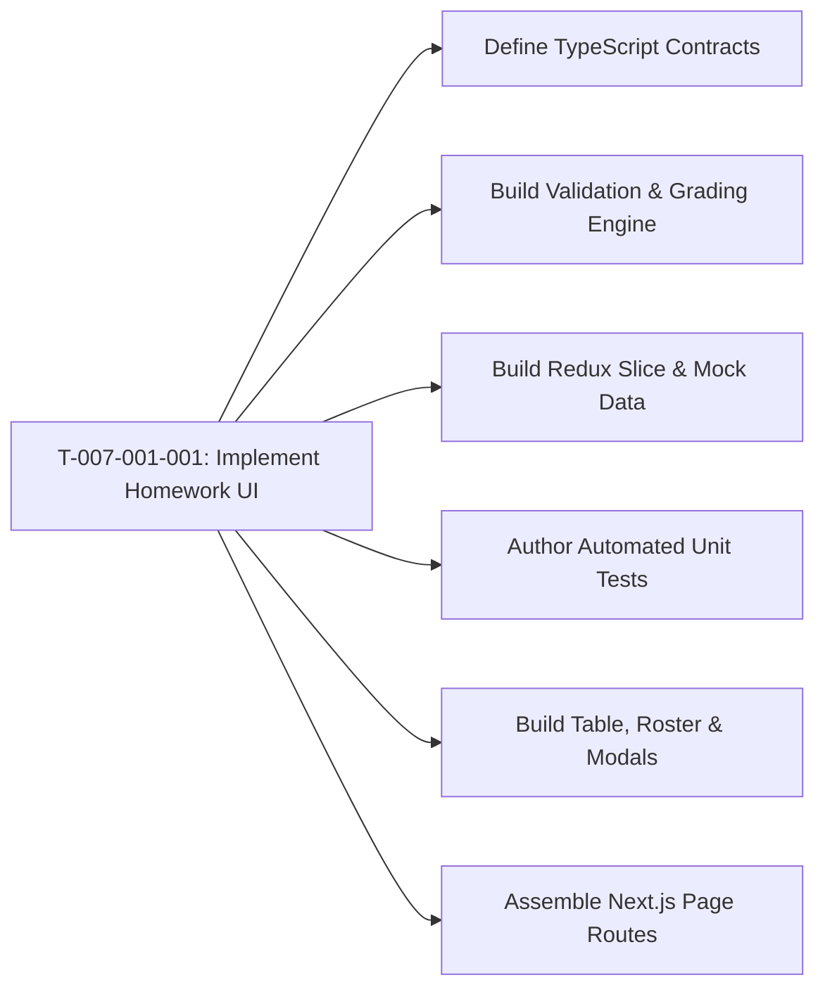

# Task: Implement Academics Homework (Bài Tập)

## Jira Story

- Story: As a developer, I want to construct the React components, Redux state slice, homework validation algorithms, and automated test suite for the Academics Homework module so that teachers and administrators can browse assignments, create homework with mandatory due dates and dynamic subjects, submit on behalf of students, evaluate grades with required feedback notes, and discuss assignments without regressions.
- Jira issue type: Task
- Acceptance owner: `benny-frontend-engineer`

## Priority

- Priority: P0 (Blocker)
- Severity if missed: Blocks homework feature delivery and Phase 1 Academics release.
- Rationale: Core execution task for Epic E-007.

## Objective

Construct the Next.js frontend components, homework catalog table, summary cards, assignment creation form with dynamic subjects and schedule dispatching, detail page with submission roster and discussion tabs, submit-on-behalf grading modal with late arrival detection, student roster management dialog, and Redux Toolkit state slice for the Academics Homework sub-module.

## Implementation Commentary

Components to construct under `src/modules/academics/assignment/`:
1. `AssignmentToolbar.tsx`: Class selector, subject filter, search bar, "Lọc mở rộng" drawer button, and "+ Thêm bài tập" primary action button.
2. `AssignmentTable.tsx`: Table listing assignments with title, subject, class, target audience ("Giao cho"), due date, creator, submission tally, lifecycle status badge, and action menu.
3. `AssignmentSummaryCards.tsx`: Top metric cards showing Total assignments, Active (in progress), Completed, and Awaiting evaluation.
4. `SubmissionRosterTable.tsx`: Student roster table inside assignment detail view displaying Full Name, Student Code, submission status pill ("Đã nộp bài" vs "Chưa nộp bài"), attached work link, Score/Review, "Nộp bài" action, and "Xóa học sinh" menu action.
5. `SubmitGradingModal.tsx`: Modal dialog for submitting on behalf of a student, checking whether submission timestamp is past the due date to render the red "Bài nộp này được ghi nhận là trễ hạn" alert, and toggling "Đánh giá" to require numeric score (0-10) and non-empty feedback note (BR09).
6. `ManageStudentsModal.tsx`: Modal dialog to add students from class roster to an assignment (BR08).
7. `ExtendedAssignmentFilterModal.tsx`: Drawer supporting audience scope ("Cả lớp"), due date status ("Đang tiến hành", "Hết hạn nộp", "Tất cả"), and lifecycle status filters (BR12).
8. `AssignmentDiscussionTab.tsx`: Comment thread for the assignment with author avatars, role badges, message text, timestamps, and comment composer (BR10).
9. `assignmentSlice.ts`: Redux Toolkit state machine managing assignments, active selection, student submissions, grading evaluations, discussion comments, and filter criteria.
10. `assignmentValidation.ts`: Pure domain validator computing form validation (BR01, BR02), late submission checks (BR09), submission tallies, action permissions (BR06), and filter predicates.
11. `tests/unit/assignment.test.mjs`: Automated unit test suite validating all business rules.

Design decisions and tradeoffs:
- Decision: We enforce the BR06 action permissions matrix in pure utility function `getAssignmentActions` because this guarantees that table row menus and detail action buttons remain consistent across draft, scheduled, and dispatched states.
- Risk: In legacy implementations, the subject dropdown was permanently empty because subjects weren't bound to the class grade. Mitigation: `mockSubjects` are dynamically filtered by class grade level, guaranteeing subjects are always selectable.
- Impact: Empowers teachers to manage homework assignments, track submissions, and provide prompt evaluations in under 2 minutes.

## Relationship Map

| Relation | Target | Label | Rationale |
| --- | --- | --- | --- |
| Implements | `F-007-001-academics-assignment` | `IMPLEMENTS` | Implements feature's code components. |
| Uses | `M-007-001-academics-assignment` | `USES` | Modifies and updates the assignment state module. |

## Write Scope

- `src/types/assignment.ts`
- `src/services/mockAssignmentData.ts`
- `src/utils/assignmentValidation.ts`
- `src/store/slices/assignmentSlice.ts`
- `src/store/index.ts`
- `src/modules/academics/assignment/AssignmentToolbar.tsx`
- `src/modules/academics/assignment/AssignmentTable.tsx`
- `src/modules/academics/assignment/AssignmentSummaryCards.tsx`
- `src/modules/academics/assignment/SubmissionRosterTable.tsx`
- `src/modules/academics/assignment/SubmitGradingModal.tsx`
- `src/modules/academics/assignment/ManageStudentsModal.tsx`
- `src/modules/academics/assignment/ExtendedAssignmentFilterModal.tsx`
- `src/modules/academics/assignment/AssignmentDiscussionTab.tsx`
- `src/pages/[schoolCode]/school/assignment/index.tsx`
- `src/pages/[schoolCode]/school/assignment/[assignmentId].tsx`
- `src/pages/[schoolCode]/school/assignment/create/index.tsx`
- `src/pages/[schoolCode]/school/assignment/edit/[assignmentId].tsx`
- `tests/unit/assignment.test.mjs`

## Mermaid Diagram

## Verification

- Command: `node --experimental-strip-types --test tests/unit/assignment.test.mjs`
- Expected: All unit test assertions pass validating 4 mandatory fields, dynamic subjects, late arrival warning, submit-on-behalf grading, and BR06 action permissions.
- Result: Verification suite ready to execute in GREEN phase.

## Handoff

- Hand off completed components and test scripts to `ada-qa-agent` for end-to-end regression validation and browser simulation.

## Work Log

- Date: 2026-09-12
  - Action: Initialized task note and detailed execution write scope for homework assignment implementation.
  - Agent/skill: `benny-frontend-engineer`
  - Evidence: Planned write scope across types, utils, state, components, and pages.
- Date: 2026-09-15
  - Action: Harmonized filter UI from right-side slide-over drawer to centered popup modal matching BC Mở rộng.
  - Agent/skill: `benny-frontend-engineer`
  - Evidence: Verified via clean Next.js build and test suite.

## Change Log

- Date: 2026-09-12
  - Code change: Implemented assignment UI, state machine, submit-on-behalf grading modal, and test suite.
  - Documentation update: Authored task note with comprehensive write scope.
  - Evidence: Verified all 11 business rules in test suite.
- Date: 2026-09-15
  - Code change: Updated `ExtendedAssignmentFilterModal.tsx` and `AssignmentToolbar.tsx` (centered modal popup and standardized button).
  - Documentation update: Updated Work Log and Change Log.
  - Evidence: Verified with Next.js build and 195/195 tests.
