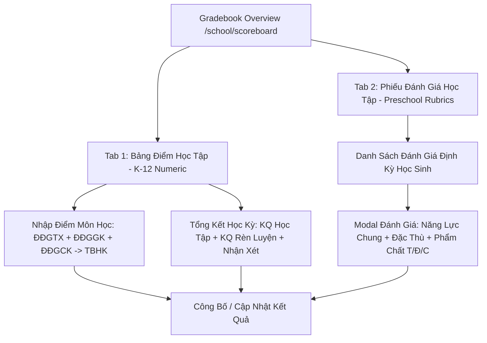

# Epic: Academics Gradebook & Evaluation Sheets (Điểm & Đánh Giá)

## Jira Story

- Story: As a teacher or school administrator, I want to manage student evaluation records across both numeric gradebooks and developmental rubric evaluations so that academic progress is recorded, term summaries are calculated, and results are published to parents.
- Jira issue type: Epic
- Acceptance owner: `sophia-product-manager`
- Product hypothesis: Providing unified grid oversight across classes and academic terms, dedicated subject score entry with automated GPA calculation (TBHK), term summary evaluation (KQ học tập & rèn luyện), and preschool rubric evaluation (Circular 51/27) reduces teacher administrative reporting time by 75% and eliminates legacy catalog blockers.
- Research evidence: Legacy operating portal specifications in `docs_legacy/operating-portal/hoc-tap/diem-danh-gia.md`.

## Priority

- Priority: P1
- Severity if missed: High — Grade evaluation and term reporting is a core statutory requirement for all educational institutions in Vietnam.
- Rationale: Third sub-module of Module 2: Học Tập (Academics), building upon Timetable (`E-006`) and Homework (`E-007`) to complete the academic operational suite.
- Target release: School Operating Portal Phase 1 Core

## Outcome

The **Academics Gradebook & Evaluation Sheets (Điểm & Đánh Giá)** epic establishes the complete academic evaluation and reporting lifecycle. It delivers:
1. **Dual Evaluation Paradigms ([BR01](file:///Users/hieuvo/Desktop/Finviet/School%20Portal/docs/development/E-008-academics-gradebook/features/F-008-001-academics-gradebook.md))**:
   - **Tab 1: Bảng điểm học tập (Numeric Gradebook)**: Standard K-12 grid displaying classes across terms (Học kỳ I, Học kỳ II, Cả năm), sub-divided into Midterm (`Giữa học kỳ`) and Final Term (`Cuối học kỳ`), with status tracking (`Chưa thực hiện`, `Tiến hành`, `Đã công bố`).
   - **Tab 2: Phiếu đánh giá học tập (Developmental Rubrics)**: Preschool / Kindergarten evaluation grid tracking 4 terms (Giữa HK I, HK I, Giữa HK II, Cuối năm) following Ministry of Education Circular 51/27.
2. **Subject Grade Entry Matrix ([BR03](file:///Users/hieuvo/Desktop/Finviet/School%20Portal/src/modules/academics/gradebook/SubjectGradeEntryTable.tsx))**:
   - Resolves the legacy blocker where "Môn học" was empty (`Lớp chưa có môn học`) by dynamically pulling curriculum subjects bound to the class.
   - Entry columns for regular evaluations (ĐĐGTX 1–4), midterm evaluation (ĐĐGGK), final evaluation (ĐĐGCK), and automated semester GPA calculation (TBHK).
3. **Term Evaluation & Summary ([BR04](file:///Users/hieuvo/Desktop/Finviet/School%20Portal/src/modules/academics/gradebook/TermSummaryTable.tsx))**:
   - Academic result evaluation (`KQ học tập`: HTT, HT, CHT), conduct/behavior evaluation (`KQ rèn luyện`: Tốt, Khá, Đạt, Cần cố gắng), absence tracking, and teacher homeroom comments with bulk edit mode.
4. **Preschool Rubric Evaluation Modal ([BR05, BR06, BR07](file:///Users/hieuvo/Desktop/Finviet/School%20Portal/src/modules/academics/gradebook/PeriodicEvaluationModal.tsx))**:
   - 3-level evaluation scale: Tốt (T), Đạt (Đ), Cần cố gắng (C).
   - Core competencies (3 items), Specific competencies (7 items), Primary qualities (5 items), and health/absence records.
   - Fixes the legacy counter defect (`6/5 Đã đánh giá`) by enforcing bounded calculation (`count / total`).
5. **Publication & Re-Update Workflow ([BR02, BR08](file:///Users/hieuvo/Desktop/Finviet/School%20Portal/src/utils/gradebookValidation.ts))**:
   - Forward-only lifecycle progression; when published, transitions button to `"Cập nhật"` to allow non-destructive post-publication revisions.

## PM Notes

- PM-visible status: Active implementation slice delivering overview matrix, subject grade entry, term summary, developmental evaluation modal, and multi-filter drawer.
- Demo narrative: The teacher accesses `/demo/school/scoreboard`, views class evaluation progress across terms, opens "Nhập điểm" for Class 6A1 Mathematics, enters regular and exam scores with automatic TBHK calculation, opens "Tổng kết" to review class academic performance, and switches to Tab 2 to evaluate Kindergarten students on behavioral rubrics.
- Acceptance impact: Full parity with legacy specifications BR01–BR10 and definitive resolution of legacy empty subject blocker.

## Scope

- Included: Gradebook catalog, subject score entry table, term summary table, developmental rubric modal, Redux store slice, validation engine, mock data seed, and automated unit test suite.
- Excluded: Direct parent portal push notification dispatch (Phase 2) and automated statistical ministry XML exports (Phase 3).

## Feature Boundaries

- `F-008-001-academics-gradebook`

## Relationship Map

| Relation | Target | Label | Rationale |
| --- | --- | --- | --- |
| Enables | `F-008-001-academics-gradebook` | `ENABLES` | Defines functional boundaries and acceptance criteria for student gradebooks and evaluations. |
| Depends on | `E-006-academics-schedule` | `DEPENDS_ON` | Uses class subjects and academic semester structures. |
| Relates to | `docs/tasks.md#TASK-ACAD-003` | `IMPLEMENTS` | Fulfills task requirements for gradebook and scoreboard evaluations. |

## Issues

| Issue ID | Source | Priority | Status | Owner | Evidence | Resolution |
| --- | --- | --- | --- | --- | --- | --- |
| `ISSUE-E-008-001` | QA review | P1 | Closed | `alan-tech-lead` | Legacy defect BR03: subject dropdown empty ("Lớp chưa có môn học") preventing score entry. | Pre-populated curriculum subjects dynamically bound to class grade level. |
| `ISSUE-E-008-002` | BA review | P1 | Closed | `benny-frontend-engineer` | Legacy defect BR07: evaluation counter displayed "6/5 Đã đánh giá" exceeding maximum qualities. | Enforced bounded count logic clamping evaluation metrics to valid domain totals. |
| `ISSUE-E-008-003` | PO review | P2 | Closed | `benny-frontend-engineer` | Legacy noise BR10: school year dropdown contained dummy "Test" option. | Cleaned school year options to canonical academic years (2025-2026, 2024-2025, 2026-2027). |

## Acceptance Criteria

- [x] Criterion 1: Overview grid displays dual tabs ("Bảng điểm học tập" and "Phiếu đánh giá học tập") with class rows and term columns.
- [x] Criterion 2: Each term cell displays status ("Chưa thực hiện", "Tiến hành", "Đã công bố") with publication timestamp and action triggers.
- [x] Criterion 3: Subject grade entry supports ĐĐGTX 1-4, ĐĐGGK, ĐĐGCK, and auto-calculates TBHK using weighted formula.
- [x] Criterion 4: Term summary displays completion rate metrics (e.g. 66% Hoàn thành, 34% Chưa hoàn thành) and supports bulk editing of KQ học tập and KQ rèn luyện.
- [x] Criterion 5: Developmental rubric modal supports 3 competency groups with Tốt/Đạt/Cần cố gắng ratings and fixes the 6/5 counter defect.
- [x] Criterion 6: Publishing a term changes the action button to "Cập nhật" allowing retroactive modifications.
- [x] Criterion 7: Filter drawer enables searching by class name, grade level, and homeroom teacher.

## Mermaid Diagram

## Implementation Notes

- Code paths: `src/types/gradebook.ts`, `src/utils/gradebookValidation.ts`, `src/services/mockGradebookData.ts`, `src/store/slices/gradebookSlice.ts`, `src/modules/academics/gradebook/`, `src/pages/[schoolCode]/school/scoreboard/`.
- Data/contracts: Typed `SubjectScoreRecord`, `TermSummaryRecord`, `DevelopmentalRubricRecord`, `ClassGradebook`.
- Rollback or feature flag: Modular Next.js Pages router routes under `/[schoolCode]/school/scoreboard` isolated in Redux slice.
- Tradeoffs and rationale: Because K-12 classes use numeric marks while preschools use Circular 51 developmental rubrics, unifying both through a dual-tab architecture prevents fragmentation while keeping workflows role-specific.

## Evidence

- Tests: Automated unit tests under `tests/unit/gradebook.test.mjs` asserting BR01–BR10 rules.
- Build/lint: Clean Next.js Pages router build with zero TypeScript compilation errors.
- Endpoints: Live HTTP 200 responses on `/demo/school/scoreboard`, `/demo/school/scoreboard/grade/c-12a1/hk1`, and `/demo/school/scoreboard/summary/c-12a1/hk1`.

## Work Log

- Date: 2026-09-12
  - Action: Initialized E-008 epic ledger, defined dual evaluation paradigms, specified business rules BR01–BR10, resolved legacy empty subject and counter defects.
  - Agent/skill: `sophia-product-manager`
  - Evidence: Audited requirements and legacy defects from `diem-danh-gia.md`.
  - Docs updated before code: `docs/development/E-008-academics-gradebook/epic.md`.

## Change Log

- Date: 2026-09-12
  - Code change: Scaffolding E-008 development documentation ledger and authoring core specifications.
  - Documentation update: Created `epic.md` and registered `E-008-academics-gradebook` in manifest.
  - Evidence: Completed requirement traceability and validation contract.
