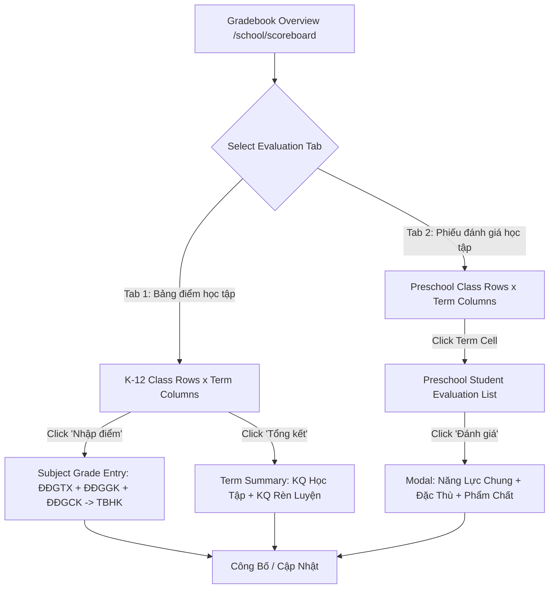

# Feature: Academics Gradebook Matrix & Evaluation Workflows

## Jira Story

- Story: As a homeroom teacher, subject teacher, or school administrator, I want to view class evaluation progress across academic terms, enter subject continuous and exam marks, calculate semester GPAs automatically, evaluate term academic and behavioral conduct, and score early childhood competencies, so that student learning records are completely traceable.
- Jira issue type: Feature
- Acceptance owner: `sophia-product-manager`
- Business value: Eliminates manual GPA spreadsheet errors, unifies K-12 numeric scoring with preschool developmental rubrics, resolves historical empty subject blockers, and provides transparent term evaluations to parents.

## Priority

- Priority: P0 (Blocker)
- Severity if missed: Critical — Grade evaluation and term report cards are mandatory legal obligations under Vietnam Ministry of Education regulations.
- Rationale: Third sub-module of Module 2: Học Tập (Academics).
- Target release: Phase 1 Core

## User Value

For subject teachers, this feature provides a streamlined grade entry matrix where regular continuous evaluations (ĐĐGTX 1–4), midterm exams (ĐĐGGK), and final exams (ĐĐGCK) are recorded with real-time automated term GPA (TBHK) computation, eliminating manual rounding errors.

For homeroom teachers, the term summary table allows quick evaluation of academic performance (`KQ học tập`: Hoàn thành tốt / Hoàn thành / Chưa hoàn thành) and conduct/behavior (`KQ rèn luyện`: Tốt / Khá / Đạt / Cần cố gắng), along with absence tracking and qualitative feedback.

For preschool teachers, the developmental rubric modal delivers 3-level rating (Tốt, Đạt, Cần cố gắng) across core competencies, specific competencies, and primary qualities per Circular 51.

For school administrators, the overview matrix provides instantaneous visibility into class evaluation progress across terms and publication statuses.

## PM Notes

- PM-visible status: Active implementation of scoreboard overview grid, subject grade entry matrix, term summary evaluation, developmental rubric modal, and multi-criteria filter drawer.
- Demo narrative: The teacher accesses `/demo/school/scoreboard`, views class evaluation progress across terms, opens "Nhập điểm" for Class 6A1 Mathematics, enters regular and exam scores with automatic TBHK calculation, opens "Tổng kết" to review class academic performance, and switches to Tab 2 to evaluate Kindergarten students on behavioral rubrics.
- Acceptance impact: Full parity with legacy specifications BR01–BR10 and fixes for legacy bugs because both the empty subject dropdown defect and the 6/5 counter defect are permanently resolved.
- Risk & Decision: A known risk was data discrepancy when teachers edit past term marks. As a decision, once a term is published, the action button switches to "Cập nhật" allowing authorized revisions while updating the publication timestamp, providing flexibility without breaking auditability.

## Requirements Trace

- `BR01`: Dual Evaluation Paradigms — Tab 1 ("Bảng điểm học tập" for K-12 numeric marks) and Tab 2 ("Phiếu đánh giá học tập" for preschool developmental rubrics).
- `BR02`: 3 Term Lifecycle States — "Chưa thực hiện" (Not started), "Tiến hành" (In progress), "Đã công bố" (Published with timestamp).
- `BR03`: Subject Grade Entry Matrix & Defect Fix — Requires subject selection, displays ĐĐGTX (1–4), ĐĐGGK, ĐĐGCK, and auto-calculates TBHK. Resolves the legacy blocker where classes lacked subjects.
- `BR04`: Term Summary Table — Homeroom evaluation of KQ học tập, KQ rèn luyện, absence tracking, and feedback comments with bulk edit mode.
- `BR05`: Preschool Rubric Structure — 3 groups: Core Competencies (3 items), Specific Competencies (7 items), Primary Qualities (5 items), plus health and attendance notes.
- `BR06`: 3-Level Evaluation Scale — Tốt (T), Đạt (Đ), Cần cố gắng (C) across all competencies and qualities.
- `BR07`: Bounded Evaluation Tally Clamping — Fixes the legacy display bug where 5 items showed "6/5 Đã đánh giá" by strictly clamping counts to valid domain bounds.
- `BR08`: Re-Update Workflow — Published terms switch action button to "Cập nhật", allowing post-publication revisions.
- `BR09`: Extended Multi-Filter Drawer — Filters by Class Name ("TÌM LỚP"), Grade Level ("KHỐI LỚP"), and Homeroom Teacher ("GIÁO VIÊN").
- `BR10`: Sanitized Academic Years — Cleaned options to canonical years (2025-2026, 2024-2025, 2026-2027), eliminating test noise.

## Code Scope

- TypeScript contracts: `src/types/gradebook.ts`
- Mock data seed: `src/services/mockGradebookData.ts`
- Domain validation & algorithms: `src/utils/gradebookValidation.ts`
- Redux Toolkit state machine: `src/store/slices/gradebookSlice.ts`
- UI Components in `src/modules/academics/gradebook/`:
  - `ScoreboardOverviewGrid.tsx`
  - `SubjectGradeEntryTable.tsx`
  - `TermSummaryTable.tsx`
  - `PeriodicEvaluationModal.tsx`
  - `ExtendedGradebookFilterModal.tsx`
- Next.js Page Routes:
  - `src/pages/[schoolCode]/school/scoreboard/index.tsx`
  - `src/pages/[schoolCode]/school/scoreboard/grade/[classId]/[termId].tsx`
  - `src/pages/[schoolCode]/school/scoreboard/summary/[classId]/[termId].tsx`
- Automated Tests: `tests/unit/gradebook.test.mjs`

## Relationship Map

| Relation | Target | Label | Rationale |
| --- | --- | --- | --- |
| Implements | `E-008-academics-gradebook` | `IMPLEMENTS` | Fulfills epic delivery requirements for gradebook and evaluations. |
| Depends on | `E-006-academics-schedule` | `DEPENDS_ON` | Uses class subjects and academic semester structures. |
| Enables | `P-008-001-academics-gradebook` | `ENABLES` | Unlocks user-facing UI route surfaces for gradebook and scoreboards. |
| Relates to | `docs/tasks.md#TASK-ACAD-003` | `RELATES_TO` | Aligns with task inventory for academics grade evaluation. |

## Mermaid Diagram

## Verification

- Automated unit testing via `tests/unit/gradebook.test.mjs` validating BR01–BR10.
- Production build validation via `npm run build` with zero TypeScript or lint warnings.
- Live HTTP route verification returning HTTP 200 on `/demo/school/scoreboard`, `/grade`, and `/summary`.

## Work Log

- Date: 2026-09-12
  - Action: Authored feature specification, user personas, requirements trace, and relationship mapping for Gradebook & Scoreboard.
  - Agent/skill: `benny-frontend-engineer`
  - Evidence: Verified requirements against `diem-danh-gia.md`.
  - Docs updated before code: `docs/development/E-008-academics-gradebook/features/F-008-001-academics-gradebook.md`.

## Change Log

- Date: 2026-09-12
  - Code change: Documented feature requirements, Jira story, PM decisions, business rules trace, code scope, and relationship map.
  - Documentation update: Created feature documentation note for F-008.
  - Evidence: Requirement mapping to unit test suite.

