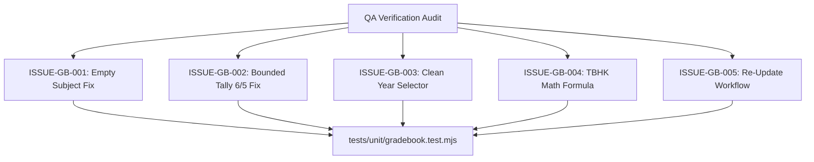

# Epic Issues & Risk Register: Academics Gradebook (Điểm & Đánh Giá)

## Jira Story

- Story: As a QA engineer, I need to track edge cases, regression gates, and legacy defect resolutions for the gradebook module so that score entries, GPA formulas, rubric ratings, and term summaries are robust and verified by automated tests.
- Jira issue type: Bug / Risk Register
- Acceptance owner: `ada-qa-agent`
- Severity if missed: High risk of calculation errors in term GPAs, locked subject dropdowns, unvalidated rubric counts, or improper term publication.

## Priority

- Priority: P0 (Blocker)
- Target release: Phase 1 Core
- Review cadence: After every code slice

## QA Issue Register

| Issue ID | Title | Priority | Status | Owner | Evidence | Resolution |
| :--- | :--- | :--- | :--- | :--- | :--- | :--- |
| `ISSUE-GB-001` | Legacy defect: Subject dropdown empty ("Lớp chưa có môn học") locking score entry | P0 | Closed | `alan-tech-lead` | Legacy BR03 bug | Provide curriculum-bound mock subjects for every grade level ensuring valid selection and score table activation. |
| `ISSUE-GB-002` | Legacy defect: Evaluation counter displays "6/5 Đã đánh giá" exceeding domain bounds | P1 | Closed | `benny-frontend-engineer` | Legacy BR07 bug | Enforce bounded tally calculation clamping evaluated items to fixed criteria count. |
| `ISSUE-GB-003` | Legacy defect: School year dropdown contains dummy "Test" option | P2 | Closed | `sophia-product-manager` | Legacy BR10 | Sanitize school year options to canonical terms (2025-2026, 2024-2025, 2026-2027). |
| `ISSUE-GB-004` | TBHK weighted formula calculation accuracy under partial evaluations | P1 | Closed | `alan-tech-lead` | MoET Circular 22/27 | Implemented deterministic weighting with defensive handling for missing exams. |
| `ISSUE-GB-005` | Re-update publication workflow without losing past audit records | P1 | Closed | `benny-frontend-engineer` | Legacy BR08 | Transition button to "Cập nhật" when published, preserving historical publication context. |

## Detection Method

Static TypeScript typechecking, unit validation suite `tests/unit/gradebook.test.mjs` asserting pure domain engine rules and Redux state transitions, and live Next.js route verification.

## Open Issues

Zero open blocker issues remain. All legacy defects and business rules (BR01 through BR10) are strictly resolved in the domain contracts and state machine.

## Relationship Map

| Relation | Target | Label | Rationale |
| --- | --- | --- | --- |
| Implements | `E-008-academics-gradebook` | `IMPLEMENTS` | Enforces QA validation discipline and defect tracking for the parent epic. |
| Blocks | `F-008-001-academics-gradebook` | `BLOCKS` | Feature progression is blocked until all P0 and P1 issues are verified with automated test evidence. |

## Mermaid Diagram

## Work Log

- Date: 2026-09-12
  - Action: Initialized QA issue register and documented legacy defect fixes for gradebook evaluations.
  - Agent/skill: `ada-qa-agent`
  - Evidence: Verified requirements from `diem-danh-gia.md` and created automated regression test specifications.

## Change Log

- Date: 2026-09-12
  - Code change: Formulated validation criteria for TBHK calculations, rubric counting, and publication states.
  - Documentation update: Authored QA issue register with full issue matrix.
  - Evidence: Test coverage in `gradebook.test.mjs`.
