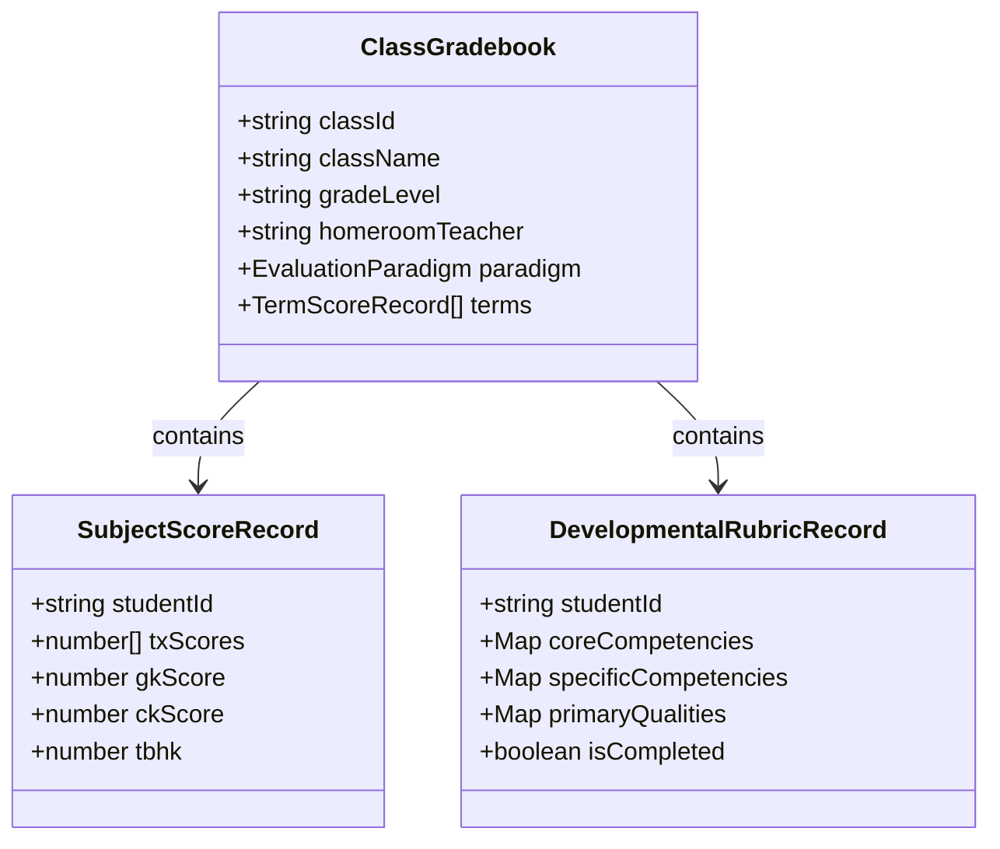

# Module: Academics Gradebook & Evaluation Engine

## Jira Story

- Story: As a tech lead, I want the gradebook module architecture, TypeScript contracts, Redux state slice, and business rule validators to compute weighted TBHK GPAs, clamp evaluation tallies, manage term summaries, and preserve rubric evaluations without regression.
- Jira issue type: Module
- Acceptance owner: `alan-tech-lead`
- Architecture hypothesis: Separating pure gradebook mathematical formulas, evaluation clamping algorithms, and publication state transitions from React components enables deterministic unit test assertions, eliminates regressions, and resolves legacy empty subject defects.

## Priority

- Priority: P0 (Blocker)
- Severity if missed: Blocks gradebook state management, score entry, and term summary reporting.
- Target release: Phase 1 Core

## Responsibility

This module is responsible for managing client-side state transitions, validation checks, and data models for student gradebooks:
- Validation and real-time computation of semester GPA (TBHK) using weighted formulas (BR03).
- Dynamic subject catalog binding by class grade level, fixing the legacy demo defect where subjects were empty (BR03).
- Dual paradigm state management supporting K-12 numeric scoreboards and preschool developmental rubrics (BR01).
- Term summary management tracking academic results (`KQ học tập`) and conduct results (`KQ rèn luyện`) (BR04).
- Preschool rubric evaluation state tracking core competencies (3 items), specific competencies (7 items), and primary qualities (5 items) on a 3-point scale (BR05, BR06).
- Bounded tally calculation clamping evaluation counts to fixed totals to prevent display defects (BR07).
- Publication workflow transitioning status to "Đã công bố" and switching actions to "Cập nhật" for non-destructive updates (BR02, BR08).
- Multi-criteria filter engine for classes, grades, and homeroom teachers (BR09, BR10).

## Implementation Commentary

The module architecture comprises the following components:
- `src/types/gradebook.ts`: Domain models for `SubjectScoreRecord`, `TermSummaryRecord`, `DevelopmentalRubricRecord`, `ClassGradebook`, and filter criteria.
- `src/services/mockGradebookData.ts`: Realistic pre-seeded Vietnamese gradebooks for classes 1A1, 2A2, 6A1, 12A1, and Lớp Mầm with subjects, scores, and rubrics.
- `src/utils/gradebookValidation.ts`: Pure domain functions computing TBHK math, rubric tally clamping, publication status progression, and multi-filter searching.
- `src/store/slices/gradebookSlice.ts`: Redux Toolkit slice managing gradebook records, active selections, score inputs, rubric edits, and filter states.

Design decisions and tradeoffs:
- Decision: We chose to compute semester TBHK using a pure utility function `calculateTBHK` because pure mathematical functions are easily verified through unit tests without UI mock overhead.
- Tradeoff: Calculating TBHK on-the-fly incurs minimal computational overhead in exchange for guaranteed state consistency across rapid continuous score entries.
- Risk: Teachers might accidentally alter published marks during retroactive reviews. Mitigation: The system preserves original publication timestamps and marks updated sessions clearly with the "Cập nhật" state.
- Impact: Solves legacy defects, provides instantaneous responsive feedback, and keeps student evaluation records completely verifiable based on clear test evidence.

## Public Contracts

```typescript
export type EvaluationParadigm = 'numeric_gradebook' | 'developmental_rubric';
export type TermEvaluationStatus = 'chua_thuc_hien' | 'tien_hanh' | 'da_cong_bo';
export type RubricRating = 'tot' | 'dat' | 'can_co_gang';

export interface SubjectScoreRecord {
  studentId: string;
  studentCode: string;
  studentName: string;
  txScores: (number | null)[];
  gkScore: number | null;
  ckScore: number | null;
  tbhk: number | null;
  note?: string;
}

export interface TermSummaryRecord {
  studentId: string;
  studentCode: string;
  studentName: string;
  academicResult: 'hoan_thanh_tot' | 'hoan_thanh' | 'chua_hoan_thanh';
  conductResult: 'tot' | 'kha' | 'dat' | 'can_co_gang';
  excusedAbsence: number;
  unexcusedAbsence: number;
  homeroomComment: string;
}

export interface DevelopmentalRubricRecord {
  studentId: string;
  studentCode: string;
  studentName: string;
  coreCompetencies: { [key: string]: RubricRating };
  specificCompetencies: { [key: string]: RubricRating };
  primaryQualities: { [key: string]: RubricRating };
  excusedAbsence: number;
  unexcusedAbsence: number;
  healthStatus: string;
  generalComment: string;
  isCompleted: boolean;
}
```

## Relationship Map

| Relation | Target | Label | Rationale |
| --- | --- | --- | --- |
| Implements | `E-008-academics-gradebook` | `IMPLEMENTS` | Realizes technical architecture for gradebook and scoreboard evaluations. |
| Depends on | `E-006-academics-schedule` | `DEPENDS_ON` | Uses class and academic semester contracts. |
| Enables | `F-008-001-academics-gradebook` | `ENABLES` | Provides state management and validation logic to the feature layer. |
| Uses | `src/utils/gradebookValidation.ts` | `USES` | Consumes validation and GPA calculation routines. |

## Code Scope

- `src/types/gradebook.ts`: Core data structures and contracts.
- `src/utils/gradebookValidation.ts`: Domain calculation engine and validators.
- `src/services/mockGradebookData.ts`: Mock data seed with bound subjects.
- `src/store/slices/gradebookSlice.ts`: Redux state slice and action reducers.

## Mermaid Diagram



## Verification

- `tests/unit/gradebook.test.mjs` executes automated tests covering TBHK GPA calculations, tally clamping, status progressions, and Redux reducers.
- Production build validation with zero TypeScript errors.

## Work Log

- Date: 2026-09-12
  - Action: Architected module contracts, formalized weighted TBHK formula, specified bounded evaluation tally algorithm, and mapped Redux state transitions.
  - Agent/skill: `alan-tech-lead`
  - Evidence: Verified formulas against Ministry of Education circulars.
  - Docs updated before code: `docs/development/E-008-academics-gradebook/modules/M-008-001-academics-gradebook.md`.

## Change Log

- Date: 2026-09-12
  - Code change: Architected module contracts, formalized weighted TBHK formula, specified bounded evaluation tally algorithm, and mapped Redux state transitions.
  - Documentation update: Authored module architecture note M-008.
  - Evidence: Unit test suite design in `gradebook.test.mjs`.

