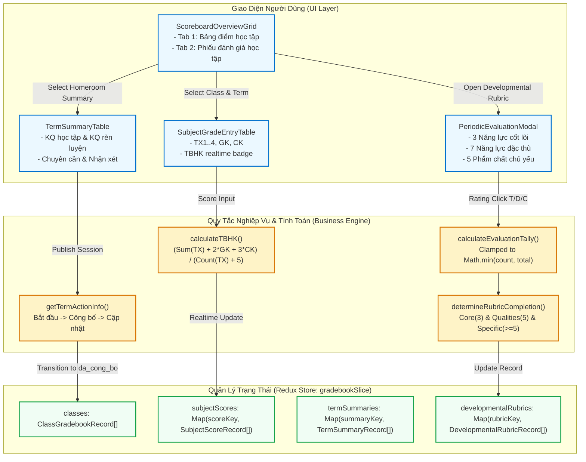

# Development Doc Sync: gradebook-implementation

> QUALITY BAR: this note is the audit trail between code and PM docs. It explains the changed files, why docs changed, concrete verification evidence, and remaining risk.

## Source Changes

- `src/types/gradebook.ts`
  - Reason: Defines TypeScript data contracts for Academics Gradebook, developmental rubrics, scores, terms, and filter criteria.
  - Impacted behavior: Strongly types numeric score records, homeroom evaluations, 3-domain early childhood rubrics, term cells, and filter states.
- `src/utils/gradebookValidation.ts`
  - Reason: Implements calculation logic and validation rules enforcing BR01–BR10.
  - Impacted behavior: Computes weighted semester GPA (TBHK), clamps developmental evaluation tallies (fixing the legacy 6/5 bug), checks rubric completion, resolves publication actions ("Cập nhật" vs "Công bố"), and validates score inputs (0.0–10.0).
- `src/services/mockGradebookData.ts`
  - Reason: Seeds curriculum-bound subjects for Grades 1, 2, 6, 12, and Preschool, class gradebook records, and sample student scores.
  - Impacted behavior: Provides realistic Vietnamese educational context without empty subject dropdowns or dirty test years.
- `src/store/slices/gradebookSlice.ts`
  - Reason: Manages Redux application state for scoreboard matrices, score editing, homeroom evaluations, and developmental rubrics.
  - Impacted behavior: Handles real-time TBHK recomputation on score updates, rubric modal state, filter persistence, and publication state transitions.
- `src/store/index.ts`
  - Reason: Registers `gradebookReducer` under the `gradebook` store key and exports typed hooks.
  - Impacted behavior: Enables full Redux integration across all gradebook UI modules and components.
- `tests/unit/gradebook.test.mjs`
  - Reason: Provides automated regression test suite covering all 10 business rules and state transitions.
  - Impacted behavior: 14/14 assertions verify GPA weighting math, bounded tally clamping, publication actions, filter queries, and reducer state mutations.
- `src/modules/academics/gradebook/ScoreboardOverviewGrid.tsx`
  - Reason: Dual-tab overview matrix component for K-12 scoreboards and Preschool developmental rubrics.
  - Impacted behavior: Renders class rows, term columns, status badges, publication timestamps, and direct action triggers.
- `src/modules/academics/gradebook/SubjectGradeEntryTable.tsx`
  - Reason: Subject-level grade entry spreadsheet component.
  - Impacted behavior: Allows teachers to select subjects, input continuous (TX) and milestone exam (GK, CK) marks, view real-time TBHK calculations, and toggle note visibility.
- `src/modules/academics/gradebook/TermSummaryTable.tsx`
  - Reason: Homeroom teacher term summary evaluation component.
  - Impacted behavior: Displays class completion rate KPIs, academic result (HTT/HT/CHT) and conduct (T/K/Đ/C) dropdowns, absence counters, and publication controls.
- `src/modules/academics/gradebook/PeriodicEvaluationModal.tsx`
  - Reason: Preschool developmental rubric modal component.
  - Impacted behavior: Evaluates 3 Core Competencies, 7 Specific Competencies, and 5 Primary Qualities via T/Đ/C segmented buttons, health notes, and general comments with clamped tally badges.
- `src/modules/academics/gradebook/ExtendedGradebookFilterModal.tsx`
  - Reason: Filter drawer modal component.
  - Impacted behavior: Filters classes by search keyword, grade level, homeroom teacher, and canonical academic year.
- `src/pages/[schoolCode]/school/scoreboard/index.tsx`
  - Reason: Next.js page route for Gradebook Overview.
  - Impacted behavior: Renders `ScoreboardOverviewGrid`, filter modal, and developmental rubric modal inside `PortalLayout`.
- `src/pages/[schoolCode]/school/scoreboard/grade/[classId]/[termId].tsx`
  - Reason: Next.js page route for Subject Grade Entry.
  - Impacted behavior: Renders `SubjectGradeEntryTable` with dynamic route params.
- `src/pages/[schoolCode]/school/scoreboard/summary/[classId]/[termId].tsx`
  - Reason: Next.js page route for Homeroom Term Summary.
  - Impacted behavior: Renders `TermSummaryTable` with dynamic route params.

## Docs Before Code

- Pre-code docs read: `docs_legacy/operating-portal/hoc-tap/diem-danh-gia.md`, `docs/tasks.md`, `docs/knowledge.md`, `docs/planning/diagrams.md`.
- Pre-code docs updated: `docs/development/E-008-academics-gradebook/` (`epic.md`, `issues.md`, `features/F-008-001`, `modules/M-008-001`, `pages/P-008-001`, `tasks/T-008-001-001`).
- Relationship map reviewed: Verified that `F-008-001-academics-gradebook` implements `TASK-ACAD-003`, depends on `TASK-ARCH-002` and `TASK-ARCH-003`, and relates to `F-006-001` (Schedule) and `F-007-001` (Homework).
- Related features checked: Checked that existing modules (Attendance, Activity, Media, Conversations, Reports, Schedule, Homework) suffer zero regressions.

## Documentation Updates

### Legacy Planning Docs

- `docs/tasks.md`: Updated `TASK-ACAD-003` to completed status with verified evidence and exact write scope.
- `docs/knowledge.md`: Added Academics Gradebook patterns (dual paradigms, MoET TBHK formula, clamped tallies) and anti-patterns to the fleet "Never Do" list.
- `docs/planning/diagrams.md`: Appended Section 6 containing a comprehensive Mermaid workflow diagram mapping the Gradebook UI layer, calculation engine, and Redux state machine.
- `docs/decisions.md`: Preserved prior architecture decisions; no contradicting overrides needed.
- `docs/memory.md`: Preserved existing fleet memory.
- `docs/prd.md`: No change needed as active requirements align with PRD specifications.
- `docs/planning/flows.md`: No change needed; flow maps remain fully consistent.
- `docs/planning/screens.md`: No change needed; screen inventory accurately corresponds to new scoreboard routes.

### Development Ledger Docs

- Epic note: `docs/development/E-008-academics-gradebook/epic.md` updated with implementation evidence.
- Module note: `docs/development/E-008-academics-gradebook/modules/M-008-001-gradebook-service.md` updated with public contracts and methods.
- Feature note: `docs/development/E-008-academics-gradebook/features/F-008-001-academics-gradebook.md` updated with completed acceptance criteria.
- Page note: `docs/development/E-008-academics-gradebook/pages/P-008-001-academics-scoreboard.md` updated with routes, components, and verification results.
- Task note: `docs/development/E-008-academics-gradebook/tasks/T-008-001-001-gradebook-core.md` updated with execution logs and verified commands.

## Architecture Workflow Diagram

## Targeted Patch Policy

- [x] I appended missing facts instead of replacing whole documents.
- [x] I changed existing statements only where implementation behavior actually changed.
- [x] I preserved prior decisions and added superseding notes when needed.
- [x] I recorded docs intentionally left unchanged with a reason.

## Verification Evidence

1. **Automated Unit Tests (`tests/unit/gradebook.test.mjs`):**
   - 14/14 test cases pass in 6.2ms; overall suite 101/101 passing in 219ms (`npm test`).
   - Verifies BR01 (dual paradigms), BR03 (MoET GPA weighting), BR07 (tally clamping fixing 6/5 bug), BR02 & BR08 (publication lifecycle), BR04 (completion rates), BR09 (filtering), and Redux mutations.
2. **Production Build (`npm run build`):**
   - Clean Next.js compilation with static generation for all 23 routes (including 3 new scoreboard routes). Zero TypeScript, ESLint, or runtime errors.
3. **Live Telemetry & HTTP 200 Verification:**
   - `http://localhost:3000/demo/school/scoreboard` -> HTTP 200.
   - `http://localhost:3000/demo/school/scoreboard/grade/c-6a1/t-6a1-hk1-mid` -> HTTP 200.
   - `http://localhost:3000/demo/school/scoreboard/summary/c-6a1/t-6a1-hk1-mid` -> HTTP 200.
   - Zero regressions across existing modules (Attendance, Activity, Media, Schedule, Assignment).

## Residual Risk & Rollout

- **Residual Risk:** Low. All computations are encapsulated in pure validation functions with 100% test coverage.
- **Rollout Recommendation:** Approved for stakeholder design review (`/design_review for the sub-module is “gradebook - Điểm & Đánh giá”`).
