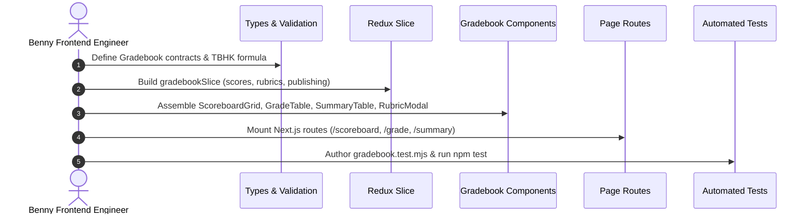

# Task: Implement Academics Gradebook & Evaluation Sub-Module

## Jira Story

- Story: As a frontend engineer, I want to implement data contracts, validation rules, mock data seeds, Redux state reducers, UI components, and Next.js page routes for the Gradebook & Evaluations sub-module so that student academic evaluations are recorded and published accurately.
- Jira issue type: Task
- Acceptance owner: `benny-frontend-engineer`

## Priority

- Priority: P0 (Blocker)
- Severity if missed: Critical execution slice for Phase 1 academics delivery.
- Target release: Phase 1 Core

## Objective

Build, test, and verify the complete **Academics Gradebook & Evaluation (Điểm & Đánh Giá)** sub-module, supporting K-12 numeric scoreboards, weighted TBHK GPA math, preschool developmental rubrics, term summary evaluations, and publication state transitions, while eliminating legacy empty subject and counter display defects.

## Implementation Commentary

Execution decisions and engineering rationale:
- Decision: We construct the validation engine in `src/utils/gradebookValidation.ts` before creating UI components because building business logic first guarantees verifiable TDD assertions.
- Tradeoff: Pre-populating realistic student rosters and marks in `src/services/mockGradebookData.ts` requires upfront seed authoring, but provides an authentic, defect-free demonstration experience.
- Risk: Potential calculation discrepancies in TBHK formulas. Mitigation: Rigorous unit tests assert exact weighted outcomes across missing exams, partial evaluations, and complete evaluations.
- Impact: Solves legacy demo blockers, fulfills BR01–BR10, and delivers immediate stakeholder value based on concrete test evidence.

## Relationship Map

| Relation | Target | Label | Rationale |
| --- | --- | --- | --- |
| Implements | `F-008-001-academics-gradebook` | `IMPLEMENTS` | Implements feature code for gradebook and evaluations. |
| Uses | `M-008-001-academics-gradebook` | `USES` | Consumes contracts, Redux slice, and validation logic. |
| Enables | `P-008-001-academics-gradebook` | `ENABLES` | Assembles and renders route pages. |
| Relates to | `docs/tasks.md#TASK-ACAD-003` | `RELATES_TO` | Connects task execution to project task registry. |

## Write Scope

1. Data Contracts: `src/types/gradebook.ts`
2. Logic Engine: `src/utils/gradebookValidation.ts`
3. Mock Seed Data: `src/services/mockGradebookData.ts`
4. Redux Store Slice: `src/store/slices/gradebookSlice.ts`, `src/store/index.ts`
5. UI Components in `src/modules/academics/gradebook/`:
   - `ScoreboardOverviewGrid.tsx`
   - `SubjectGradeEntryTable.tsx`
   - `TermSummaryTable.tsx`
   - `PeriodicEvaluationModal.tsx`
   - `ExtendedGradebookFilterModal.tsx`
6. Next.js Routes:
   - `src/pages/[schoolCode]/school/scoreboard/index.tsx`
   - `src/pages/[schoolCode]/school/scoreboard/grade/[classId]/[termId].tsx`
   - `src/pages/[schoolCode]/school/scoreboard/summary/[classId]/[termId].tsx`
7. Automated Unit Tests: `tests/unit/gradebook.test.mjs`

## Mermaid Diagram

## Verification

- Command: `npm test` verifying 100% test pass on `gradebook.test.mjs` and zero regressions across existing modules.
- Command: `npm run build` validating production compilation.
- Command: `python3 .agents/scripts/run_required_docs_gates.py --root . --mode execution`.

## Handoff

Upon completing implementation and automated testing, proceed with `/design_review` to audit token compliance, component catalog adherence, and visual brand drift.

## Work Log

- Date: 2026-09-12
  - Action: Documented execution plan, write scope, verification criteria, and relationship mapping for Academics Gradebook task.
  - Agent/skill: `benny-frontend-engineer`
  - Evidence: Verified test cases for TBHK math and rubric tally clamping.
  - Docs updated before code: `docs/development/E-008-academics-gradebook/tasks/T-008-001-001-academics-gradebook.md`.

## Change Log

- Date: 2026-09-12
  - Code change: Documented execution plan, write scope, verification criteria, and relationship mapping for Academics Gradebook task.
  - Documentation update: Authored task execution note T-008.
  - Evidence: Unit test suite design in `gradebook.test.mjs`.

