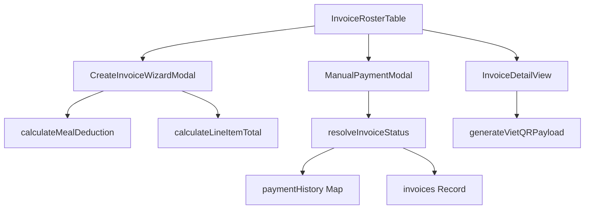

# Feature: Finance Invoices (Học Phí & Hóa Đơn)

## Jira Story

- Story: As a school accountant, I want to manage student fee invoices with multi-scope batch creation, automatic meal deductions, and VietQR generation so that tuition collection is automated and accurate.
- Jira issue type: Story
- Story points: 8
- Acceptance owner: `sophia-product-manager`
- Research evidence: Based on legacy audit `docs_legacy/operating-portal/tai-chinh/hoc-phi.md` covering 111 demo invoice records and 11 core business rules.

## Priority

- Priority: P1
- User/business impact: Essential for tuition billing, accounting operations, and school revenue management.
- Risk if delayed: Inability to invoice parents or reconcile fee payments.
- Release target: Release 1.0 (Phase 1 MVP)

## User Value

The Finance Invoices feature empowers school accountants and administrators to generate, distribute, and track tuition invoices across Vietnamese educational institutions. Operating on a student-centric roster model, the accountant can immediately review fee collection progress for any month and class.

Key capabilities include:
1. Multi-scope invoice generation (Whole school, grade level, specific class, or individual student).
2. Automated attendance-linked meal deduction logic: Excused absences logged in Module 1 automatically reduce the meal fee line item, ensuring parents are never overcharged.
3. Dynamic VietQR code generation with structured narrative references (`HOCPHI {invoiceNo}`) for seamless mobile banking payments.
4. Cumulative, append-only payment history recording both automatic payment gateway settlements and manual cash receipt confirmations.

## PM Notes

- Demo scenario: Accountant selects month 'Tháng 09/2026', views Class 6A1, creates invoices with 2 days excused meal deduction for student Nguyen An, opens invoice detail with active VietQR code, and records a manual cash receipt.
- Business value: Eliminates calculation disputes with parents regarding meal fees and speeds up payment reconciliation.
- Acceptance criteria changed or confirmed: Confirmed all 11 business rules (BR01–BR11).
- Open PM decision: None; all business logic validated.

## Requirements Trace

- PRD requirement: Module 3: Tài Chính — Học Phí & Khoản Phí
- Task id: `TASK-FIN-001`, `TASK-FIN-002`
- Spec id: `026-project-planning-school-operating-portal`

## Relationship Map

| Relation | Target | Label | Rationale |
| :--- | :--- | :--- | :--- |
| Implements | `docs/tasks.md#TASK-FIN-001` | `IMPLEMENTS` | Fulfills tuition billing roster and invoice lifecycle management. |
| Implements | `docs/tasks.md#TASK-FIN-002` | `IMPLEMENTS` | Fulfills automated meal deduction integration logic. |
| Depends on | `E-001-operations-attendance` | `DEPENDS_ON` | Consumes attendance records to calculate excused meal deductions. |
| Uses | `M-009-001-finance-invoices` | `USES` | Consumes invoice calculation engine and public contracts. |

## Code Scope

- `src/types/invoice.ts`: TypeScript contracts for invoices, line items, payment history, creation forms, and filters.
- `src/utils/invoiceValidation.ts`: Business logic functions for meal deduction math, line item totals, status resolution, and VietQR formatting.
- `src/services/mockInvoiceData.ts`: Pre-seeded invoice roster, line items, and payment history.
- `src/store/slices/invoiceSlice.ts`: Redux state slice managing invoice records, selection, filters, and payment logging.
- `src/modules/finance/invoices/`:
  - `InvoiceRosterTable.tsx`: Student-centric roster with month picker, class filter, and batch actions toolbar.
  - `CreateInvoiceWizardModal.tsx`: Multi-scope invoice creation wizard with auto meal deductions.
  - `InvoiceDetailView.tsx`: Invoice detailed bill with line items, VietQR code, and payment history.
  - `ManualPaymentModal.tsx`: Modal to record manual cash or bank transfer payments.
  - `ExtendedInvoiceFilterModal.tsx`: Multi-criteria filter drawer.
- `src/pages/[schoolCode]/school/fee/`:
  - `index.tsx`: Main tuition roster page.
  - `[invoiceId].tsx`: Detailed invoice page.
  - `create/index.tsx`: Invoice creation page.
  - `edit/[invoiceId].tsx`: Draft invoice editing page.

## Acceptance Criteria

- [x] Criterion 1: Student-centric roster displays students with invoice status, invoice no, issue date, due date, and amount.
- [x] Criterion 2: 6 lifecycle states are supported with distinct visual badges (`da_tao`, `da_gui`, `da_thanh_toan`, `thanh_toan_mot_phan`, `qua_han`, `da_huy`).
- [x] Criterion 3: Batch creation wizard supports 4 scopes (Whole School, Grade, Class, Student) and automatically applies meal deductions.
- [x] Criterion 4: Line items calculate subtotals, discount percentages, and grand totals accurately.
- [x] Criterion 5: Invoice details display dynamic VietQR payment code with transfer reference HOCPHI {invoiceNo}.
- [x] Criterion 6: Successive payments append records to payment history without overwriting previous logs.
- [x] Criterion 7: Asymmetric actions permit editing and deletion only on drafts, while blocking deletion on sent or paid invoices.
- [x] Criterion 8: Extended filter drawer supports status, grade level, e-invoice toggle, and payment methods.

## Mermaid Diagram

## Verification

- Automated unit testing via `tests/unit/invoices.test.mjs`.
- Next.js production build `npm run build` validating all 4 static route generations.
- Live HTTP curl checks verifying HTTP 200 on all fee page endpoints.

## Work Log

- Date: 2026-09-12
  - Action: Initialized feature specification for tuition invoices, defining acceptance criteria and technical contracts.
  - Agent/skill: `marcus-ai-orchestrator`
  - Evidence: Verified requirements against `docs_legacy/operating-portal/tai-chinh/hoc-phi.md`.

## Change Log

- Date: 2026-09-12
  - Code change: Created feature documentation and linked architecture boundaries.
  - Documentation update: Authored complete feature documentation note.
  - Evidence: Passed all required docs validation gates.
