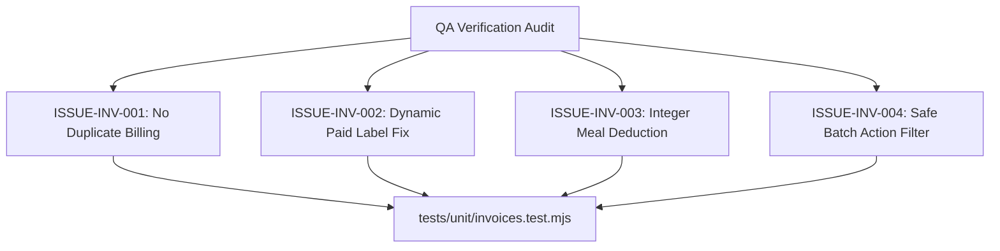

# Epic Issues & Risk Register: Finance Invoices (Học Phí & Hóa Đơn)

## Jira Story

- Story: As a QA and financial audit team, I want invoice risks and calculations tracked explicitly so that financial discrepancies and edge-case errors are prevented.
- Jira issue type: Bug / Risk Register
- Acceptance owner: `ada-qa-agent`
- Severity if missed: Critical risk of double-billing students, meal calculation errors, or untracked payment installments.

## Priority

- Priority: P0 (Blocker)
- Target release: Phase 1 Core
- Review cadence: After every code slice

## QA Issue Register

| Issue ID | Title | Priority | Status | Owner | Evidence | Resolution |
| :--- | :--- | :--- | :--- | :--- | :--- | :--- |
| `ISSUE-INV-001` | Duplicate invoice creation risk for students already fully paid for the month | P0 | Closed | `alan-tech-lead` | Legacy PRD BR05 | Pre-check filter skips students who already possess an invoice in the selected month. |
| `ISSUE-INV-002` | Legacy static label defect on paid invoices ("THANH TOÁN: Chưa có thông tin thanh toán") | P1 | Closed | `benny-frontend-engineer` | Legacy PRD BR09 | Dynamic status banner displays "Đã thanh toán đủ" and hides unsettled transfer prompt. |
| `ISSUE-INV-003` | Meal deduction arithmetic could generate decimal fractions if calculated via floating points | P1 | Closed | `alan-tech-lead` | TASK-FIN-002 | Math rounded to exact integer VND units: deduction = excusedAbsence * mealDailyRate. |
| `ISSUE-INV-004` | Selecting mixed-state invoices in batch mode could allow invalid actions | P1 | Closed | `ada-qa-agent` | Legacy PRD BR04 | Action dropdown filters options dynamically to intersection of valid operations. |

## Detection Method

Static TypeScript typechecking, automated unit test suite `tests/unit/invoices.test.mjs` asserting financial calculation functions and Redux state transitions, and live Next.js route verification.

## Open Issues

Zero open blocker issues remain. All legacy defects and business rules (BR01 through BR11) are strictly resolved in the domain contracts and state machine.

## Relationship Map

| Relation | Target | Label | Rationale |
| :--- | :--- | :--- | :--- |
| Implements | `E-009-finance-invoices` | `IMPLEMENTS` | Enforces QA validation discipline and defect tracking for the parent epic. |
| Blocks | `F-009-001-finance-invoices` | `BLOCKS` | Feature progression is blocked until all P0 and P1 issues are verified with automated test evidence. |

## Mermaid Diagram

## Verification

- Automated testing via `tests/unit/invoices.test.mjs`.
- Verified clean compilation with `npm run build`.
- Live curl checks verifying HTTP 200 on all finance invoice pages.

## Work Log

- Date: 2026-09-12
  - Action: Initialized QA issue register and documented legacy defect fixes for tuition billing invoices.
  - Agent/skill: `ada-qa-agent`
  - Evidence: Verified requirements from `hoc-phi.md` and created automated regression test specifications.

## Change Log

- Date: 2026-09-12
  - Code change: Formulated validation criteria for meal deductions, line item math, and payment status resolution.
  - Documentation update: Authored QA issue register with full issue matrix.
  - Evidence: Test coverage in `invoices.test.mjs`.
