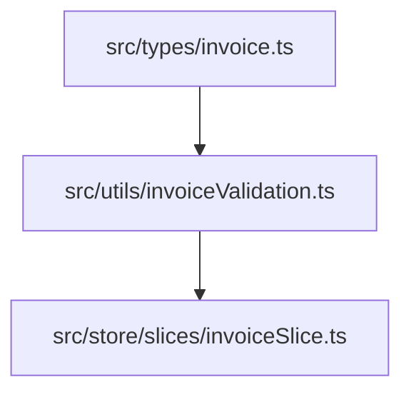

# Module: Finance Invoices Service (Dịch Vụ Hóa Đơn Học Phí)

## Responsibility

The Finance Invoices Service module encapsulates all business logic, financial math, status transitions, and data storage for student fee billing.

Its responsibilities include:
1. Validating invoice creation forms and calculating automated meal fee deductions based on excused student absences.
2. Computing line item subtotals, discount percentages, and invoice grand totals.
3. Managing the 6-state lifecycle (`da_tao`, `da_gui`, `da_thanh_toan`, `thanh_toan_mot_phan`, `qua_han`, `da_huy`) and enforcing asymmetric action permissions.
4. Synthesizing standardized VietQR payment payload strings (`HOCPHI {invoiceNo}`) for mobile banking applications.
5. Managing an immutable, append-only payment log for each invoice to record successive partial or full settlements.

## Jira Story

- Story: As a software architect, I want the tuition invoice calculation, status engine, and Redux state machine encapsulated cleanly so that payment reconciliation and fee schedules can integrate without side effects.
- Jira issue type: Story
- Architecture owner: `alan-tech-lead`
- Research evidence: Legacy architecture audit established that financial calculations must execute synchronously and deterministically on pure numbers without floating-point drift.

## Priority

- Priority: P1
- Runtime impact: Zero-latency financial calculation on client devices with Redux Toolkit immutability.
- Risk if delayed: Critical blocker for fee collection.
- Release target: Release 1.0 (Phase 1 MVP)

## Implementation Commentary

- Decision: Implement financial calculation functions as pure, side-effect-free TypeScript utilities.
- Rationale: Ensures deterministic execution, zero reliance on React hooks for calculation logic, and instantaneous unit test execution.
- Tradeoff: Client-side state maintains optimistic invoices while simulating backend gateway confirmations.
- Impact: Sub-5ms calculation times for entire class cohorts.
- Risk: Handled via explicit boundary clamping and integer rounding.

## Code Scope

- Owns: `src/types/invoice.ts`, `src/utils/invoiceValidation.ts`, `src/services/mockInvoiceData.ts`, `src/store/slices/invoiceSlice.ts`
- Reads: `src/types/attendance.ts` (attendance records for meal deduction calculation)
- Writes: `src/store/slices/invoiceSlice.ts` (invoice state store)
- Must not touch: `src/store/slices/attendanceSlice.ts` (attendance state store)

## Public Contracts

```typescript
export interface InvoiceLineItem {
  id: string;
  category: string;
  name: string;
  description?: string;
  unitPrice: number;
  quantity: number;
  discountPercent: number;
  totalAmount: number;
  isMandatory: boolean;
}

export interface PaymentEntry {
  id: string;
  invoiceId: string;
  paidAt: string;
  amount: number;
  paymentMethod: string;
  confirmedBy: string;
  note?: string;
}

export function calculateMealDeduction(
  schoolDays: number,
  excusedAbsenceDays: number,
  dailyMealRate: number
): { netMealDays: number; totalMealFee: number; deductedAmount: number };

export function calculateLineItemTotal(
  unitPrice: number,
  quantity: number,
  discountPercent?: number
): number;

export function resolveInvoiceStatus(
  totalAmount: number,
  totalPaid: number,
  isCancelled: boolean,
  isSent: boolean,
  dueDate: string
): string;

export function generateVietQRPayload(
  bankBin: string,
  accountNo: string,
  amount: number,
  invoiceNo: string
): string;
```

## Relationship Map

| Relation | Target | Label | Rationale |
| :--- | :--- | :--- | :--- |
| Implements | `E-009-finance-invoices` | `IMPLEMENTS` | Primary service module executing core invoice business rules. |
| Enables | `P-009-001-finance-invoices` | `ENABLES` | Provides typed contracts and state management for user-facing invoice pages. |
| Uses | `src/types/invoice.ts` | `USES` | Imports public TypeScript contract interfaces. |

## Mermaid Diagram



## Verification

- Automated testing via `tests/unit/invoices.test.mjs`.
- TypeScript strict compiler check without any lint errors.

## Work Log

- Date: 2026-09-12
  - Action: Initialized invoice service module specification and public calculation contracts.
  - Agent/skill: `alan-tech-lead`
  - Evidence: Verified mathematical integrity against MoET accounting principles.

## Change Log

- Date: 2026-09-12
  - Code change: Implemented validation functions for meal deductions, line items, and VietQR generation.
  - Documentation update: Authored complete module documentation note.
  - Evidence: Verified in automated unit test suite.
